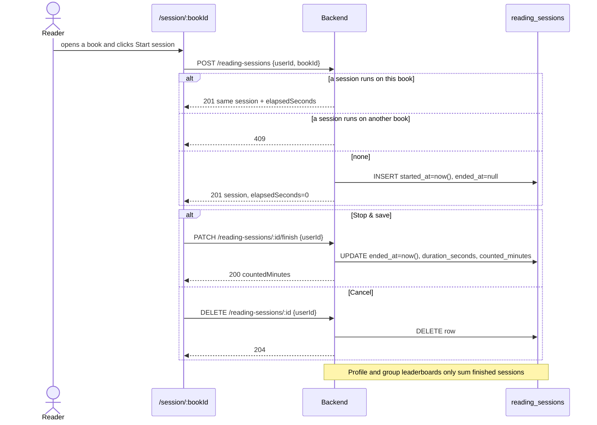

# ADR-0005: Server-Timed Reading Sessions Counted by Challenge Period

- **Status:** Proposed
- **Date:** 2026-10-31
- **Deciders:** Group 6
- **Context area:** Reading sessions, challenge groups, profile stats (`apps/backend`, `apps/frontend`)

## Context

A reader starts a timer on a book, reads, and stops it. The minutes read feed the profile's reading time and the leaderboards of challenge groups (F-READ, F-GRP). Because leaderboards are competitive, the minutes must not be something the client can make up: a modified browser, a changed system clock or a hand-written request must not add time.

Three questions had to be answered:

1. Who measures the duration: the client or the server?
2. What happens on a page reload, a closed tab or a session started by mistake?
3. How does one session reach the groups the reader is in?

Supabase Auth is not wired yet, so the user is the seeded demo user (`DEMO_USER_ID`) sent in the request; this ADR does not depend on that.

## Options considered

| Option | Summary | Verdict |
|---|---|---|
| A. Client sends the duration | The browser times the session and sends `durationSeconds` in one request on finish. | Rejected: the client controls the number. |
| B. Server clock, start and finish requests | `POST` on start stores the server time; `PATCH .../finish` computes the duration from the server clock. | **Chosen** |
| C. Server clock with heartbeats | As B, plus a ping every N seconds; only time between pings counts, allowing pause and idle detection. | Rejected for now: more requests, more state, and pause is not needed. Can extend B later. |
| D. Sessions linked to a group | The reader picks a group when starting; the session counts only there. | Rejected: one reading should count everywhere it is eligible, as the design says. |

## Decision

### 1. The server clock measures every session

The client sends **two requests** and never a duration:

- `POST /reading-sessions` `{ userId, bookId }` starts the session. The server stores `started_at = now()` (its clock).
- `PATCH /reading-sessions/:id/finish` `{ userId }` finishes it. The server sets `ended_at = now()`, `duration_seconds = ended_at - started_at`, and `counted_minutes = floor(min(duration_seconds, 12 h) / 60)`.

The timer on the page is only a display seeded from the server's `elapsedSeconds`.

### 2. Lifecycle rules

- **One running session per reader.** Starting on another book while one runs returns `409`.
- **Reload resumes.** Starting again on the **same** book returns the running session (same id, same `started_at`), so reloading or reopening the page continues the clock.
- **No pause.** To take a break, the reader finishes and later starts a new session.
- **Cancel.** `DELETE /reading-sessions/:id` deletes a running session started by mistake; it never counts.
- **Owner only, once.** Only the reader who started a session can finish or cancel it, and only while it runs (`409` otherwise).
- **Cap.** A forgotten timer counts at most 12 hours.

### 3. One session counts for every eligible challenge

Sessions are not linked to groups. A challenge group stores its period (`challenges.start_date`, `end_date`) and metric. Its leaderboard is a read-side query: for the `minutes` metric, each member's score is the sum of `counted_minutes` of their sessions **finished** inside the period (UTC days, half-open `[start 00:00, end + 1 day 00:00)`). So one finished session adds to every minutes challenge the reader is in whose period contains `ended_at`, and to the profile **once** (`GET /user/:userId/reading-stats` sums all finished sessions).

### Flow

## Consequences

### Positive

- The client cannot inflate minutes: no request carries a duration.
- A reload or closed tab does not lose or reset a session.
- No new table or column: it uses the existing `reading_sessions` and `challenges` tables.
- Leaderboards are always computed from the sessions, so they never drift from the profile.

### Negative / risks

- **Wall-clock time, not reading time.** Leaving the timer running counts until the cap. *Mitigation:* the 12 h cap; still-reading checks or heartbeats (option C) can be added later.
- **A session finished after midnight UTC** counts on the next day, which can move it out of a challenge that ended. *Mitigation:* acceptable for now; use the reader's timezone (`users.timezone`) when daily caps are added.
- **Group rules are not applied yet.** Daily caps and "lowest counted value across groups" from the design need the fair-reading settings stored first.
- **Leaderboards are computed on each request.** Fine at our scale; a `leaderboard_entries` snapshot can be added when challenges end and results must freeze.

## References

- [ADR-0004: Database Host, Access Library and Migrations](0004-database-access-and-migrations.md)
- Backend: [`reading-session`](../../apps/backend/src/features/reading-session/) and [`challenge-group`](../../apps/backend/src/features/challenge-group/) features
- Frontend: [`ActiveSessionView.vue`](../../apps/frontend/src/views/ActiveSessionView.vue)
