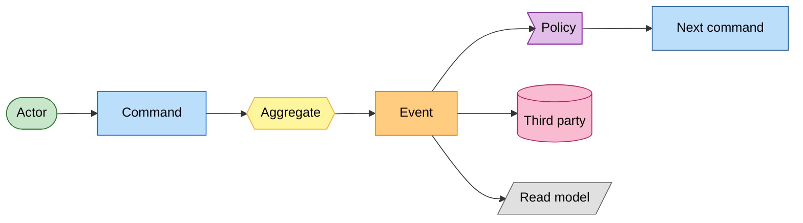
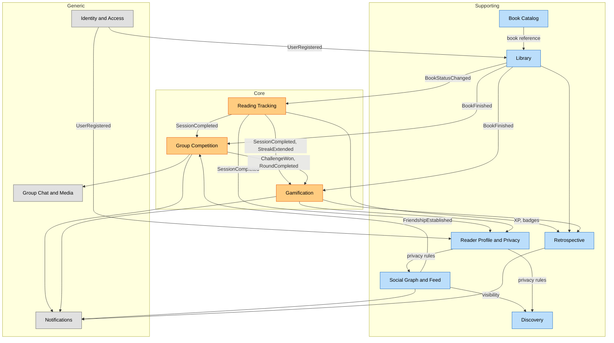
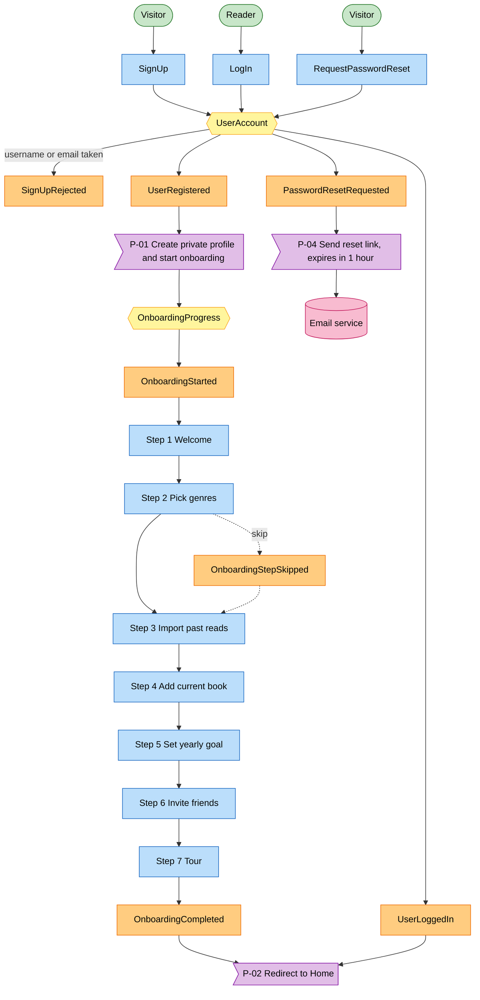
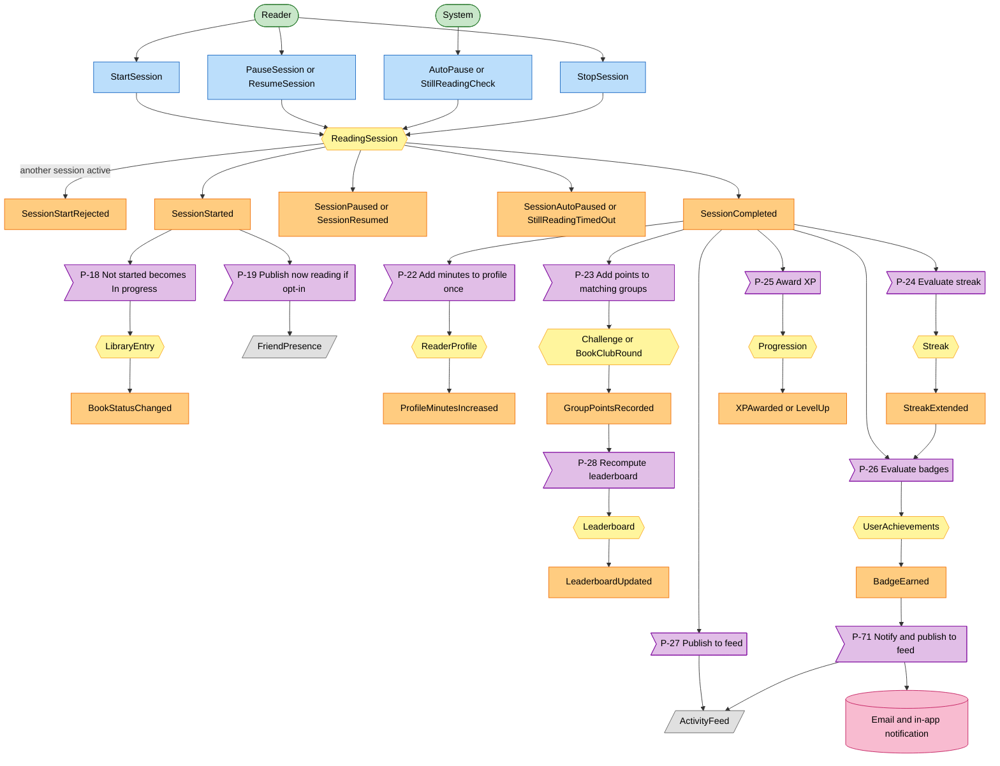
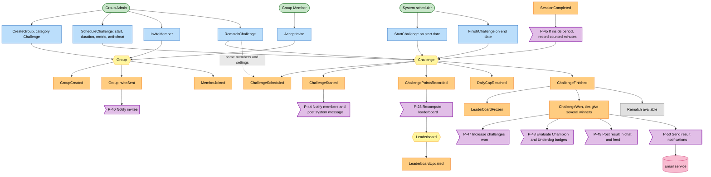
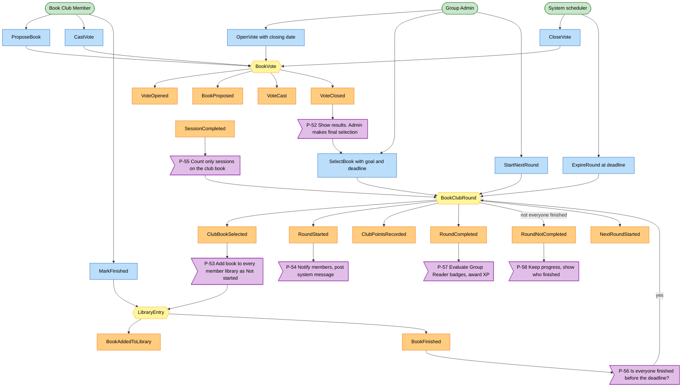
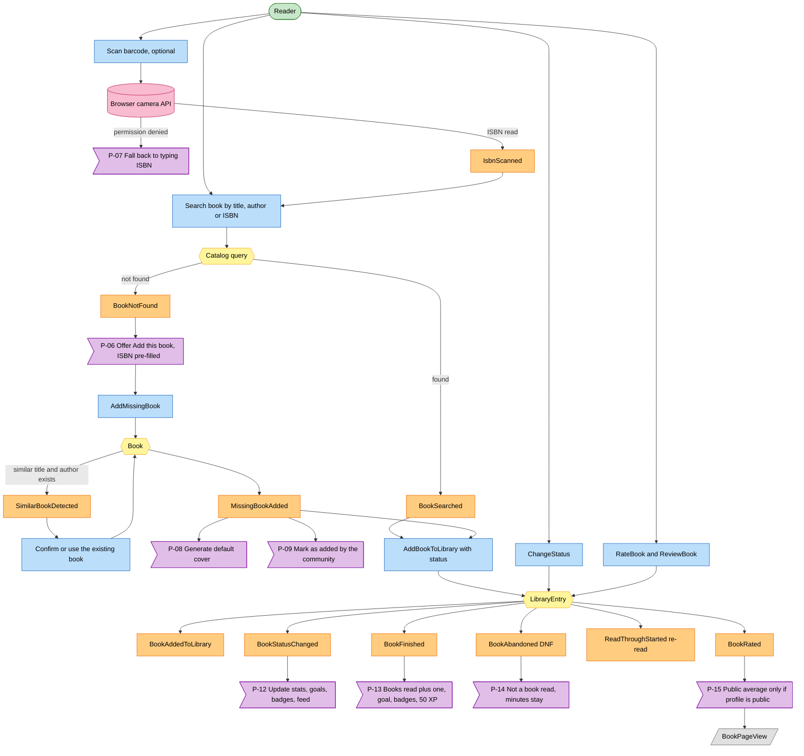
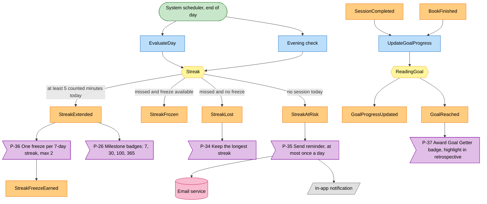
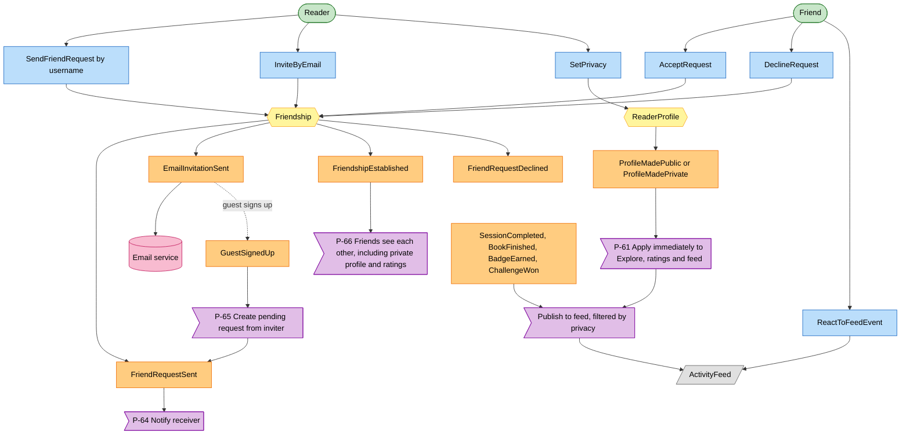

# Reading WebApp: Event Storming

Source: Reading WebApp Product Specification v1.1 (2026-10-10). Feature IDs such as `[F-READ-01]` point back to the spec.

Items marked **(inferred)** are not stated in the spec. They are modelling decisions to validate in the session.

## 0. Legend

| Sticky | Meaning | Mermaid colour |
|---|---|---|
| Event | Something that happened, past tense | orange |
| Command | Intent or action | blue |
| Policy | "Whenever X happens, then do Y" (automatic reaction) | purple |
| Aggregate | Consistency boundary that decides whether a command succeeds | yellow |
| Actor | Person or role that issues commands | green |
| Third party | External system | pink |
| Read model | Projection or view | grey |

---

## 1. Actors

| Actor | Description | Main commands |
|---|---|---|
| **Visitor** | Not logged in. Only the authentication page is reachable. | Sign up, log in, request password reset |
| **Reader (User)** | Registered user. The main actor. | Everything in the library, reading, social and groups areas |
| **New Reader** | A Reader going through onboarding for the first time. | Pick genres, import books, set a goal, invite friends |
| **Friend** | Another Reader with an accepted friendship. A role, not a separate account type. | Accept or decline requests, react to feed events, receive books and nudges |
| **Group Admin** | The Reader who created the group, or who inherited it. | Create the group, invite or remove members, select the book, open a vote, set anti-cheat, start a rematch |
| **Group Member** | A Reader in a group. | Chat, join or leave, propose or vote on books, nudge, join a live room |
| **Challenge Participant** | A member of a Challenge group. | Run sessions that count toward the challenge |
| **Book Club Member** | A member of a Book Club group. | Read the selected book, mark it finished, propose and vote |
| **Public Reader** | A Reader with a public profile. Visible to strangers. | Publish public lists and folders |
| **Platform Admin** | Minimal app-level admin (Q10 / TFR-19). | Moderate content, merge duplicate books |
| **Invited Guest** | A person invited by email who has no account yet. | Sign up through the invitation |
| **System (Scheduler)** | Time-driven actor. | Start and end challenges, close deadlines and votes, evaluate streaks, generate retrospectives |

---

## 2. Subdomains

| Type | Subdomain | Why | Features |
|---|---|---|---|
| **Core** | **Reading Tracking** | The product's main value: sessions, streaks, goals, progress, pace. | F-READ-01 to 05 |
| **Core** | **Group Competition** | The differentiator: challenges, book clubs, leaderboards, anti-cheat. | F-GRP-01 to 10 |
| **Core** | **Gamification** | Retention engine: badges, XP, levels, rarity. | F-GAM-01 to 03 |
| Supporting | **Library** | Personal book shelves, statuses, folders, tags, re-reads, DNF. | F-LIB-01 to 07 |
| Supporting | **Book Catalog** | Book metadata, community-added books, ISBN lookup, duplicate detection. | F-BOOK-01 to 04 |
| Supporting | **Reader Profile and Privacy** | Statistics, labels, persona, import of past reads, visibility. | F-PROF-01 to 05 |
| Supporting | **Social Graph and Feed** | Friends, activity feed, presence, sending books. | F-SOC-01 to 05 |
| Supporting | **Discovery** | Search, trending, public ratings and reviews, public lists, suggestions. | F-EXP-01 to 06 |
| Supporting | **Retrospective** | Monthly and yearly summaries. | F-RET-01 |
| Generic | **Identity and Access** | Sign up, log in, password reset, onboarding gate. | F-AUTH-01/02, F-ONB-01 |
| Generic | **Notifications** | In-app notification centre, email preferences and delivery. | F-NOT-01, nudges |
| Generic | **Group Chat and Media** | Real-time messages with images and video. | F-GRP-02 |

### Context map

---

## 3. Aggregates

| # | Aggregate | Subdomain | Key invariants | Commands it handles |
|---|---|---|---|---|
| A1 | **UserAccount** | Identity | Email and username are unique. Reset link expires (default 1 hour). | SignUp, LogIn, LogOut, RequestPasswordReset, ResetPassword |
| A2 | **OnboardingProgress** | Identity | Runs once. Every step except Welcome is skippable. Can be restarted. | StartOnboarding, CompleteStep, SkipStep, SkipOnboarding, RestartOnboarding |
| A3 | **Book** | Catalog | A title is required. Possible duplicates are detected. A default cover is used if none is given. | AddMissingBook, UpdateBookMetadata, MergeDuplicateBooks |
| A4 | **LibraryEntry** (with **ReadThrough**) | Library | One current status per user and book. A re-read is a new read-through. DNF books don't count as books read. | AddBookToLibrary, ChangeStatus, MarkFinished, MarkDNF, RestartBook, StartReread, RateBook, ReviewBook, TagBook |
| A5 | **Folder** | Library | Deleting a folder doesn't remove its books. Visibility is private or public. | CreateFolder, RenameFolder, DeleteFolder, AddBookToFolder, CopyFolder, FollowFolder |
| A6 | **ReadingSession** | Reading | One active session per user. It is linked to one library book. Counted minutes are capped by group rules. Minutes reach the profile once. | StartSession, PauseSession, ResumeSession, StopSession, LogProgress, DeleteSession |
| A7 | **Streak** | Reading | A day counts at 5 or more counted minutes. Freeze stock is at most 2. A missed day with no freeze resets the streak. The longest streak is kept. | ConfigureStreak, EvaluateDay (system), GrantFreeze |
| A8 | **ReadingGoal** | Reading | Yearly goal in books, minutes, or both. | SetGoal, ChangeGoal |
| A9 | **ReaderProfile** | Profile | Default is private. Estimated minutes are kept apart from counted minutes. | UpdateProfile, SetPrivacy, ImportPastReads, HidePersona, ToggleFriendPresence |
| A10 | **Friendship** | Social | Mutual. Only friends can be invited to groups. | SendFriendRequest, AcceptRequest, DeclineRequest, RemoveFriend, InviteByEmail |
| A11 | **Group** (root for Challenge and Book Club) | Groups | Has an admin. Duration, metric and anti-cheat are frozen after start. Admin rights pass to the oldest member if the admin leaves. Maximum 50 members (Q11). | CreateGroup, InviteMember, AcceptInvite, RemoveMember, LeaveGroup, UpdateGroup |
| A12 | **Challenge** | Groups | Lifecycle is Draft, Scheduled, Active, Finished. Only counted minutes inside the period count. Ties produce several winners. | ScheduleChallenge, StartChallenge, FinishChallenge, RematchChallenge, AssignTeams |
| A13 | **BookClubRound** | Groups | One book per round. The round is completed only if every member finishes before the deadline. | SelectBook, StartRound, CompleteRound, ExpireRound, StartNextRound |
| A14 | **BookVote** | Groups | Maximum proposals per member. Votes are anonymous or named. The admin makes the final selection. | OpenVote, ProposeBook, CastVote, CloseVote |
| A15 | **Leaderboard** | Groups | Ties share a rank. Recalculated after each session. Frozen at the end. | RecordPoints (internal), FreezeLeaderboard |
| A16 | **GroupChat** | Chat | Visible to members only. The admin can delete any message. | PostMessage, DeleteMessage |
| A17 | **LiveRoom** | Groups | Members only. Sessions started inside it are normal sessions. | OpenRoom, JoinRoom, LeaveRoom, CloseRoom |
| A18 | **Nudge** | Groups/Notif | One per sender per receiver per day. Maximum 3 per receiver per day. | SendNudge |
| A19 | **BadgeCatalog** | Gamification | Visible or secret, with a rarity tier. | DefineBadge |
| A20 | **UserAchievements** | Gamification | Badges are permanent once earned. | EvaluateBadges, AwardBadge |
| A21 | **Progression** (XP ledger) | Gamification | Estimated minutes give no XP. Levels need increasing XP. | AwardXP, LevelUp |
| A22 | **ReadingList** (public list) | Discovery | Published from a folder. Public profile only. | PublishList, UnpublishList, FollowList |
| A23 | **Notification** and **NotificationPreferences** | Notifications | Email types can be switched on or off per user. | Notify, MarkRead, SetEmailPreference |
| A24 | **Retrospective** | Retrospective | Monthly on the 1st, yearly on 1 January. Shared only if the user chooses. | GenerateRetrospective, ShareRetrospective |
| A25 | **BookSuggestion** (inferred) | Discovery | Never suggests books already in the library. | RefreshSuggestions |
| A26 | **BookSend** (inferred) | Social | Sent to one or more friends, with an optional note. | SendBookToFriend |

### Read models (no business invariants)

| Read model | Fed by | Used in |
|---|---|---|
| **HomeDashboard** | Library, streak, goal, groups, feed, trending, invites | F-HOME-01 |
| **ActivityFeed** | Session, status, badge and challenge events, filtered by privacy | F-SOC-03 |
| **FriendPresence** | Session started and stopped, opt-in | F-SOC-04 |
| **BookPageView** | Book, average rating, public reviews, friends' ratings, own status | F-BOOK-01, F-EXP-02/03 |
| **TrendingLists** | Counted minutes and new in-progress per book, by period, friends or genre | F-EXP-04 |
| **BadgeRarityStats** | Count of badge owners divided by total users | F-GAM-02 |
| **GenrePreferenceLabel** | Finished books by genre | F-PROF-04 |
| **ReaderPersona** | Time of day, genre, pace | F-PROF-05 |
| **PersonalPace** | Sessions with minutes and pages (at least 5) | F-READ-02 |

---

## 4. Events, commands and policies by subdomain

Reading order for each table: **Actor** issues a **Command**, the **Aggregate** accepts it, **Events** are emitted, **Policies** react and trigger further commands.

### 4.1 Identity and Access

| Actor | Command | Aggregate | Event(s) | Policy triggered |
|---|---|---|---|---|
| Visitor | SignUp | UserAccount | `UserRegistered` | **P-01** Whenever a user registers, create a private ReaderProfile and start onboarding. |
| Visitor | SignUp (taken username or email) | UserAccount | `SignUpRejected` | |
| Visitor | LogIn | UserAccount | `UserLoggedIn`, or `LoginFailed` | **P-02** If onboarding is not done, redirect to onboarding, otherwise to Home. |
| Reader | LogOut | UserAccount | `UserLoggedOut` | **P-03** Whenever there is no session, show only the authentication page. |
| Visitor | RequestPasswordReset | UserAccount | `PasswordResetRequested` | **P-04** Send the reset email with a link that expires. The same message is shown whether or not the email exists. |
| Visitor | ResetPassword | UserAccount | `PasswordReset`, or `ResetLinkExpired` | |
| System | (on start of onboarding) | OnboardingProgress | `OnboardingStarted` | |
| New Reader | CompleteStep or SkipStep | OnboardingProgress | `GenresSelected`, `PastReadsImported`, `CurrentBookAdded`, `GoalSet`, `FriendsInvited`, `TourCompleted`, `OnboardingStepSkipped` | **P-05** Each step event runs the matching command in its own subdomain. |
| New Reader | SkipOnboarding | OnboardingProgress | `OnboardingSkipped` | **P-02** (continues to Home) |
| Reader | RestartOnboarding | OnboardingProgress | `OnboardingRestarted` | |

### 4.2 Book Catalog

| Actor | Command | Aggregate | Event(s) | Policy triggered |
|---|---|---|---|---|
| Reader | SearchBook, or search by ISBN | (Catalog query) | `BookSearched`, `BookNotFound` | **P-06** If a book is not found, offer "Add this book", with the ISBN pre-filled when one was typed. |
| Reader | ScanBarcode (Could) | (Catalog query) | `CameraPermissionGranted` or `CameraPermissionDenied`, then `IsbnScanned` | **P-07** If camera permission is denied, fall back to typing the ISBN. |
| Reader | AddMissingBook | Book | `SimilarBookDetected` (needs confirmation), `MissingBookAdded` | **P-08** If a default cover is needed, generate a cover showing the title. **P-09** Mark the book "added by the community" and make it searchable for everyone. |
| Platform Admin | MergeDuplicateBooks | Book | `BooksMerged` | **P-10** Re-point library entries and sessions to the surviving book. (inferred) |
| Platform Admin | UpdateBookMetadata | Book | `BookMetadataUpdated` | |

### 4.3 Library

| Actor | Command | Aggregate | Event(s) | Policy triggered |
|---|---|---|---|---|
| Reader | AddBookToLibrary (status) | LibraryEntry | `BookAddedToLibrary` | **P-11** If the status is Finished, treat it like finishing (see below). |
| Reader | ChangeStatus | LibraryEntry | `BookStatusChanged` | **P-12** Whenever a status changes, update profile stats, goals and badges, and publish to the feed. |
| Reader | MarkFinished | LibraryEntry | `BookFinished` | **P-13** Increase books read, update goal progress, evaluate badges, award 50 XP, check the Book Club round. |
| Reader | MarkDNF (with reason) | LibraryEntry | `BookAbandoned` | **P-14** DNF does not count as a book read, but its minutes stay in the total. |
| Reader | RestartBook | LibraryEntry | `BookRestarted` | |
| Reader | StartReread | LibraryEntry | `ReadThroughStarted` | |
| Reader | RateBook, ReviewBook | LibraryEntry | `BookRated`, `BookReviewed`, `ReviewEdited`, `ReviewDeleted` | **P-15** The rating counts in the public average only if the profile is public. |
| Reader | TagBook | LibraryEntry | `BookTagged` | |
| Reader | CreateFolder, RenameFolder, DeleteFolder | Folder | `FolderCreated`, `FolderRenamed`, `FolderDeleted` | |
| Reader | AddBookToFolder | Folder | `BookAddedToFolder` | |
| Reader | SetFolderVisibility | Folder | `FolderMadePublic`, `FolderMadePrivate` | |
| Reader | CopyFolder (Could) | Folder | `FolderCopied` | **P-16** Add its books as "Not started" unless they are already in the library. |
| Reader | FollowFolder (Could) | Folder | `FolderFollowed` | **P-17** When the owner changes the folder, update followers. |

### 4.4 Reading Tracking (core)

| Actor | Command | Aggregate | Event(s) | Policy triggered |
|---|---|---|---|---|
| Reader | StartSession (book) | ReadingSession | `SessionStarted`, or `SessionStartRejected` (one is already active) | **P-18** If the book is "Not started", move it to "In progress". **P-19** If friend presence is on, publish "now reading". |
| Reader | PauseSession, ResumeSession | ReadingSession | `SessionPaused`, `SessionResumed` | |
| System | AutoPause (inactivity) | ReadingSession | `SessionAutoPaused` | **P-20** If the group uses auto-pause, pause the session at the last activity. |
| System | StillReadingCheck | ReadingSession | `StillReadingCheckSent`, then `StillReadingConfirmed` or `StillReadingTimedOut` | **P-21** If the check times out, pause the session at the last confirmation. |
| Reader | StopSession | ReadingSession | `SessionCompleted` (counted minutes, per-group counted minutes) | **P-22** Add minutes to the profile once (lowest counted value across groups). **P-23** Add points to each matching group (see 4.5). **P-24** Evaluate the streak. **P-25** Award XP. **P-26** Evaluate badges. **P-27** Publish to the feed. **P-28** Recompute leaderboards. |
| Reader | LogProgress (page or %) | ReadingSession / LibraryEntry | `ProgressLogged`, `BookReachedCompletion` | **P-29** At 100%, suggest marking the book as Finished. **P-30** Recompute personal pace once there are 5 or more sessions with pages. |
| Reader | DeleteSession | ReadingSession | `SessionDeleted` | **P-31** Subtract from the profile and groups. |
| Reader | AddManualSession (Q7) | ReadingSession | `ManualSessionAdded` | **P-32** Profile only, never in groups. |
| Reader | CloseTabWhileRunning | ReadingSession | (none, the session keeps running) | **P-33** On the next visit, remind the user to stop it. |
| Reader | ConfigureStreak (daily or weekly) | Streak | `StreakConfigured` | |
| System | EvaluateDay (end of day) | Streak | `StreakExtended`, `StreakFrozen` (freeze used), `StreakLost` | **P-34** On `StreakLost`, keep the longest streak. **P-35** In the evening, if there is no session today, send a streak-at-risk reminder (at most once a day). |
| System | GrantFreeze | Streak | `StreakFreezeEarned` | **P-36** Grant 1 freeze per 7-day streak, up to the maximum. |
| Reader | SetGoal, ChangeGoal | ReadingGoal | `GoalSet`, `GoalChanged` | |
| System | (progress check) | ReadingGoal | `GoalProgressUpdated`, `GoalReached` | **P-37** On `GoalReached`, award the Goal Getter badge and highlight it in the yearly retrospective. |

### 4.5 Group Competition (core)

**Group (shared)**

| Actor | Command | Aggregate | Event(s) | Policy triggered |
|---|---|---|---|---|
| Group Admin | CreateGroup (category, settings, anti-cheat) | Group | `GroupCreated` | **P-38** The creator becomes admin. **P-39** Post a system message in the chat. |
| Group Admin | InviteMember (friends only) | Group | `GroupInviteSent` | **P-40** Notify the invitee (in-app and email). |
| Reader | AcceptInvite, DeclineInvite | Group | `MemberJoined`, `GroupInviteDeclined` | **P-41** Post a "member joined" message. **P-42** Show the active anti-cheat options before joining. |
| Group Admin | RemoveMember | Group | `MemberRemoved` | |
| Group Member | LeaveGroup | Group | `MemberLeft`, `AdminRightsTransferred` | **P-43** Keep the member's past points, remove them from the active leaderboard. If the admin leaves, hand admin to the oldest member. |
| Group Admin | UpdateGroup (name or picture) | Group | `GroupUpdated` | Blocked for duration, metric and anti-cheat once started. |
| Group Member | PostMessage (text, image, video) | GroupChat | `MessagePosted`, or `MessageRejected` (format or size) | |
| Group Member / Admin | DeleteMessage | GroupChat | `MessageDeleted` | |

**Challenge**

| Actor | Command | Aggregate | Event(s) | Policy triggered |
|---|---|---|---|---|
| Group Admin | ScheduleChallenge (start, duration, metric, anti-cheat) | Challenge | `ChallengeScheduled` | |
| System | StartChallenge (start date reached) | Challenge | `ChallengeStarted` | **P-44** Notify members. Post a system message. |
| Group Admin | AssignTeams (Could) | Challenge | `TeamsAssigned` | |
| Challenge Participant | (a session completes) | Challenge / Leaderboard | `ChallengePointsRecorded`, `DailyCapReached` | **P-45** If the session is inside the period and matches the rules, add the counted minutes. **P-46** Apply the daily cap. |
| System | FinishChallenge (end date reached) | Challenge | `ChallengeFinished`, `LeaderboardFrozen`, `ChallengeWon` (one or more winners) | **P-47** Increase the winner's "challenges won". **P-48** Evaluate Champion and Underdog badges. **P-49** Post the result in chat and the feed. **P-50** Send result notifications by email and in-app. |
| Group Admin | RematchChallenge | Challenge | `ChallengeRematchRequested`, then `ChallengeScheduled` | Same members and settings. |

**Book Club**

| Actor | Command | Aggregate | Event(s) | Policy triggered |
|---|---|---|---|---|
| Group Admin | OpenVote | BookVote | `VoteOpened` | **P-51** Notify members. |
| Book Club Member | ProposeBook | BookVote | `BookProposed` | |
| Book Club Member | CastVote | BookVote | `VoteCast` | |
| System | CloseVote (closing date) | BookVote | `VoteClosed` | **P-52** Show the results. The admin makes the final selection. |
| Group Admin | SelectBook (goal and deadline) | BookClubRound | `ClubBookSelected`, `RoundStarted` | **P-53** Add the book to every member's library as "Not started". **P-54** Notify members and post a system message. |
| Book Club Member | (a session completes) | BookClubRound | `ClubPointsRecorded` | **P-55** Count only sessions on the club book. |
| Book Club Member | MarkFinished | BookClubRound | `MemberFinishedClubBook` | **P-56** If every member has finished before the deadline, complete the round. |
| System | CompleteRound | BookClubRound | `RoundCompleted` | **P-57** Evaluate Group Reader badges. Award XP. |
| System | ExpireRound (deadline passes) | BookClubRound | `RoundNotCompleted` | **P-58** Keep progress and show who finished. |
| Group Admin | StartNextRound | BookClubRound | `NextRoundStarted` | Past rounds are kept in the history. |

**Live rooms and nudges (Could)**

| Actor | Command | Aggregate | Event(s) | Policy triggered |
|---|---|---|---|---|
| Group Member | OpenRoom, JoinRoom, LeaveRoom | LiveRoom | `LiveRoomOpened`, `MemberJoinedRoom`, `MemberLeftRoom` | **P-59** Show members' timers in real time. Sessions count normally. |
| Group Member | SendNudge | Nudge | `NudgeSent`, or `NudgeRejected` (limit reached) | **P-60** Deliver in-app and by email, unless the receiver turned nudge emails off. |

### 4.6 Profile and Privacy

| Actor | Command | Aggregate | Event(s) | Policy triggered |
|---|---|---|---|---|
| Reader | UpdateProfile | ReaderProfile | `ProfileUpdated` | |
| Reader | SetPrivacy | ReaderProfile | `ProfileMadePublic`, `ProfileMadePrivate` | **P-61** Apply immediately: update visibility in Explore, ratings counted publicly, and feed visibility. |
| New Reader / Reader | ImportPastReads (many books) | ReaderProfile + LibraryEntry | `PastReadsImported`, `EstimatedMinutesAdded` | **P-62** Estimated minutes = pages ÷ pace (personal pace if known, else 1 page per minute, and 300 pages if the page count is unknown). **P-63** Estimated minutes never count in groups, streaks, time-based badges, or XP. They do count for books read and genre badges. |
| System | (finished books change) | ReaderProfile | `GenrePreferenceLabelUpdated` | |
| System | (signals change) | ReaderProfile | `ReaderPersonaUpdated` | |
| Reader | HidePersona | ReaderProfile | `PersonaHidden` | |
| Reader | ToggleFriendPresence | ReaderProfile | `PresenceEnabled`, `PresenceDisabled` | |

### 4.7 Social

| Actor | Command | Aggregate | Event(s) | Policy triggered |
|---|---|---|---|---|
| Reader | SendFriendRequest (username) | Friendship | `FriendRequestSent` | **P-64** Notify the receiver. |
| Reader | InviteByEmail | Friendship | `EmailInvitationSent`, and later `GuestSignedUp` | **P-65** When the guest signs up, create a pending friend request from the inviter. |
| Friend | AcceptRequest | Friendship | `FriendshipEstablished` | **P-66** Friends can now see each other's private profile (Q3), and each other's ratings. |
| Friend | DeclineRequest | Friendship | `FriendRequestDeclined` | |
| Reader | RemoveFriend | Friendship | `FriendRemoved` | **P-67** The other person is not notified. |
| Reader / Friend | ReactToFeedEvent | ActivityFeed | `FeedEventReacted` | |
| Reader | SendBookToFriend (Could) | BookSend | `BookSent` | **P-68** Notify the friend, who can add the book to "Want to read" in one click. |

### 4.8 Discovery

| Actor | Command | Aggregate | Event(s) | Policy triggered |
|---|---|---|---|---|
| Reader | Search (books and users) | (Search query) | `SearchPerformed` | **P-69** Show only public profiles and friends in user results. |
| System | RefreshTrending | TrendingLists | `TrendingRefreshed` | Weekend, monthly, friends, genre lists. |
| Public Reader | PublishList (Could) | ReadingList | `ListPublished`, `ListUnpublished` | |
| Reader | FollowList, CopyList | ReadingList | `ListFollowed`, `ListCopied` | |
| System | RefreshSuggestions (Could) | BookSuggestion | `SuggestionsRefreshed` | **P-70** Never suggest books already in the library. Include the reason ("Because you liked ..."). |

### 4.9 Gamification (core)

| Actor | Command | Aggregate | Event(s) | Policy triggered |
|---|---|---|---|---|
| System | EvaluateBadges (after session, finish, streak, challenge or round events) | UserAchievements | `BadgeProgressUpdated`, `BadgeEarned` | **P-71** Notify the user and publish to the feed. **P-72** Award XP by rarity (25, 75 or 200). |
| System | AwardXP | Progression | `XPAwarded`, `LevelUp` | **P-73** XP sources: counted minutes, finished books, badges, challenge wins, completed rounds. |
| Platform Admin | DefineBadge | BadgeCatalog | `BadgeDefined` | |
| System | RecomputeRarity | BadgeRarityStats | `BadgeRarityUpdated` | |

### 4.10 Retrospective and Notifications

| Actor | Command | Aggregate | Event(s) | Policy triggered |
|---|---|---|---|---|
| System | GenerateRetrospective (1st of month, 1 January) | Retrospective | `MonthlyRetrospectiveGenerated`, `YearlyRetrospectiveGenerated`, `FreshStartMessageGenerated` (no reading) | **P-74** Notify the user by email and in-app. |
| Reader | ShareRetrospective | Retrospective | `RetrospectiveShared` | Appears in the feed. |
| System | Notify | Notification | `NotificationCreated`, `EmailQueued` | **P-75** Send the email only if the type is enabled in preferences. |
| Reader | MarkNotificationRead | Notification | `NotificationRead` | |
| Reader | SetEmailPreference | NotificationPreferences | `EmailPreferenceChanged` | |

---

## 5. Third parties (external systems)

| # | Third party | Used by | Direction | Notes |
|---|---|---|---|---|
| T1 | **Email delivery service** (SES, SendGrid or similar) | Notifications, Identity | Out | Password reset, friend invites by email, group invites, challenge results, nudges, streak at risk, retrospectives. (inferred, the vendor is not named) |
| T2 | **Book metadata provider** (Open Library, Google Books or ISBNdb) | Book Catalog | In | Seeds the catalog and ISBN lookup. The spec doesn't name a source, so this is an assumption. (inferred) |
| T3 | **Browser camera and barcode API** | Book Catalog (F-BOOK-04) | In | Optional. Falls back to typing the ISBN if permission is denied. |
| T4 | **Media storage and CDN** | Chat, Catalog, Profile | In/Out | Chat images and videos, book covers, profile photos. Formats and sizes are in TFR-04, which was not in the text I received. (inferred) |
| T5 | **Real-time messaging (WebSocket service)** | Group Chat, Live Rooms, Leaderboard, Presence | In/Out | Real-time chat, live timers, leaderboard updates. (inferred) |
| T6 | **Job scheduler / cron** | Challenges, Streaks, Retrospective, Votes | Internal trigger | Day rollover, challenge end, round deadline, vote close, retrospectives. May be internal rather than third party. (inferred) |
| T7 | **Content moderation (optional)** | Chat media, Book Catalog | Out | Relevant to the Platform Admin role (Q10). (inferred) |

---

## 6. Flowcharts

### 6.1 Access and onboarding

### 6.2 Reading session, the main reaction chain

### 6.3 Challenge lifecycle

### 6.4 Book club round

### 6.5 Library and book catalog

### 6.6 Streak and goals (time-driven)

### 6.7 Social: friends, privacy and feed

---

## 7. Hotspots (to discuss in the session)

| # | Hotspot | Why it matters |
|---|---|---|
| H1 | **Counted vs estimated minutes.** Two kinds of minutes live in the same profile. | Every policy that sums minutes (streaks, XP, badges, leaderboards) must say which kind it uses. Consider two separate value objects. |
| H2 | **One session, many groups, different anti-cheat rules.** The profile receives the lowest counted value (F-READ-03). | `SessionCompleted` has to carry per-group counted minutes. Decide where this is computed: ReadingSession or each Group. |
| H3 | **Challenge end is time-driven and must be idempotent.** | A scheduler retry must not award a win twice. Decide the cut-off for sessions that finish close to the deadline. |
| H4 | **Streak day boundaries.** Which time zone defines "a day"? The spec doesn't say. | Affects `StreakLost`, Night Reader (after midnight), Early Bird (before 6:00) and daily caps. |
| H5 | **Group membership and privacy.** Group activity is always visible to members, even for private profiles (F-PROF-02). | Feed and leaderboard projections need clear visibility rules. |
| H6 | **Book club rounds with leavers.** What happens when a member leaves mid-round? Does "everyone finished" still apply? | Not defined in the spec. |
| H7 | **Duplicate books and merges.** Library entries and sessions point to books that may get merged. | Decide whether merges are allowed once reading data exists (Q10). |
| H8 | **Metric "most books finished" and "longest streak" in a challenge.** | Needs events from Library and Streak inside the Group context. Check coupling. |
| H9 | **Manual sessions (Q7).** Allowed for the profile only. | They produce `SessionCompleted`-like events that groups must ignore. Consider a different event name. |
| H10 | **Re-reads and badges.** Does finishing a re-read count toward Fiction Expert (10 fiction books)? | Not defined. The spec says each finished read-through counts as a book read. |
| H11 | **Friend removal and shared groups.** Removing a friend does not remove group membership. | Check that "only friends can be invited" is checked at invite time only. |
| H12 | **Missing source material.** Section 3 (technical requirements TFR and NFR) was not included in what I received. | Media limits (TFR-04), leaderboard latency (NFR-05), group size (NFR-10), language (NFR-17), and the admin role (TFR-19) are not modelled in detail. |

## 8. Suggested bounded contexts (summary)

| Context | Aggregates |
|---|---|
| **Identity** | UserAccount, OnboardingProgress |
| **Catalog** | Book |
| **Library** | LibraryEntry (ReadThrough), Folder |
| **Reading** | ReadingSession, Streak, ReadingGoal |
| **Profile** | ReaderProfile |
| **Social** | Friendship, BookSend, ActivityFeed (read model) |
| **Groups** | Group, Challenge, BookClubRound, BookVote, Leaderboard, LiveRoom, Nudge, GroupChat |
| **Gamification** | BadgeCatalog, UserAchievements, Progression |
| **Discovery** | ReadingList, BookSuggestion, TrendingLists (read model) |
| **Retrospective** | Retrospective |
| **Notifications** | Notification, NotificationPreferences |
