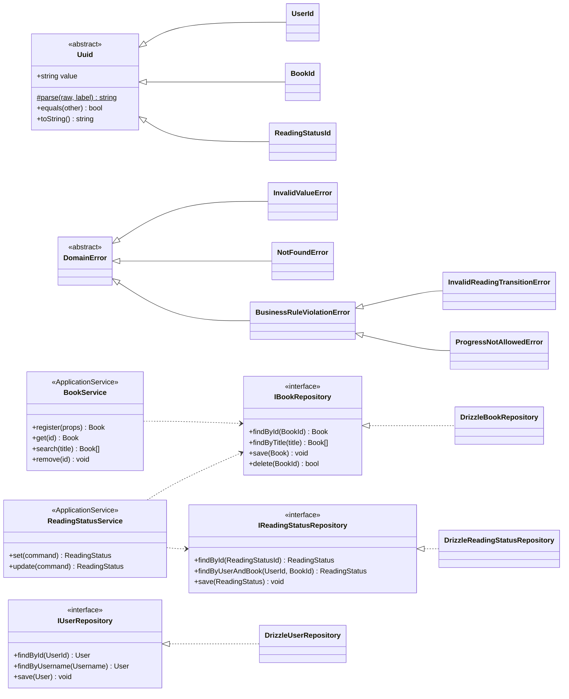

# LES: Domain class diagram (Core)

The object model behind the [Core database tables](table_UML.md), in UML class notation. Each table maps to a domain class (or to the part of an aggregate that owns it). Unlike the table diagram, this one shows **behaviour**: the methods that change each object and the rules they protect.

Classes marked ✅ in the [status table](#implementation-status) exist in [`apps/backend/src/features/`](../../apps/backend/src/features/), one folder per feature. The rest are the design for the Core issues still to build; method names are a proposal, adjust them when you implement.

## Notation

| Mermaid | UML meaning | Example |
|---|---|---|
| `A <\|-- B` | Inheritance (generalisation): B is an A | `ReadingState <\|-- InProgress` |
| `A <\|.. B` | Realisation: B implements interface A | `IBookRepository <\|.. DrizzleBookRepository` |
| `A *-- B` | Composition: B lives and dies with A | `ChallengeGroup *-- GroupMember` |
| `A o-- B` | Aggregation: A groups B, B lives on its own | `List o-- Book` |
| `A --> B` | Directed association (a reference, by id across aggregates) | `ReadingSession --> Book` |
| `A -- B` | Bidirectional association | `Book -- Author` |
| `A ..> B` | Dependency: A uses B in a method | `LeaderboardCalculator ..> ReadingSession` |
| `+` / `-` | Public / private member | |
| `method()$` | Static (factory) method | `User.register()$` |
| `method()*` | Abstract method | `ReadingState.progressOnEnter()*` |
| `<<AggregateRoot>>` and similar | DDD stereotype | |

## Domain model

```mermaid
classDiagram
    direction TB

    %% ---------- Identity and social graph ----------
    class User {
        <<AggregateRoot>>
        +UserId id
        +Email email
        +Username username
        -string displayName
        +string photoUrl
        +string profileDescription
        +string timezone
        -Visibility profileVisibility
        +Date createdAt
        -Date updatedAt
        +register(NewUserProps)$ User
        +reconstitute(UserState)$ User
        +rename(displayName) void
        +makeProfilePublic() void
        +makeProfilePrivate() void
        -touch() void
    }
    class Email {
        <<ValueObject>>
        +string value
        +of(raw)$ Email
    }
    class Username {
        <<ValueObject>>
        +string value
        +of(raw)$ Username
    }
    class Friendship {
        <<AggregateRoot>>
        +FriendshipId id
        +UserId requesterUserId
        +UserId addresseeUserId
        -FriendshipStatus status
        +Date createdAt
        -Date respondedAt
        +request(requester, addressee)$ Friendship
        +accept(by UserId) void
        +decline(by UserId) void
        +involves(UserId) bool
        +isAccepted() bool
    }

    %% ---------- Catalog ----------
    class Book {
        <<AggregateRoot>>
        +BookId id
        +BookTitle title
        +string description
        +Isbn13 isbn13
        +PageCount pageCount
        +string coverUrl
        +GenreId genreId
        +bool isCommunityAdded
        +Date createdAt
        +create(NewBookProps)$ Book
        +reconstitute(BookState)$ Book
        +progressAt(page) PageProgress
        +classifyAs(GenreId) void
    }
    class BookTitle {
        <<ValueObject>>
        +string value
        +of(raw)$ BookTitle
    }
    class Isbn13 {
        <<ValueObject>>
        +string value
        +of(raw)$ Isbn13
    }
    class PageCount {
        <<ValueObject>>
        +int value
        +of(raw)$ PageCount
    }
    class Author {
        <<Entity>>
        +AuthorId id
        +string name
    }
    class Genre {
        <<Entity>>
        +GenreId id
        +string name
    }

    %% ---------- Library ----------
    class ReadingStatus {
        <<AggregateRoot>>
        +ReadingStatusId id
        +UserId userId
        +BookId bookId
        -ReadingState state
        -PageProgress progress
        -DnfReason dnfReason
        -Date finishedAt
        -Date updatedAt
        +create(UserId, BookId)$ ReadingStatus
        +reconstitute(ReadingStatusState)$ ReadingStatus
        +startReading() void
        +finish(PageCount) void
        +abandon(DnfReason) void
        +moveBackToShelf() void
        +changeStatus(target, PageCount) void
        +updateProgress(PageProgress) void
        -transitionTo(ReadingState, PageCount) void
    }
    class ReadingState {
        <<abstract>>
        +ReadingStatusType type
        +bool tracksProgress
        +start() ReadingState
        +finish() ReadingState
        +abandon() ReadingState
        +moveBackToShelf() ReadingState
        +progressOnEnter(from, previous, totalPages)* PageProgress
        +of(type)$ ReadingState
    }
    class NotStarted
    class InProgress
    class Finished
    class DidNotFinish
    class PageProgress {
        <<ValueObject>>
        +int page
        +of(raw, total)$ PageProgress
        +zero()$ PageProgress
        +equals(PageProgress) bool
    }
    class Review {
        <<AggregateRoot>>
        +ReviewId id
        +UserId userId
        +BookId bookId
        -Rating rating
        -string comment
        -Date deletedAt
        +write(UserId, BookId, Rating, comment)$ Review
        +edit(Rating, comment) void
        +remove() void
        +isDeleted() bool
    }
    class Rating {
        <<ValueObject>>
        +int value
        +of(raw)$ Rating
    }
    class List {
        <<AggregateRoot>>
        +ListId id
        +UserId userId
        -string name
        -Visibility visibility
        -Set~BookId~ bookIds
        -Date deletedAt
        +create(UserId, name)$ List
        +rename(name) void
        +addBook(BookId) void
        +removeBook(BookId) void
        +makePublic() void
        +makePrivate() void
        +remove() void
    }

    %% ---------- Reading ----------
    class ReadingSession {
        <<AggregateRoot>>
        +ReadingSessionId id
        +UserId userId
        +BookId bookId
        -ReadingSessionStatus status
        +Date startedAt
        -Date endedAt
        -int durationSeconds
        +start(UserId, BookId, now)$ ReadingSession
        +stop(now) void
        +isRunning() bool
        +countedMinutes() int
        +localDay(timezone) Date
        +isWithin(ChallengePeriod) bool
    }
    class StreakCalculator {
        <<DomainService>>
        +current(sessions, timezone, today) int
        +longest(sessions, timezone) int
    }

    %% ---------- Challenge groups ----------
    class ChallengeGroup {
        <<AggregateRoot>>
        +ChallengeGroupId id
        -string name
        -string description
        -ChallengePeriod period
        -List~GroupMember~ members
        -List~LeaderboardEntry~ finalStandings
        -Date deletedAt
        +create(admin UserId, name, ChallengePeriod)$ ChallengeGroup
        +invite(by UserId, invitee UserId) void
        +acceptInvite(UserId) void
        +declineInvite(UserId) void
        +leave(UserId) void
        +statusOn(today) ChallengeStatus
        +freezeStandings(LeaderboardCalculator, sessions) void
        +activeMembers() List~GroupMember~
        +admin() GroupMember
        +remove(by UserId) void
    }
    class ChallengePeriod {
        <<ValueObject>>
        +Date startDate
        +Date endDate
        +of(start, end)$ ChallengePeriod
        +contains(instant, timezone) bool
        +hasStarted(today) bool
        +hasEnded(today) bool
    }
    class GroupMember {
        <<Entity>>
        +UserId userId
        -GroupMemberRole role
        -GroupMemberStatus status
        +Date createdAt
        -Date joinedAt
        -Date leftAt
        +accept() void
        +decline() void
        +leave() void
        +isActive() bool
        +isAdmin() bool
    }
    class LeaderboardEntry {
        <<Entity>>
        +UserId userId
        +int totalMinutes
        +int rank
        +isWinner() bool
    }
    class LeaderboardCalculator {
        <<DomainService>>
        +rank(members, sessions, ChallengePeriod) List~LeaderboardEntry~
    }
    class Conversation {
        <<AggregateRoot>>
        +ConversationId id
        +ChallengeGroupId challengeGroupId
        -Date updatedAt
        -Date deletedAt
        +openFor(ChallengeGroupId)$ Conversation
        +post(UserId, content) Message
    }
    class Message {
        <<Entity>>
        +MessageId id
        +ConversationId conversationId
        +UserId userId
        -string content
        +Date createdAt
        -Date deletedAt
        +edit(by UserId, content) void
        +delete(by UserId) void
        +isDeleted() bool
    }

    %% ---------- Enumerations ----------
    class Visibility {
        <<enumeration>>
        private
        public
    }
    class FriendshipStatus {
        <<enumeration>>
        pending
        accepted
        declined
    }
    class ReadingStatusType {
        <<enumeration>>
        not-started
        in-progress
        finished
        did-not-finish
    }
    class DnfReason {
        <<enumeration>>
        not-for-me
        too-slow
        will-try-later
        other
    }
    class ReadingSessionStatus {
        <<enumeration>>
        running
        finished
    }
    class ChallengeStatus {
        <<enumeration>>
        scheduled
        active
        finished
    }
    class GroupMemberRole {
        <<enumeration>>
        admin
        member
    }
    class GroupMemberStatus {
        <<enumeration>>
        invited
        active
        declined
        left
    }

    %% ---------- Inheritance (State pattern) ----------
    ReadingState <|-- NotStarted
    ReadingState <|-- InProgress
    ReadingState <|-- Finished
    ReadingState <|-- DidNotFinish

    %% ---------- Composition: value objects and parts owned by an aggregate ----------
    User *-- "1" Email
    User *-- "1" Username
    Book *-- "1" BookTitle
    Book *-- "0..1" Isbn13
    Book *-- "0..1" PageCount
    ReadingStatus *-- "1" ReadingState : current state
    ReadingStatus *-- "1" PageProgress
    Review *-- "1" Rating
    ChallengeGroup *-- "1" ChallengePeriod
    ChallengeGroup *-- "1..*" GroupMember : members
    ChallengeGroup *-- "0..*" LeaderboardEntry : final standings
    Conversation *-- "0..*" Message : messages

    %% ---------- Aggregation ----------
    List o-- "0..*" Book : groups

    %% ---------- Associations (by id across aggregates) ----------
    Friendship "0..*" --> "1" User : requester
    Friendship "0..*" --> "1" User : addressee
    ReadingStatus "0..*" --> "1" User : reader
    ReadingStatus "0..*" --> "1" Book
    Review "0..*" --> "1" User : author
    Review "0..*" --> "1" Book
    List "0..*" --> "1" User : owner
    Book "0..*" -- "1..*" Author : written by
    Book "0..*" --> "0..1" Genre : main genre
    ReadingSession "0..*" --> "1" User : reader
    ReadingSession "0..*" --> "1" Book
    GroupMember "0..*" --> "1" User
    LeaderboardEntry "0..*" --> "1" User
    Conversation "1" --> "1" ChallengeGroup : chat of
    Message "0..*" --> "1" User : sender

    %% ---------- Typed by an enumeration ----------
    User ..> Visibility
    List ..> Visibility
    Friendship ..> FriendshipStatus
    ReadingState ..> ReadingStatusType
    ReadingStatus ..> DnfReason
    ReadingSession ..> ReadingSessionStatus
    ChallengeGroup ..> ChallengeStatus
    GroupMember ..> GroupMemberRole
    GroupMember ..> GroupMemberStatus

    %% ---------- Dependencies: domain services ----------
    LeaderboardCalculator ..> ReadingSession : sums minutes
    LeaderboardCalculator ..> GroupMember : active members
    LeaderboardCalculator ..> LeaderboardEntry : creates
    ChallengeGroup ..> LeaderboardCalculator : freezeStandings()
    StreakCalculator ..> ReadingSession : one 5-min session per local day
    StreakCalculator ..> User : timezone
    ReadingSession ..> ChallengePeriod : isWithin()
```

### How to read it

- **Aggregates reference each other by id**, never by object (`ReadingStatus` holds a `UserId`, not a `User`). The arrows between aggregates are those ids; they become the foreign keys in the [tables](table_UML.md).
- **`ReadingState` is the State pattern**: each status is a subclass that decides which transitions it allows and what happens to the page progress. `ReadingStatus` delegates to its current state. Adding a status (for example `paused` reading) means adding a subclass, not editing a switch.
- **`ChallengeGroup` owns its members and final standings** (composition): they have no meaning outside the group and are saved with it (`group_member` and `leaderboard_entry` rows). The admin is the member with role `admin`.
- **`List` aggregates books**: deleting a list does not delete its books (aggregation, not composition). A list holds books of the owner's library (`reading_status`), it is not the library itself.
- **Computed, not stored**: streaks (`StreakCalculator`) and the live leaderboard (`LeaderboardCalculator`) are domain services that read `ReadingSession`. The challenge status is computed too: `statusOn(today)` compares the period with today. The first time a finished challenge is read, `ChallengeGroup.freezeStandings()` stores the calculator's result as `LeaderboardEntry` rows, so no scheduler is needed. These rows are the only stored leaderboard data, and "challenges won" counts the rows with rank 1.
- **`Conversation` and `Message`** stay apart from `ChallengeGroup`, so posting a message does not load or lock the group. A message is soft-deleted: `delete()` checks that the caller is the sender or the group admin (F-GRP-02 rule 4).

## Shared kernel and persistence ports

The base classes every aggregate uses (in `src/utils/`), and how the application services and the database plug in (Ports and Adapters). Only the implemented services and repositories are shown.

Each repository file (`features/<name>/<name>-repository.ts`) holds the interface, the Drizzle implementation and its Data Mapper functions (`toDomain`, `toRow`), the only place that knows both the table row and the domain object. Services depend only on the interfaces, so unit tests swap in in-memory repositories.

## Implementation status

| Class | Table | Status |
|---|---|---|
| `User`, `Email`, `Username`, `UserId` | `user` | ✅ Implemented |
| `Book`, `BookTitle`, `Isbn13`, `PageCount`, `BookId` | `book` | ✅ Implemented (`genreId` and `classifyAs()` still to add) |
| `ReadingStatus`, `ReadingState` and subclasses, `PageProgress` | `reading_status` | ✅ Implemented (`dnfReason`, `finishedAt` still to add) |
| `Author`, `Genre` | `author`, `book_author`, `genre` | Planned |
| `Friendship` | `friendship` | Planned (F-SOC-01) |
| `Review`, `Rating` | `review` | Planned (F-LIB-02) |
| `List` | `list`, `list_book` | Planned (F-LIB-03) |
| `ReadingSession`, `StreakCalculator` | `reading_session` | Planned (F-READ-01, F-READ-04) |
| `ChallengeGroup`, `ChallengePeriod`, `GroupMember`, `LeaderboardEntry`, `LeaderboardCalculator` | `challenge_group`, `group_member`, `leaderboard_entry` | Planned (F-GRP-01, F-GRP-03, F-GRP-04) |
| `Conversation`, `Message` | `conversation`, `message` | Planned (F-GRP-02) |
