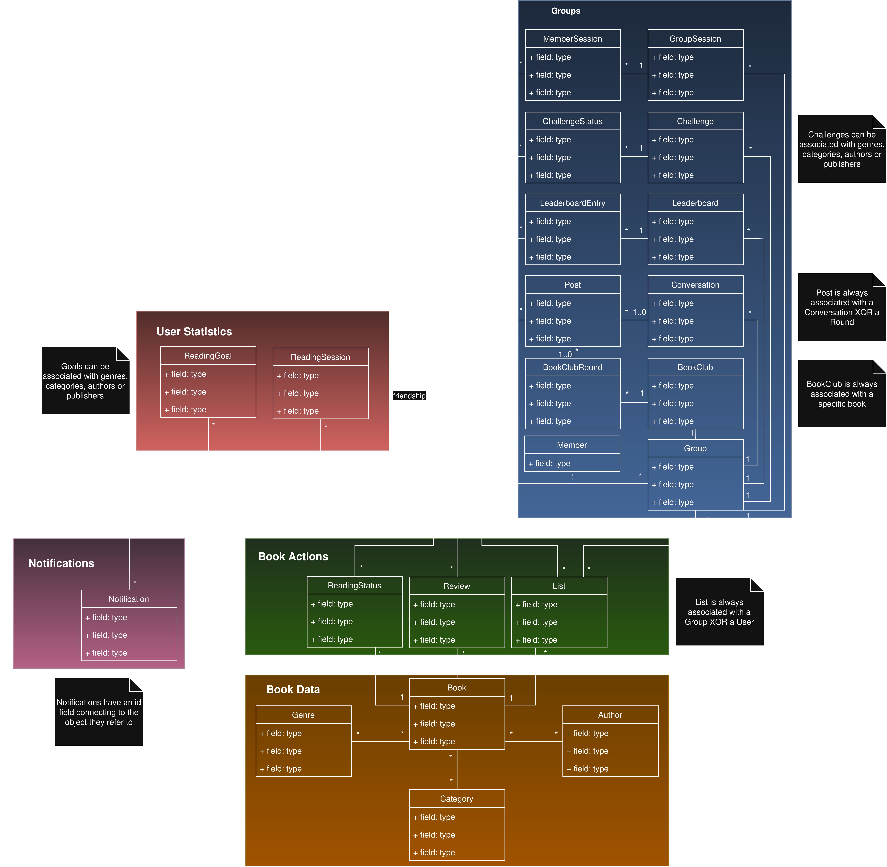

# Database Tables Specification

This document details all relational database tables derived from the conceptual UML model, organized by domain module.

---

## Core Entities

### User

Stores application-specific user profiles. Authentication, passwords, and sessions are managed externally by Supabase Auth (`auth.users`), sharing the same UUID primary key.

| Attribute          | Type     | Notes                                                        |
| ------------------ | -------- | ------------------------------------------------------------ |
| id                 | uuid     | Primary key (matches Supabase Auth user UUID)                |
| email              | string   | Unique email address                                         |
| username           | string   | Unique handle chosen by the user                             |
| display_name       | string   | Public name shown on profile and leaderboards                |
| photo_url          | string   | URL to avatar image (nullable)                               |
| bio                | string   | Short profile biography (nullable)                           |
| timezone           | string   | IANA timezone (e.g. `Europe/Lisbon`) for streak calculations |
| profile_visibility | string   | Visibility setting (`private` by default, `public`)          |
| created_at         | datetime | Account creation timestamp                                   |
| streak_type        | string   | Type of the streak (`daily`, `weekly`)                       |
| current_streak     | int      | Current streak value                                         |
| longest_streak     | int      | Value of the longest streak recorded                         |
| hit_streak         | bool     | If the user already hit his streak or not                    |

### Friendship

Represents mutual social connections and pending friend requests between two users.

| Attribute    | Type     | Notes                                                      |
| ------------ | -------- | ---------------------------------------------------------- |
| id           | uuid     | Primary key                                                |
| requester_id | uuid     | Foreign key → User (who sent the request)                  |
| addressee_id | uuid     | Foreign key → User (who received the request)              |
| status       | string   | Request state (`pending`, `accepted`, `declined`)          |
| created_at   | datetime | Timestamp when request was sent                            |
| responded_at | datetime | Timestamp when request was accepted or declined (nullable) |

---

## Book Data

### Book

Stores catalog information for books. Sourced via Open Library or created manually by users.

| Attribute | Type | Notes |
|---|---|---|
| id | uuid | Primary key |
| title | string | Book title (required) |
| description | string | Synopsis or summary (nullable) |
| isbn13 | string | 13-digit ISBN identifier (nullable, unique) |
| page_count | int | Total number of pages (nullable) |
| cover_url | string | URL to book cover image (nullable, fallback to default) |
| is_community_added | bool | Flag indicating if a user added it manually |
| created_at | datetime | Record creation timestamp |

### Author

Stores information about book authors.

| Attribute | Type | Notes |
|---|---|---|
| id | uuid | Primary key |
| name | string | Author full name |

### BookAuthor

Junction table supporting the many-to-many relationship between books and authors.

| Attribute | Type | Notes |
|---|---|---|
| book_id | uuid | Composite primary key, Foreign key → Book |
| author_id | uuid | Composite primary key, Foreign key → Author |

### Genre

Granular sub-classification or genre tag for books (e.g., Sci-Fi, Historical Fiction).

| Attribute | Type | Notes |
|---|---|---|
| id | uuid | Primary key |
| name | string | Unique genre name |

### BookGenre

Junction table supporting the many-to-many relationship between books and genres.

| Attribute | Type | Notes |
|---|---|---|
| book_id | uuid | Composite primary key, Foreign key → Book |
| genre_id | uuid | Composite primary key, Foreign key → Genre |

### Category

Broad parent category classification for books (e.g., Fiction, Non-Fiction).

| Attribute | Type | Notes |
|---|---|---|
| id | uuid | Primary key |
| name | string | Unique category name |

---

## Book Actions

### ReadingStatus

Tracks a user's current reading state and progress for a specific book in their personal library.

| Attribute    | Type     | Notes                                                       |
| ------------ | -------- | ----------------------------------------------------------- |
| id           | uuid     | Primary key                                                 |
| user_id      | uuid     | Foreign key → User                                          |
| book_id      | uuid     | Foreign key → Book                                          |
| status       | string   | Reading state (`not_started`, `reading`, `finished`, `dnf`) |
| current_page | int      | Last logged page number (default 0)                         |
| updated_at   | datetime | Timestamp of last status or progress change                 |

### Review

Stores star ratings and optional written reviews left by users for books.

| Attribute | Type | Notes |
|---|---|---|
| id | uuid | Primary key |
| user_id | uuid | Foreign key → User |
| book_id | uuid | Foreign key → Book |
| rating | int | Star score from 1 to 5 |
| comment | string | User review commentary (nullable) |
| created_at | datetime | Timestamp when review was submitted |

### List

Represents a shelf, folder, or curated list of books. Associated exclusively with either an individual user or a group (XOR constraint).

| Attribute | Type | Notes |
|---|---|---|
| id | uuid | Primary key |
| user_id | uuid | Foreign key → User (nullable, XOR with group_id) |
| group_id | uuid | Foreign key → Group (nullable, XOR with user_id) |
| name | string | List or shelf title |
| visibility | string | Access scope (`private`, `public`) |
| created_at | datetime | List creation timestamp |

### ListBook

Junction table linking books included within a list or shelf.

| Attribute | Type | Notes |
|---|---|---|
| list_id | uuid | Composite primary key, Foreign key → List |
| book_id | uuid | Composite primary key, Foreign key → Book |
| added_at | datetime | Timestamp when book was added to list |

---

## Groups

### Group

Base entity for collaborative reading communities. Subtyped into Challenges and Book Clubs.

| Attribute   | Type     | Notes                                            |
| ----------- | -------- | ------------------------------------------------ |
| id          | uuid     | Primary key                                      |
| name        | string   | Name of the group                                |
| description | string   | Description of the group                         |
| admin_id    | uuid     | Foreign key → User (group creator and moderator) |
| created_at  | datetime | Group creation timestamp                         |

### Member

Association table managing user membership and roles within a group.

| Attribute | Type | Notes |
|---|---|---|
| group_id | uuid | Composite primary key, Foreign key → Group |
| user_id | uuid | Composite primary key, Foreign key → User |
| role | string | Role in group (`admin`, `member`) |
| joined_at | datetime | Timestamp when user joined the group |

### BookClub

Specific group subtype focused on structured communal reading of designated books.

| Attribute | Type | Notes |
|---|---|---|
| group_id | uuid | Primary key, Foreign key → Group (1:1 subtype) |
| current_book_id | uuid | Foreign key → Book (currently active reading selection) |

### BookClubRound

Represents an individual reading cycle or round within a book club, targeting a specific book and deadline.

| Attribute    | Type     | Notes                                              |
| ------------ | -------- | -------------------------------------------------- |
| id           | uuid     | Primary key                                        |
| book_club_id | uuid     | Foreign key → BookClub                             |
| round_number | int      | Incremental cycle number (1, 2, ...)               |
| start        | date     | Starting date for the round                        |
| deadline     | date     | Target completion date for the round               |
| status       | string   | Round lifecycle (`pending`, `active`, `completed`) |
| created_at   | datetime | Timestamp when round was opened                    |

### Challenge

Specific group subtype focused on competitive reading goals over a fixed period.

| Attribute          | Type   | Notes                                                   |
| ------------------ | ------ | ------------------------------------------------------- |
| id                 | int    | Primary key                                             |
| group_id           | uuid   | Foreign key → Group                                     |
| start_date         | date   | Beginning of the competition period                     |
| end_date           | date   | Conclusion of the competition period                    |
| win_metric         | string | Competition metric (`minutes`, `pages`, `books`)        |
| metric_goal        | int    | Amount relative to the metric to complete the challenge |
| target_genre_id    | uuid   | Optional constraint filter → Genre (nullable)           |
| target_category_id | uuid   | Optional constraint filter → Category (nullable)        |
| target_author_id   | uuid   | Optional constraint filter → Author (nullable)          |

### ChallengeStatus

Table defining the current status and progress of a user on a challenge.

| Attribute    | Type   | Notes                                                            |
| ------------ | ------ | ---------------------------------------------------------------- |
| id           | int    | Primary key                                                      |
| user_id      | uuid   | Foreign key → User                                               |
| challenge_id | int    | Foreign key → Challenge                                          |
| code         | string | Status code (`unfinished`, `not started`, `ongoing`, `finished`) |
| progress     | int    | Current amount towards the goal                                  |

### GroupSession

Represents a live reading session hosted in real time by a group moderator for members to join.

| Attribute  | Type     | Notes                                                        |
| ---------- | -------- | ------------------------------------------------------------ |
| id         | uuid     | Primary key                                                  |
| group_id   | uuid     | Foreign key → Group                                          |
| host_id    | uuid     | Foreign key → User (moderator who initiated session)         |
| started_at | datetime | Timestamp when host opened the session                       |
| ended_at   | datetime | Timestamp when session was finalized (nullable while active) |
| status     | string   | Session state (`open`, `finished`)                           |

### MemberSession

Records an individual member's attendance and participation within an active group reading session.

| Attribute        | Type     | Notes                                                |
| ---------------- | -------- | ---------------------------------------------------- |
| id               | uuid     | Primary key                                          |
| group_session_id | uuid     | Foreign key → GroupSession                           |
| user_id          | uuid     | Foreign key → User (participant)                     |
| joined_at        | datetime | Timestamp when member joined                         |
| left_at          | datetime | Timestamp when member exited (nullable while active) |
| pages_read       | int      | Amount of pages read during the session              |
| book_id          | uuid     | Foreign key → Book                                   |

### Leaderboard

Maintains standings and scoring contexts for groups and challenges.

| Attribute          | Type     | Notes                                            |
| ------------------ | -------- | ------------------------------------------------ |
| id                 | uuid     | Primary key                                      |
| group_id           | uuid     | Foreign key → Group                              |
| updated_at         | datetime | Timestamp of latest standings recalculation      |
| metric             | string   | Competition metric (`minutes`, `pages`, `books`) |
| target_genre_id    | uuid     | Optional constraint filter → Genre (nullable)    |
| target_category_id | uuid     | Optional constraint filter → Category (nullable) |
| target_author_id   | uuid     | Optional constraint filter → Author (nullable)   |

### LeaderboardEntry

An individual member's score and computed rank within a leaderboard.

| Attribute      | Type     | Notes                                            |
| -------------- | -------- | ------------------------------------------------ |
| leaderboard_id | uuid     | Composite primary key, Foreign key → Leaderboard |
| user_id        | uuid     | Composite primary key, Foreign key → User        |
| score          | int      | Accumulated competition metric value             |
| rank           | int      | Position on the leaderboard (ties share rank)    |
| updated_at     | datetime | Timestamp when entry score was updated           |

### Conversation

Chat room container associated 1:1 with a group.

| Attribute   | Type     | Notes                        |
| ----------- | -------- | ---------------------------- |
| id          | uuid     | Primary key                  |
| group_id    | uuid     | Foreign key → Group          |
| name        | string   | Chat room name               |
| description | string   | Chat room description        |
| created_at  | datetime | Container creation timestamp |

### Post

Chat message or comment. Exclusively belongs to either a general group conversation or a specific book club round discussion thread (XOR constraint).

| Attribute | Type | Notes |
|---|---|---|
| id | uuid | Primary key |
| author_id | uuid | Foreign key → User |
| conversation_id | uuid | Foreign key → Conversation (nullable, XOR with round_id) |
| round_id | uuid | Foreign key → BookClubRound (nullable, XOR with conversation_id) |
| content | string | Message text body |
| created_at | datetime | Timestamp when message was posted |

---

## User Statistics

### ReadingSession

Logs an individual solo reading session completed by a user using the active reading timer.

| Attribute        | Type     | Notes                                                |
| ---------------- | -------- | ---------------------------------------------------- |
| id               | uuid     | Primary key                                          |
| user_id          | uuid     | Foreign key → User                                   |
| book_id          | uuid     | Foreign key → Book                                   |
| started_at       | datetime | Timestamp when timer started                         |
| ended_at         | datetime | Timestamp when timer stopped (nullable while active) |
| duration_seconds | int      | Raw elapsed duration                                 |
| counted_minutes  | int      | Validated minutes credited toward streaks and stats  |
| pages_read       | int      | Pages read during the session                        |
| created_at       | datetime | Session record creation timestamp                    |

### ReadingGoal

Personal reading targets set by a user for a given year, with optional classification filters.

| Attribute          | Type     | Notes                                            |
| ------------------ | -------- | ------------------------------------------------ |
| id                 | uuid     | Primary key                                      |
| user_id            | uuid     | Foreign key → User                               |
| target_date        | date     | Target date to complete the goal                 |
| metric             | string   | Competition metric (`minutes`, `pages`, `books`) |
| value              | int      | Amount of metric to complete                     |
| target_genre_id    | uuid     | Optional constraint filter → Genre (nullable)    |
| target_category_id | uuid     | Optional constraint filter → Category (nullable) |
| target_author_id   | uuid     | Optional constraint filter → Author (nullable)   |
| created_at         | datetime | Goal definition timestamp                        |

---

## Notifications

### Notification

Generic in-app notification delivered to a user, referencing the related domain entity via polymorphic reference.

| Attribute  | Type     | Notes                                                                       |
| ---------- | -------- | --------------------------------------------------------------------------- |
| id         | uuid     | Primary key                                                                 |
| user_id    | uuid     | Foreign key → User (recipient of the notification)                          |
| type       | string   | Event code (e.g., `friend_request`, `challenge_deadline`, `round_deadline`) |
| target_id  | uuid     | Identifier of the referenced entity (e.g. group_id, round_id, user_id)      |
| is_read    | bool     | Status flag indicating if user reviewed the alert                           |
| created_at | datetime | Timestamp when notification was generated                                   |
