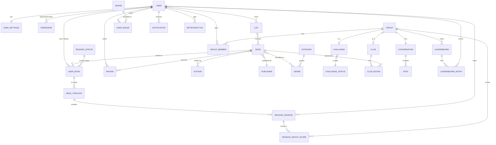
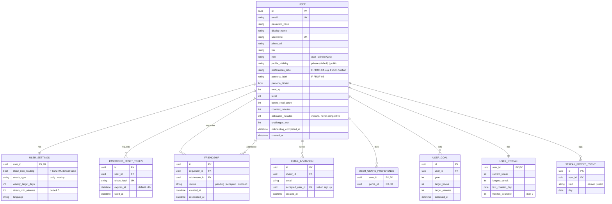
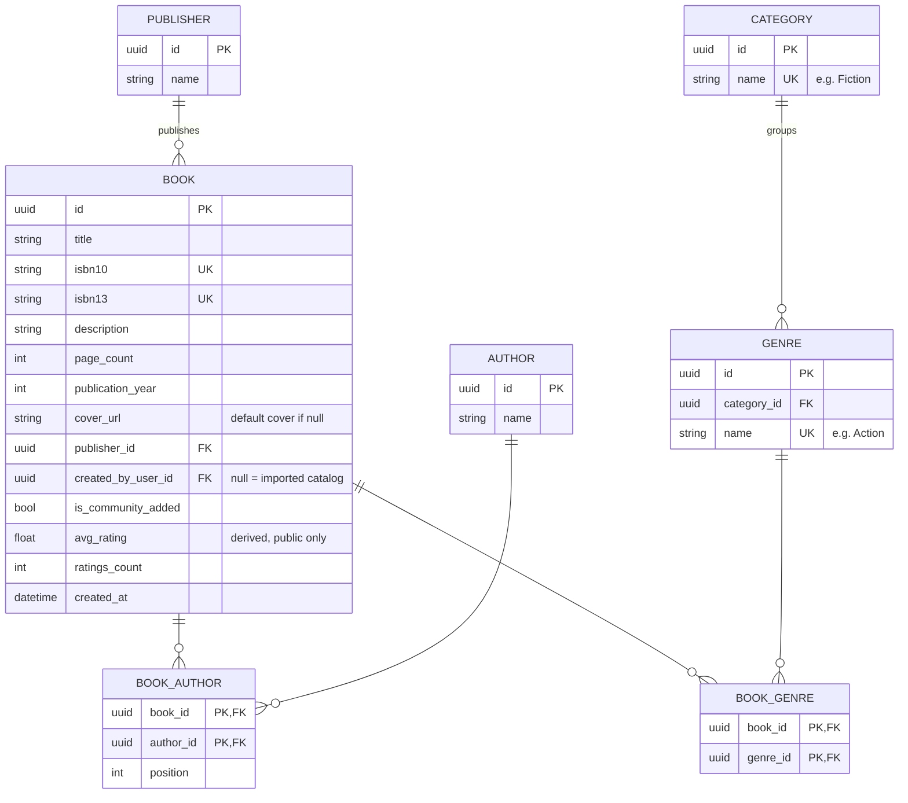
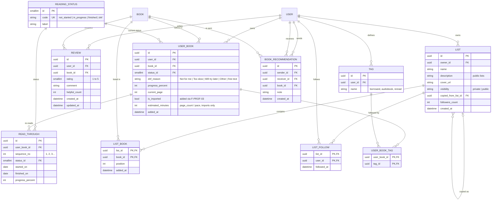
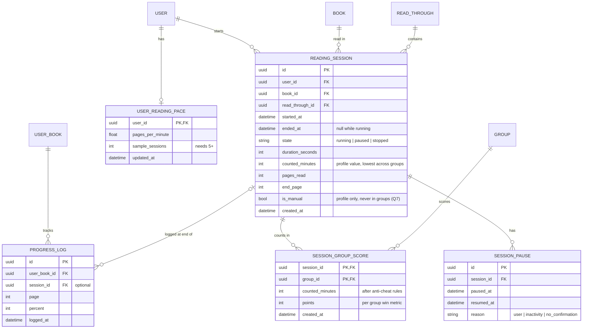
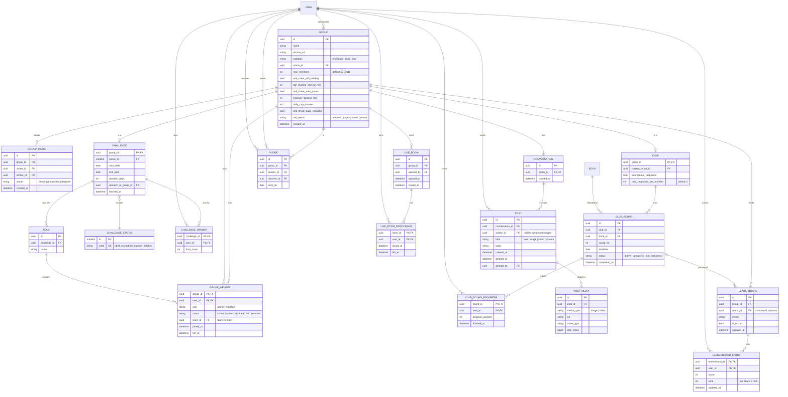
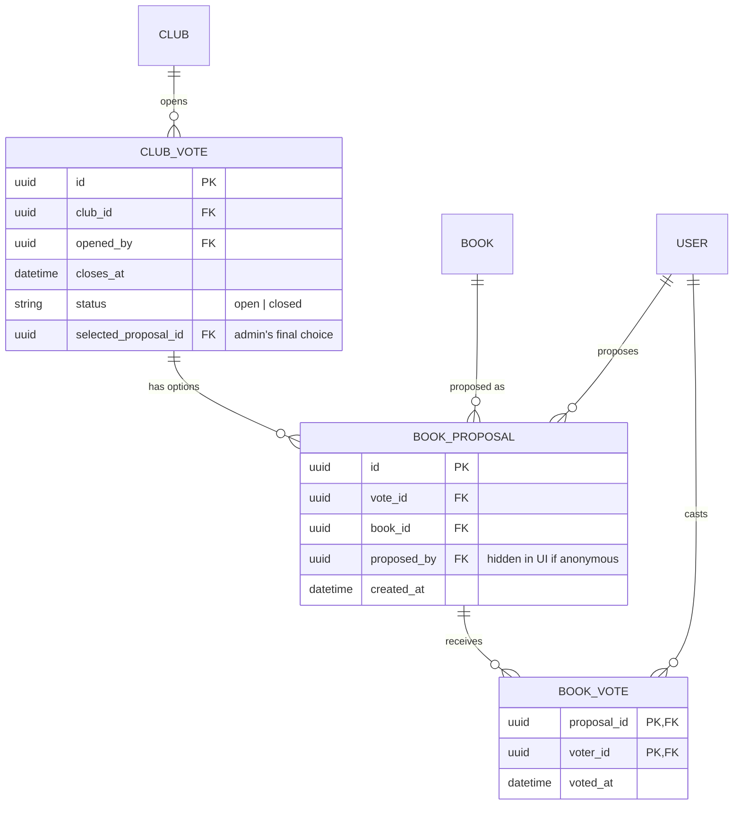
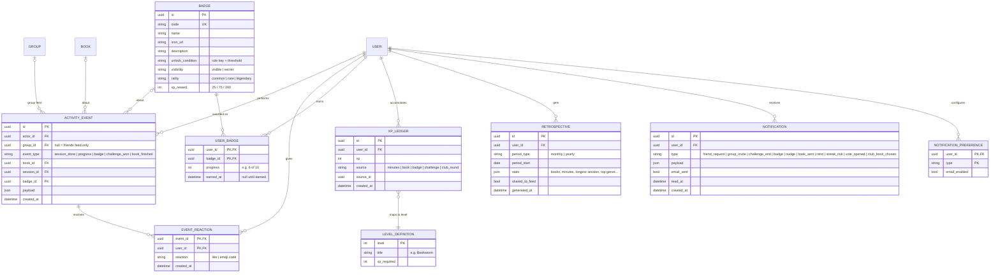

# LES: Database tables UML (v1.0)

Derived from `LES-UML.drawio` (17 skeleton classes, no relationships) and the product requirements v1.1.

**Drawio classes kept:** Book, User, Club, Review, Challenge, Conversation, List, ReadingStatus, Post, Leaderboard, LeaderboardEntry, ChallengeStatus, Genre, Author, Publisher, Category, ReadingSession.

**Added** to cover the requirements: friendships, library entries, read-throughs, folders/tags, streaks, goals, group members, anti-cheat, voting, badges, XP, notifications, retrospectives, etc.

**Mapping decisions**
- `ReadingStatus` is a lookup table of statuses (`not_started`, `in_progress`, `finished`, `dnf`). The per-user status lives in `user_books.status_id`.
- `Club` and `Challenge` are subtypes of a shared `groups` table (1:1 each), because both share membership, chat and leaderboard (F-GRP-01).
- `ChallengeStatus` is a lookup table (`draft`, `scheduled`, `active`, `finished`), from the lifecycle in F-GRP-04.
- `List` is the folder/shelf (F-LIB-03) and also the public curated list (F-EXP-05). Both are the same table with a visibility flag.
- `Category` is the parent of `Genre` (e.g. Category "Fiction", Genre "Action").
- `Conversation` is the group chat (1:1 with a group). `Post` is a chat message with optional media.

Legend: `PK` primary key, `FK` foreign key, `UK` unique. Cardinality uses crow's foot notation (`||` exactly one, `o|` zero or one, `}o` zero or many, `}|` one or many).

---

## 0. Overview (entities and relationships only)

---

## 1. Identity, settings and social graph

Notes
- `FRIENDSHIP` is unique on the unordered pair (requester, addressee). Only `accepted` rows make a mutual friendship.
- `books_read_count`, `counted_minutes`, `estimated_minutes`, `total_xp`, `level` are denormalized profile counters (F-PROF-01, F-GAM-03).

---

## 2. Catalog (Book, Author, Publisher, Genre, Category)

Notes
- `BOOK_AUTHOR` and `BOOK_GENRE` resolve the many-to-many relations (a book has several authors/genres).
- Only `title` is required (F-BOOK-02). The duplicate warning is application logic on title plus author similarity.

---

## 3. Library, reviews, folders and tags

Notes
- Unique constraints: `USER_BOOK (user_id, book_id)` ("exactly one current status per user", F-LIB-01), `REVIEW (user_id, book_id)`, `READ_THROUGH (user_book_id, sequence_no)`.
- "Books read" counts each finished `READ_THROUGH` (F-LIB-05). The book page shows "Read N times" from the same table.
- A review counts in the public average only if the author's profile is public (Q4). This is a query filter, not a column.
- Folders (F-LIB-03) and public curated lists (F-EXP-05) share `LIST`. Copy sets `copied_from_list_id` (F-LIB-07).

---

## 4. Reading sessions, progress and anti-cheat scoring

Notes
- One active session per user: partial unique index on `READING_SESSION (user_id)` where `state in ('running','paused')`.
- `SESSION_GROUP_SCORE` is what lets one session count in several groups (Q8) while the profile receives it **once** (F-GRP-03 rule 4). Profile minutes use `READING_SESSION.counted_minutes`.
- Estimated minutes live on `USER_BOOK.estimated_minutes` and are never joined into `SESSION_GROUP_SCORE`.

---

## 5. Groups: challenges, book clubs, chat and leaderboards

Notes
- `GROUP` is the shared supertype. `CHALLENGE` and `CLUB` use `group_id` as both PK and FK (1:1 subtype). The `category` column decides which subtype row must exist.
- Anti-cheat and win metric are set at creation and frozen after start (F-GRP-01 rule 4, F-READ-03). Enforce this in the application.
- `LEADERBOARD_ENTRY.score` is the sum of `SESSION_GROUP_SCORE.points` for the user within the challenge period or club round.
- Challenge lifecycle (`CHALLENGE_STATUS`): draft, scheduled, active, finished, and rematch back to draft (a new challenge pointing to `rematch_of_group_id`).
- `NUDGE` limits (1 per sender/receiver/day, max 3 received per day) come from a unique `(sender_id, receiver_id, sent_on)` plus a count query.

---

## 6. Book club voting

Note: `proposed_by` is always stored. Anonymity is a display rule driven by `CLUB.anonymous_proposals`.

---

## 7. Social feed, gamification, retrospective and notifications

Notes
- `USER_BADGE` rows exist for visible badges from the start (to show progress, F-GAM-01 rule 2). Secret badges get a row only when earned. Badges are permanent.
- Rarity percentage (F-GAM-02) is computed: `count(earned user_badge) / count(user)`.
- `XP_LEDGER` is the audit trail. `USER.total_xp` and `USER.level` are its denormalized sum. Estimated (imported) minutes never write to it.
- Trending lists (F-EXP-04) and suggestions (F-EXP-06) are queries over `READING_SESSION`, `USER_BOOK`, `REVIEW` and `FRIENDSHIP`. They need no tables of their own.

---

## 8. Open points to confirm

1. **`READ_THROUGH` vs `USER_BOOK.status`**: `USER_BOOK.status_id` holds the current status, and each read-through also has its own status. If you prefer a simpler model, drop `READ_THROUGH.status_id` and derive it from `finished_on`.
2. **`GROUP` table name**: `GROUP` is a reserved SQL word. In the physical schema use `groups` (and `users` for `USER`).
3. **Club and Challenge as subtypes vs two separate tables**: I used subtypes to share membership, chat and leaderboard. Two independent tables would duplicate `GROUP_MEMBER`, `CONVERSATION` and `LEADERBOARD` foreign keys.
4. **Denormalized counters** on `USER` and `BOOK` (minutes, books read, average rating) are for speed. Drop them if you prefer to compute from source tables.
5. **Language (Q9)** is stored as `USER_SETTINGS.language` but is not decided yet.
