# LES: Database tables UML (v2.0, Core)

The database model for **Core**, the scope of the first iterations in [`features_priority.md`](../product/features_priority.md): library, reading sessions, streaks, friends and **challenge groups only** (book clubs come back in Extras).

- The implementation is [`apps/backend/src/database/schema.ts`](../../apps/backend/src/database/schema.ts), applied by the migrations in [`apps/backend/src/database/migrations/`](../../apps/backend/src/database/migrations/). Change this document and the schema together.
- The domain classes behind these tables, with their behaviour, are in the [domain class diagram](class_diagram.md).
- v1.0 of this document (the full model for every feature, 40+ tables) is in the git history. The [deferred tables](#deferred-to-extras) section says what comes back and how.

Legend: `PK` primary key, `FK` foreign key, `UK` unique. Cardinality uses crow's foot notation (`||` exactly one, `o|` zero or one, `}o` zero or many).

---

## Modelling rules

These apply to every table. They come from the v1.0 review (PR #75 and the feedback on it).

1. **Singular table names**: `user`, `book`, `review`. `user` is a reserved word in PostgreSQL. Drizzle quotes it, but in raw SQL write `"user"` (unquoted, `SELECT * FROM user` returns the current database role).
2. **A foreign key to a user is `user_id`.** When a table has two, they are prefixed by role: `requester_user_id`, `addressee_user_id`. There are no `author_id`, `admin_id` or `host_id` columns.
3. **Fixed sets of values are PostgreSQL enums** (`pgEnum`), never free `varchar`. See [Enums](#enums).
4. **Timestamps**: every table has `created_at`. Tables whose rows change have `updated_at`. Tables whose rows can be deleted by a user and must keep history (`challenge_group`, `conversation`, `message`, `review`, `list`) have `deleted_at` (soft delete). Queries filter `deleted_at IS NULL`.
5. **Store facts, compute numbers.** Streaks, minutes read, books read, challenges won and the live leaderboard are computed from `reading_session`, `reading_status` and `leaderboard_entry`. No counters on `user`.
6. **Identity is owned by Supabase Auth.** `user.id` is the Supabase user id. Passwords, sessions and reset tokens are not in our tables ([infra.md](infra.md)).

## Overview

```mermaid
erDiagram
    USER ||--o{ FRIENDSHIP : "requests"
    USER ||--o{ FRIENDSHIP : "receives"
    USER ||--o{ READING_STATUS : "has in library"
    BOOK ||--o{ READING_STATUS : "saved as"
    USER ||--o{ REVIEW : writes
    BOOK ||--o{ REVIEW : receives
    USER ||--o{ LIST : owns
    LIST ||--o{ LIST_BOOK : contains
    BOOK ||--o{ LIST_BOOK : "listed in"
    BOOK ||--o{ BOOK_AUTHOR : ""
    AUTHOR ||--o{ BOOK_AUTHOR : ""
    GENRE |o--o{ BOOK : classifies
    USER ||--o{ READING_SESSION : runs
    BOOK ||--o{ READING_SESSION : "read in"
    CHALLENGE_GROUP ||--o{ GROUP_MEMBER : has
    USER ||--o{ GROUP_MEMBER : joins
    CHALLENGE_GROUP ||--|| CONVERSATION : has
    CONVERSATION ||--o{ MESSAGE : contains
    USER ||--o{ MESSAGE : writes
    CHALLENGE_GROUP ||--o{ LEADERBOARD_ENTRY : "final standings"
    USER ||--o{ LEADERBOARD_ENTRY : ranks

    USER {
        uuid id PK "Supabase Auth id"
        varchar email UK
        varchar username UK
        varchar display_name
        text photo_url
        text profile_description
        varchar timezone "IANA name"
        visibility profile_visibility
        timestamptz created_at
        timestamptz updated_at
    }
    FRIENDSHIP {
        uuid id PK
        uuid requester_user_id FK
        uuid addressee_user_id FK
        friendship_status status
        timestamptz created_at
        timestamptz responded_at
    }
    BOOK {
        uuid id PK
        text title
        text description
        varchar isbn13 UK
        int page_count
        text cover_url
        uuid genre_id FK
        bool is_community_added
        timestamptz created_at
        timestamptz updated_at
    }
    AUTHOR {
        uuid id PK
        text name
    }
    BOOK_AUTHOR {
        uuid book_id PK, FK
        uuid author_id PK, FK
    }
    GENRE {
        uuid id PK
        text name UK
    }
    READING_STATUS {
        uuid id PK
        uuid user_id FK
        uuid book_id FK
        reading_status_type status
        int current_page
        dnf_reason dnf_reason
        timestamptz finished_at
        timestamptz created_at
        timestamptz updated_at
    }
    REVIEW {
        uuid id PK
        uuid user_id FK
        uuid book_id FK
        int rating "1 to 5"
        text comment
        timestamptz created_at
        timestamptz updated_at
        timestamptz deleted_at
    }
    LIST {
        uuid id PK
        uuid user_id FK
        text name
        visibility visibility
        timestamptz created_at
        timestamptz updated_at
        timestamptz deleted_at
    }
    LIST_BOOK {
        uuid list_id PK, FK
        uuid book_id PK, FK
        timestamptz added_at
    }
    READING_SESSION {
        uuid id PK
        uuid user_id FK
        uuid book_id FK
        reading_session_status status
        timestamptz started_at
        timestamptz ended_at
        int duration_seconds
        timestamptz created_at
        timestamptz updated_at
    }
    CHALLENGE_GROUP {
        uuid id PK
        text name
        text description
        date start_date
        date end_date
        timestamptz created_at
        timestamptz updated_at
        timestamptz deleted_at
    }
    GROUP_MEMBER {
        uuid challenge_group_id PK, FK
        uuid user_id PK, FK
        group_member_role role
        group_member_status status
        timestamptz created_at
        timestamptz joined_at
        timestamptz left_at
    }
    CONVERSATION {
        uuid id PK
        uuid challenge_group_id FK, UK
        timestamptz created_at
        timestamptz updated_at
        timestamptz deleted_at
    }
    MESSAGE {
        uuid id PK
        uuid conversation_id FK
        uuid user_id FK
        text content
        timestamptz created_at
        timestamptz updated_at
        timestamptz deleted_at
    }
    LEADERBOARD_ENTRY {
        uuid id PK
        uuid challenge_group_id FK
        uuid user_id FK
        int total_minutes
        int rank "ties share a rank"
        timestamptz created_at
    }
```

---

## Identity and social graph

### user

The reader's profile. The row is created right after Supabase sign-up (`POST /me`, see [infra.md](infra.md)).

| Column | Type | Notes |
|---|---|---|
| id | uuid | PK, the Supabase Auth user id (no default) |
| email | varchar(255) | UK |
| username | varchar(50) | UK, used to send friend requests (F-SOC-01) |
| display_name | varchar(255) | |
| photo_url | text | Nullable |
| profile_description | text | Nullable. Was `bio` |
| timezone | varchar(64) | IANA name, default `Europe/Lisbon`. Decides which local day a session belongs to, so streaks ("one session of at least 5 minutes per day", F-READ-04) break at the reader's midnight, not the server's. Validated in the application against the IANA list, not an enum (about 400 values) |
| profile_visibility | `visibility` | Default `private`. Core shows profiles to friends only (F-PROF-02); the public switch is Extras |
| created_at, updated_at | timestamptz | |

No streak or counter columns: current and longest streak, minutes, books read and challenges won are computed (rule 5). `user_stats` comes back with streak freezes (Extras), which need stored state (`freezes_available`, `last_counted_day`).

### friendship

A friend request and, once accepted, the friendship (F-SOC-01).

| Column | Type | Notes |
|---|---|---|
| id | uuid | PK |
| requester_user_id | uuid | FK → user, who sent the request |
| addressee_user_id | uuid | FK → user, who received it |
| status | `friendship_status` | `pending` (default), `accepted`, `declined` |
| created_at | timestamptz | |
| responded_at | timestamptz | Nullable, set on accept or decline |

Constraints: `requester_user_id <> addressee_user_id`, and a unique index on the unordered pair (`LEAST`, `GREATEST`) so A→B and B→A cannot both exist.

---

## Catalog

### book

Catalog entry, imported from Open Library or added by a reader (F-BOOK-02).

| Column | Type | Notes |
|---|---|---|
| id | uuid | PK |
| title | text | The only required field |
| description | text | Nullable |
| isbn13 | varchar(13) | UK, nullable |
| page_count | int | Nullable |
| cover_url | text | Nullable, the UI falls back to a default cover |
| genre_id | uuid | FK → genre, nullable, `ON DELETE SET NULL`. One main genre per book |
| is_community_added | bool | Added by a reader rather than imported |
| created_at, updated_at | timestamptz | |

### genre

A fixed, seeded list (Fantasy, Romance, Sci-Fi, ...). Open Library "subjects" are mapped onto it on import and the rest is ignored.

| Column | Type | Notes |
|---|---|---|
| id | uuid | PK |
| name | text | UK |

Genre is a column on `book` (many-to-one) and not a `book_genre` join table: one main genre is enough for every planned feature (genre label F-PROF-04, trending in your genre, Genre Explorer badge). If several genres per book are needed later, create `book_genre` and copy `genre_id` into it. It is a table and not an enum so a genre is added with an insert, not a migration. `category` (a parent of genre) was dropped: nothing in Core uses it.

### author, book_author

| Table | Column | Type | Notes |
|---|---|---|---|
| author | id | uuid | PK |
| author | name | text | |
| book_author | book_id | uuid | PK, FK → book |
| book_author | author_id | uuid | PK, FK → author |

A book can have several authors, so this one stays many-to-many.

---

## Library

### reading_status

**The library.** A book saved by a reader is exactly one row here (unique `user_id, book_id`, F-LIB-01). Saving a book creates it as `not-started` ("want to read").

| Column | Type | Notes |
|---|---|---|
| id | uuid | PK |
| user_id | uuid | FK → user |
| book_id | uuid | FK → book |
| status | `reading_status_type` | `not-started` (default), `in-progress`, `finished`, `did-not-finish` |
| current_page | int | Default 0 |
| dnf_reason | `dnf_reason` | Nullable, only for `did-not-finish` (F-LIB-06) |
| finished_at | timestamptz | Nullable, set when the book is finished |
| created_at, updated_at | timestamptz | |

There is no minutes column: minutes read for a book are the sum of its `reading_session` rows.

### review

Rating and comment of a book (F-LIB-02).

| Column | Type | Notes |
|---|---|---|
| id | uuid | PK |
| user_id | uuid | FK → user |
| book_id | uuid | FK → book |
| rating | int | `CHECK (rating BETWEEN 1 AND 5)` |
| comment | text | Nullable |
| created_at, updated_at, deleted_at | timestamptz | Editable and soft-deleted |

A partial unique index on `(user_id, book_id) WHERE deleted_at IS NULL` allows one live review per reader and book, and a new one after a delete.

### list, list_book

Named collections of books ("Summer 2026", "Borrowed"), the folders of F-LIB-03. They sit **on top of** the library: the library is `reading_status`, a list only groups books. A list always belongs to one user (the v1.0 "user or group" owner is gone).

| Table | Column | Type | Notes |
|---|---|---|---|
| list | id | uuid | PK |
| list | user_id | uuid | FK → user |
| list | name | text | |
| list | visibility | `visibility` | Default `private` |
| list | created_at, updated_at, deleted_at | timestamptz | |
| list_book | list_id | uuid | PK, FK → list |
| list_book | book_id | uuid | PK, FK → book |
| list_book | added_at | timestamptz | |

---

## Reading

### reading_session

One run of the reading timer (F-READ-01). It is the single source for minutes, streaks and challenge scores.

| Column | Type | Notes |
|---|---|---|
| id | uuid | PK |
| user_id | uuid | FK → user |
| book_id | uuid | FK → book |
| status | `reading_session_status` | `running` (default), `finished` |
| started_at | timestamptz | Stored on the server, so the session survives closing the tab |
| ended_at | timestamptz | Null while running |
| duration_seconds | int | Set when the session stops |
| created_at, updated_at | timestamptz | |

Constraints and indexes:
- `CHECK`: a running session has no `ended_at`; a finished one has `ended_at >= started_at`.
- Partial unique index on `user_id WHERE status = 'running'`: one active session per user.
- Index on `(user_id, started_at)` for streak and leaderboard queries.

**No group column.** One session counts in every challenge where the reader is an `active` member and whose `start_date`–`end_date` contains the session. This replaces v1.0's `group_sessions` + `member_sessions` (a live "read together" room, F-GRP-09, Optional) and lets the same table serve challenges now and book clubs later.

---

## Challenge groups

In Core every group is a challenge (F-GRP-01 "category fixed to Challenge"), so `groups` and `challenges` are merged into `challenge_group`. When book clubs arrive they get their own `book_club` table and share `group_member`, `conversation` and `leaderboard_entry` (see [deferred](#deferred-to-extras)).

### challenge_group

| Column | Type | Notes |
|---|---|---|
| id | uuid | PK |
| name | text | |
| description | text | Nullable |
| start_date, end_date | date | `CHECK (end_date >= start_date)`. Scheduled, active or finished is computed from these dates and today, not stored (no background jobs, see [infra.md](infra.md)) |
| created_at, updated_at, deleted_at | timestamptz | A group can be deleted |

Removed from v1.0: `admin_id` (the admin is the `group_member` with role `admin`, one source of truth), `win_metric` (Core ranks by minutes; other metrics are F-GRP-05, Extras), `metric_goal` (a challenge has no target: whoever reads the most wins), and the genre/category/author filters (any book counts, F-GRP-04 rule 2).

### group_member

Membership, invitations and the admin role (F-GRP-01).

| Column | Type | Notes |
|---|---|---|
| challenge_group_id | uuid | PK, FK → challenge_group |
| user_id | uuid | PK, FK → user |
| role | `group_member_role` | `admin`, `member` (default) |
| status | `group_member_status` | `invited` (default), `active`, `declined`, `left` |
| created_at | timestamptz | When the invite was sent |
| joined_at | timestamptz | Nullable, set on accept |
| left_at | timestamptz | Nullable. A member who left keeps their history (F-GRP-01 rule 5) |

### conversation, message

The group chat (F-GRP-02), text only. A conversation is 1:1 with its group (`challenge_group_id` is unique).

| Table | Column | Type | Notes |
|---|---|---|---|
| conversation | id | uuid | PK |
| conversation | challenge_group_id | uuid | FK → challenge_group, UK |
| conversation | created_at, updated_at, deleted_at | timestamptz | `updated_at` is also the time of the last message, to sort chats |
| message | id | uuid | PK |
| message | conversation_id | uuid | FK → conversation |
| message | user_id | uuid | FK → user, the sender. Was `posts.author_id` |
| message | content | text | |
| message | created_at, updated_at, deleted_at | timestamptz | A deleted message shows as "message deleted" |

Index on `(conversation_id, created_at)` to page through a chat.

### leaderboard_entry

The **final** standings of a challenge (the leaderboard "freezes", F-GRP-04). While a challenge is running the leaderboard is a query over `reading_session` with `RANK()`, as F-GRP-03 asks ("computed from the sessions"). The first read after `end_date` stores that result here, so there is no scheduler and later session deletes cannot change a finished result.

| Column | Type | Notes |
|---|---|---|
| id | uuid | PK |
| challenge_group_id | uuid | FK → challenge_group |
| user_id | uuid | FK → user |
| total_minutes | int | Minutes read inside the challenge period |
| rank | int | Ties share a rank |
| created_at | timestamptz | When the standings were frozen |

Unique `(challenge_group_id, user_id)`. Every row with `rank = 1` is a winner, so "challenges won" is a count over this table.

---

## Enums

| Enum | Values | Used by |
|---|---|---|
| `visibility` | `private`, `public` | `user.profile_visibility`, `list.visibility` |
| `friendship_status` | `pending`, `accepted`, `declined` | `friendship.status` |
| `reading_status_type` | `not-started`, `in-progress`, `finished`, `did-not-finish` | `reading_status.status` (same values as the domain `ReadingState`) |
| `dnf_reason` | `not-for-me`, `too-slow`, `will-try-later`, `other` | `reading_status.dnf_reason` |
| `reading_session_status` | `running`, `finished` | `reading_session.status` (`paused` comes with pause and resume) |
| `group_member_role` | `admin`, `member` | `group_member.role` |
| `group_member_status` | `invited`, `active`, `declined`, `left` | `group_member.status` |

Adding a value is `ALTER TYPE ... ADD VALUE` in a migration.

---

## Deferred to Extras

Dropped by migration `0002_core_model.sql`. Each comes back with its feature, in this shape:

| Feature | Tables |
|---|---|
| Book club (F-GRP-07) | `book_club` (`challenge_group`'s sibling, or a shared `reading_group` parent with a `type` enum), `book_club_round` |
| Challenge win metrics (F-GRP-05) | `challenge_group.win_metric` enum (`minutes`, `pages`, `books_finished`, `longest_streak`), `leaderboard_entry.total_minutes` becomes `score` |
| Yearly goal (F-READ-05) | `user_reading_goal` (`user_id`, `year`, `target_books`, `target_minutes`) |
| Streak freeze, weekly streak (F-READ-04) | `user_stats` (`current_streak`, `longest_streak`, `last_counted_day`, `freezes_available`, `streak_type`) |
| Badges (F-GAM-01) | `badge`, `user_badge` |
| Notifications (F-NOT-01) | `notification` |
| Several genres per book, categories | `book_genre`, `category` (parent of `genre`) |
| Live reading rooms (F-GRP-09) | `live_room`, `live_room_participant` |
