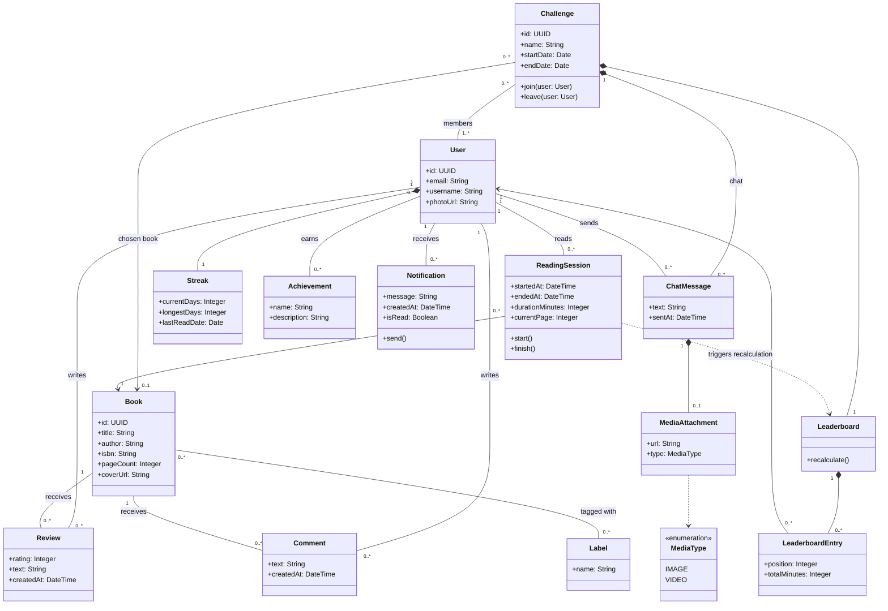
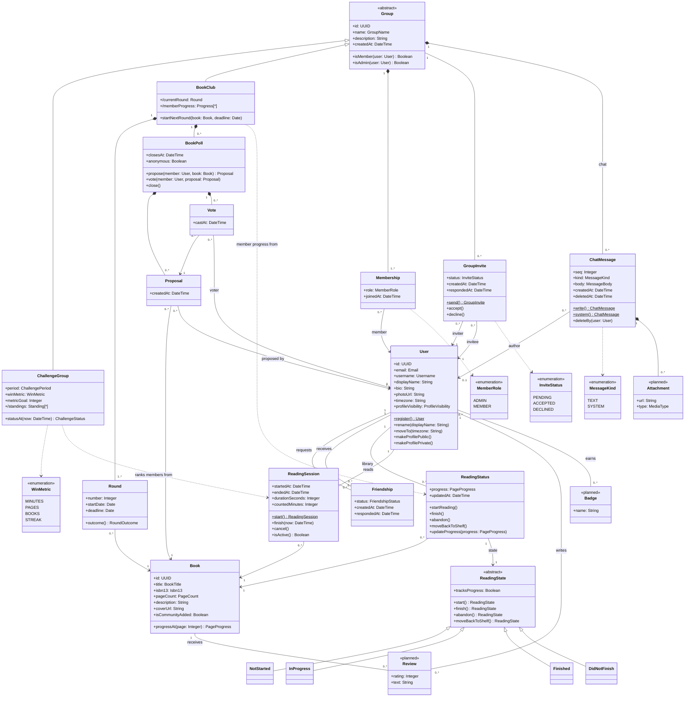
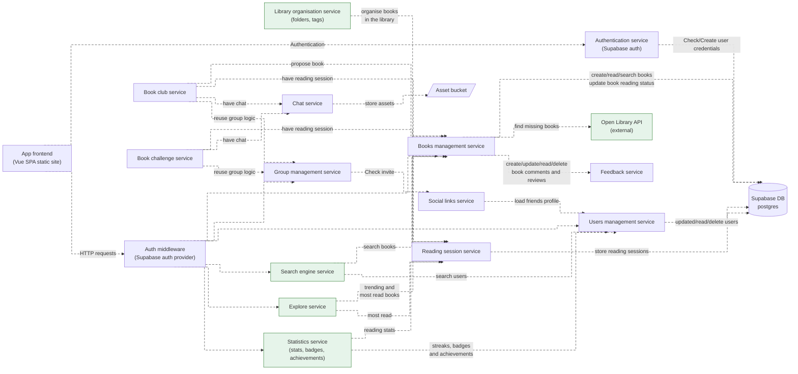

# Design

How Bookmarked is designed, and how that design changed from one iteration to the next. Each iteration has a class diagram and a component diagram, with the images in [`oop_assets/`](oop_assets/). A diagram shows the target architecture for the whole project, so it also includes components that are not built yet.

## Contents

- [Iteration 0](#iteration-0)
  - [Class diagram](#class-diagram)
  - [Component diagram](#component-diagram)
  - [Event storming](#event-storming)
- [Iteration 1](#iteration-1)
  - [Class diagram](#class-diagram-1)
  - [Component diagram](#component-diagram-1)
  - [Change analysis](#change-analysis)
- [Iteration 2](#iteration-2)
  - [Class diagram](#class-diagram-2)
  - [Component diagram](#component-diagram-2)
  - [Change analysis](#change-analysis-1)

## Iteration 0

### Class diagram

The domain model of the first plan, drawn from the [iteration 0 component diagram](#component-diagram). It shows the concepts the product talks about and how they relate, not the code. PNG: [`class_diagram_iteration_0.png`](oop_assets/class_diagram_iteration_0.png).

- A **Challenge** is the only kind of group. It holds its members, its chat and a stored **Leaderboard**.
- A **ReadingSession** stores the current page as well as the time, and finishing one triggers a leaderboard recalculation.
- **Streak**, **Achievement** and **Notification** are stored per user and kept up to date as the reader reads.
- **Review**, **Comment** and **Label** are the feedback on a book. A chat message can carry one photo or video.

### Component diagram

The first design, made in the first week of the project, before any code was written.

| Component | Responsibility |
|---|---|
| **App frontend** | The web app the reader uses. It calls the Authentication service on the login page and the backend services for everything else. |
| **Authentication service** | An external service, Supabase Auth. It creates user accounts, logs users in and authenticates every route that needs a signed-in user. |
| **Database** | One central PostgreSQL database hosted on Supabase. It holds the authentication tables and the application tables. |
| **Books management service** | CRUD for books: get a book from the external book API or the database, create a book when it is not in either (any reader), and update or delete book metadata (admin only). |
| **Search engine service** | Looks up books and user profiles. A result opens the book's details or the user's profile. Book searches go through the Books management service. |
| **Feedback service** | Saves book reviews, comments and labels. |
| **Challenge management service** | Creates reading challenges: friendly competitions where friends see who reads more within a time window. Each challenge has a group chat. |
| **Chat service** | Stores each group's message history. Photos and videos are uploaded to object storage (a bucket), and their link is saved with the message. |
| **Reading session service** | Times a reading session for the book the reader chose. When a session ends, it triggers the leaderboard update. |
| **Leaderboard sync service** | Recalculates the challenge leaderboard: the total minutes each member has read since the challenge started. |
| **Gamification component** | Takes the minutes of each reading session, records the days the reader read, and keeps the streaks, achievements and challenges won. |
| **Notification service** | Sends notifications for every component that needs one: joining a challenge, a leaderboard change, a broken streak or a completed achievement. |

### Event storming

The event flow of the app: actors (small yellow), commands (blue), domain events (orange), policies (pink) and external systems (red), split into subdomains (red boxes). The large yellow stickies are the aggregates.

| Subdomain | Aggregates |
|---|---|
| **Authentication** | User Account |
| **Search engine** | Book |
| **Group Sessions** | Book Challenge, Reading Session |
| **Chat** | Chat Message |
| **Library** | Review, Reading Status |
| **Profile** | None yet (streaks and badges come from policies) |

## Iteration 1

### Class diagram

The domain model after the first release, following the [iteration 1 component diagram](#component-diagram-1). Classes marked «planned» are part of the design but not built yet. PNG: [`class_diagram_iteration_1.png`](oop_assets/class_diagram_iteration_1.png).

#### What changed from iteration 0

- **Group is an abstract class with two subclasses (generalization).** **ChallengeGroup** (competitive: a period, a win metric and a goal) and **BookClub** (cooperative: rounds and polls) both inherit the name, description, members and admin rules from **Group**. Group also owns what both kinds share: the **Membership** list (with a role, admin or member), the **GroupInvite**s and the **ChatMessage**s.
- **Membership** replaces the direct link between User and Challenge, because a member now has a role and a join date.
- **The leaderboard is a derived attribute** (`/standings`), not a stored class. The challenge works it out from its members' reading sessions when it is read, so Leaderboard and LeaderboardEntry are gone. A book club's `/memberProgress` is derived the same way from reading statuses.
- **ReadingStatus (new)** is a reader's entry for one book in their library, with the current page. Its status uses the **State pattern**: the abstract **ReadingState** with the subclasses NotStarted, InProgress, Finished and DidNotFinish, each deciding which changes are allowed. The current page moved here from ReadingSession, which now only stores the time read.
- **BookClub** is composed of **Round**s (each with a book and a deadline) and **BookPoll**s, which are composed of **Proposal**s and **Vote**s.
- **Friendship (new)** links two users, the requester and the addressee. Groups use it to check that invites go only to friends.
- **ChatMessage** now has a kind (text or system), so the group can post messages such as "X joined the group".
- **Streak, Achievement and Notification were removed** from the model: streaks will be worked out from reading sessions when read ([infra.md](architecture/infra.md)), and Badge and Review stay as «planned».

### Component diagram

The design updated to what was learned while building the first release (`iter-1`).

#### What changed from iteration 0

- **Auth middleware (new).** The backend now has one entry point for authentication. Every HTTP request carries the reader's Supabase token (JWT). The middleware verifies it with Supabase's public keys (JWKS) and loads the reader's profile from the Users management service before the request reaches any other service. The frontend still signs up and logs in directly with Supabase Auth.
- **Users management service (new).** Owns the reader's profile: creating it after sign-up (username, display name, timezone), reading and updating it, and later the reader's stats and badges. Supabase Auth only knows the email and password; everything else about the user lives in our own `users` table, which uses the same id as the Supabase account.
- **Social links service (new).** Owns friendships: friend requests and each reader's list of friends. Groups use it to check that a reader only invites friends.
- **Group management service (new).** Holds what reading challenges and book clubs have in common: members, admins and invites. When an invite is accepted, the new member joins the group, the chat posts "X joined the group", and in a book club the current book is added to the member's library.
- **Book club service (new).** A second kind of group. A challenge is competitive: friends race to read the most. A book club is cooperative: everyone reads the same book. The club works in rounds, each with a book and a deadline, and members choose the next book with a poll (propose a book, then vote). The club page shows each member's progress on the current book.
- **Challenge management → Book challenge service.** Now only handles reading challenges: dates, the win metric, the goal and the leaderboard. Book clubs moved to their own service, and membership and invites moved to Group management.
- **Leaderboard sync service removed.** Nothing is recalculated when a session ends. The Book challenge service works out the leaderboard from the members' reading sessions each time someone opens the challenge, and the Book club service does the same for member progress. There is no stored leaderboard to keep in sync.
- **Search engine service removed.** Book search is part of the Books management service. User search will belong to the Users management service.
- **Books management service** also keeps each reader's library: the reading status of each book (not started, in progress, finished or did not finish) and the current page.
- **Chat service** is shared by both kinds of group. Messages are sent and loaded over HTTP, and new messages are pushed live to members who have the group open (Socket.IO). Group management, Book club and Book challenge post system messages in it, such as "X joined the group".
- **Reading session service** is shared too. It only stores when a session started and ended and how long it lasted, timed on the server so a session survives a closed tab. Book club and Book challenge read these sessions to rank or follow their members.
- **Gamification and Notification** are not in this diagram yet. Following the decision in [infra.md](architecture/infra.md), streaks and stats will be worked out from the reading sessions when they are read, not stored and updated by a background job.

### Change analysis

The change scenario for this iteration is **adding book clubs** next to reading challenges. The full analysis is in [`oop_assets/change_analysis_iteration_1.md`](oop_assets/change_analysis_iteration_1.md): the scenario, a coupling analysis using the Balanced Coupling model ([modularity skill](https://github.com/vladikk/modularity)), a cohesion analysis, the options considered, and the decision. The decision is a shared `Group` kernel (membership, roles, the member-joined event), with `ChallengeGroup` and `BookClub` as specialisations in their own modules.

## Iteration 2

### Class diagram

The domain model at the end of iteration 2 (`iter-2`), following the [iteration 2 component diagram](#component-diagram-2). Classes marked «planned» are part of the design but not built yet.

#### What changed from iteration 1

- **Library organisation (new).** A reader owns **Folder**s (private, name unique ignoring case, a book can be in several) and **Tag**s (free text, lower case, created on first use and deleted when no book has them). Both can only hold books that are already in the reader's library.
- **Review is built.** It leaves the «planned» list: a **Rating** from 1 to 5 plus an optional **ReviewComment**, one review per reader and book, allowed only when the book's `ReadingState` has `allowsReview` (In progress, Finished, Did not finish).
- **Book has Authors and an outside catalogue.** `Book` is linked to one or more **Author**s (unique ignoring case and accents). The **BookCatalog** interface, with the **OpenLibraryCatalog** adapter, is how books missing from our database are found and imported by ISBN-13.
- **ReadingStatus has dates.** `startedOn` and `finishedOn` are stored, and `setDates` edits them.
- **User has a streak.** `currentStreak`, `longestStreak` and `lastReadDate`, updated by `recordReadingDay`. A finished session of 5+ counted minutes, or 5+ pages of progress on a book in progress, or finishing a book counts as a reading day (the two dashed links from ReadingSession and ReadingStatus to User).
- **Group can be left.** `requireCanLeave` keeps the admin from leaving while others remain. `Group` also stores its `kind` (challenge or book club).
- **Domain events (Observer).** **SessionCompleted** is published when a session finishes and **MemberJoined** when an invite is accepted. SessionCompleted has no listener yet.
- **Badges (planned).** **Badge**, **BadgeAward** and a **BadgeRule** per badge (ThousandMinutes, WeekWarrior and Marathon first) react to SessionCompleted, MemberJoined and the new planned event **StreakExtended**, and publish **BadgeEarned**. This is the decision of the [change analysis](#change-analysis-1).

### Component diagram

The architecture at the end of iteration 2. It keeps the simple style of the [iteration 1 component diagram](#component-diagram-1) and adds the new services, shown in green. All services in the diagram are built.

Mermaid source of the component diagram

#### What changed from iteration 1

- **Search engine service (new).** One place to search: it finds books through Books management and users through Users management.
- **Explore service (new).** Trending and most-read books, built from Books management and the reading sessions.
- **Statistics service (new).** Reading stats, streaks, badges and achievements. It reads the reading sessions and saves the results on the user.
- **Library organisation service (new).** Folders and tags to organise the books in a reader's library.
- **Open Library API (new, external).** Books management asks it for books that are not in our database.
- The middleware now also routes requests to the Search engine, Explore and Statistics services. The rest of the iteration 1 services and links are unchanged.

### Change analysis

The change scenario for this iteration is **adding reader badges** (and, after them, notifications and the feed). The full analysis is in [`oop_assets/change_anaysis_iteration_2.md`](oop_assets/change_anaysis_iteration_2.md): the scenario and its context, the coupling and cohesion analysis with strength, distance and volatility, the options considered, and the decision. The decision is a **Badge module that subscribes to events** (`SessionCompleted`, `MemberJoined` and one new `StreakExtended`) and publishes `BadgeEarned`, while the streak stays a direct call for now. The analysis for the previous scenario (book clubs, iteration 1) is in [`oop_assets/change_analysis_iteration_1.md`](oop_assets/change_analysis_iteration_1.md).