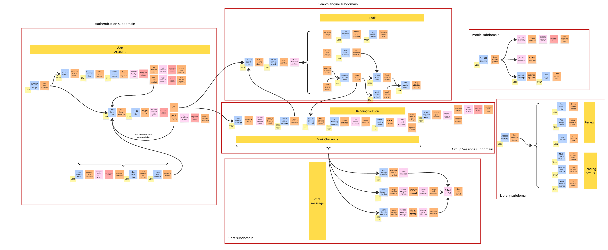
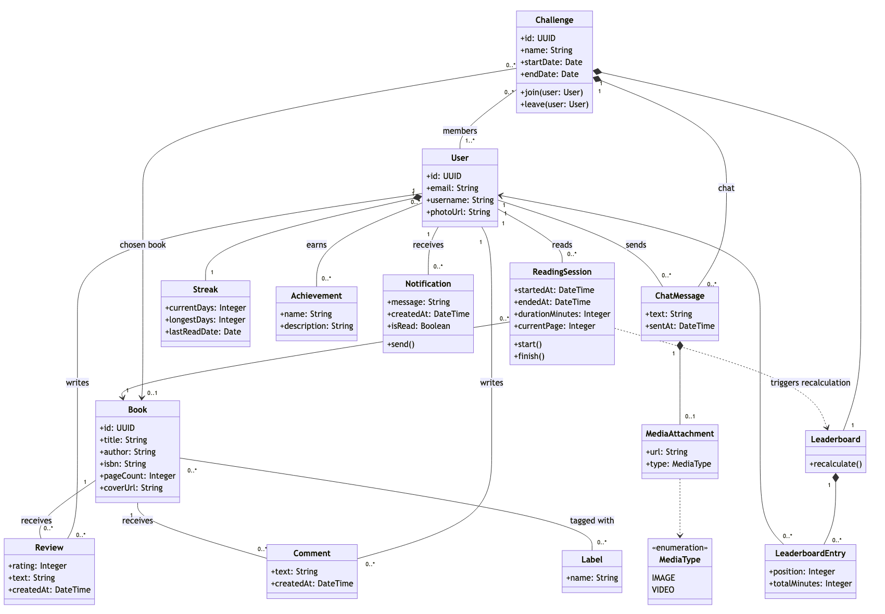
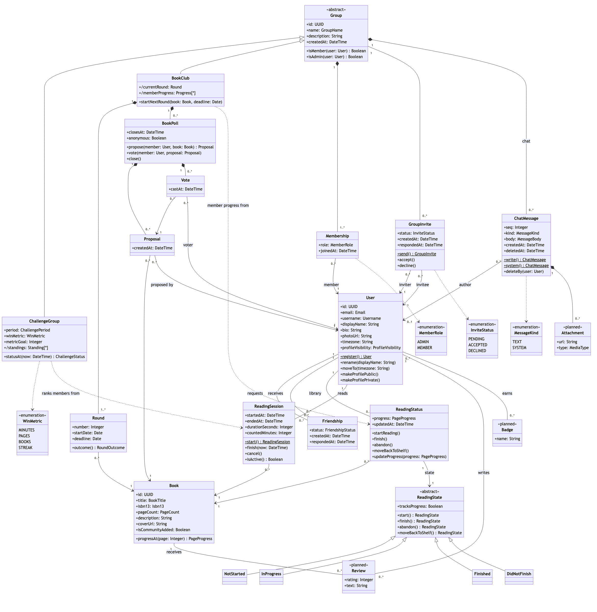
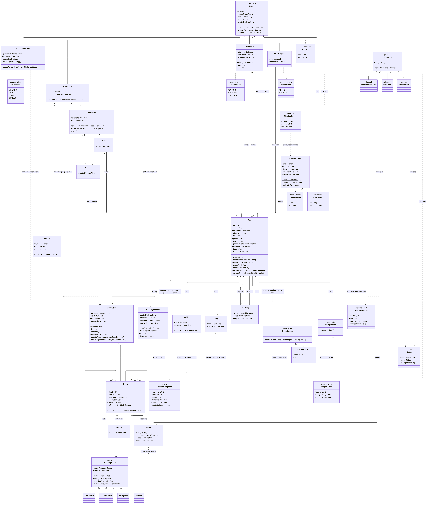

# Design Report — Bookmarked

How Bookmarked is designed, and how that design changed from one iteration to the next. The diagrams are in [`oop_assets/`](oop_assets/). A diagram shows the target architecture for the whole project, so it can include components that are not built yet.

## Contents

1. [Project overview](#1-project-overview)
2. [Domain discovery and modeling](#2-domain-discovery-and-modeling)
   - [2.1. EventStorming results](#21-eventstorming-results)
   - [2.2. Domain model](#22-domain-model)
3. [High-level architecture](#3-high-level-architecture)
4. [Future change scenarios: coupling, cohesion, and design decisions](#4-future-change-scenarios-coupling-cohesion-and-design-decisions)
   - [4.1. Scenario 1 — Adding book clubs (Iteration 1)](#41-scenario-1--adding-book-clubs-iteration-1)
   - [4.2. Scenario 2 — Adding reader badges (Iteration 2)](#42-scenario-2--adding-reader-badges-iteration-2)
5. [Existing design pattern instances](#5-existing-design-pattern-instances)
   - [5.1. Reading status transitions — State](#51-reading-status-transitions--state)
   - [5.2. Reacting to domain events — Observer](#52-reacting-to-domain-events--observer)
   - [5.3. Finding books outside our database — Adapter (port)](#53-finding-books-outside-our-database--adapter-port)
6. [Existing code smells and possible refactorings](#6-existing-code-smells-and-possible-refactorings)
   - [6.1. Shotgun surgery: the streak rules](#61-shotgun-surgery-the-streak-rules)

## 1. Project overview

Bookmarked is a web app that helps readers build a lasting reading habit, with friends and groups keeping each other reading. Readers time their reading sessions, keep streaks and a personal library (status, reviews, folders and tags), add friends, and join groups that run reading **challenges** (compete to read the most) and **book clubs** (read the same book together). See the [product vision](iterations/0/Vision.md) and the [requirements](requirements/requirements.md).

Technically it is a Vue single-page app and one Express backend (TypeScript), with Supabase for authentication and the Postgres database. The backend is organised in one module per feature under [`apps/backend/src/features/`](../apps/backend/src/features/).

## 2. Domain discovery and modeling

### 2.1. EventStorming results

The event flow of the app: actors (small yellow), commands (blue), domain events (orange), policies (pink) and external systems (red), split into subdomains (red boxes). The large yellow stickies are the aggregates.

| Subdomain | Aggregates |
|---|---|
| **Authentication** | User Account |
| **Search engine** | Book |
| **Group Sessions** | Book Challenge, Reading Session |
| **Chat** | Chat Message |
| **Library** | Review, Reading Status |
| **Profile** | None yet (streaks and badges come from policies) |

### 2.2. Domain model

#### 2.2.1. Iteration 0

The domain model of the first plan, drawn from the [iteration 0 component diagram](#31-iteration-0). It shows the concepts the product talks about and how they relate, not the code.

- A **Challenge** is the only kind of group. It holds its members, its chat and a stored **Leaderboard**.
- A **ReadingSession** stores the current page as well as the time, and finishing one triggers a leaderboard recalculation.
- **Streak**, **Achievement** and **Notification** are stored per user and kept up to date as the reader reads.
- **Review**, **Comment** and **Label** are the feedback on a book. A chat message can carry one photo or video.

#### 2.2.2. Iteration 1

The domain model after the first release, following the [iteration 1 component diagram](#32-iteration-1). Classes marked «planned» are part of the design but not built yet.

##### What changed from iteration 0

- **Group is an abstract class with two subclasses (generalization).** **ChallengeGroup** (competitive: a period, a win metric and a goal) and **BookClub** (cooperative: rounds and polls) both inherit the name, description, members and admin rules from **Group**. Group also owns what both kinds share: the **Membership** list (with a role, admin or member), the **GroupInvite**s and the **ChatMessage**s.
- **Membership** replaces the direct link between User and Challenge, because a member now has a role and a join date.
- **The leaderboard is a derived attribute** (`/standings`), not a stored class. The challenge works it out from its members' reading sessions when it is read, so Leaderboard and LeaderboardEntry are gone. A book club's `/memberProgress` is derived the same way from reading statuses.
- **ReadingStatus (new)** is a reader's entry for one book in their library, with the current page. Its status uses the **State pattern**: the abstract **ReadingState** with the subclasses NotStarted, InProgress, Finished and DidNotFinish, each deciding which changes are allowed. The current page moved here from ReadingSession, which now only stores the time read.
- **BookClub** is composed of **Round**s (each with a book and a deadline) and **BookPoll**s, which are composed of **Proposal**s and **Vote**s.
- **Friendship (new)** links two users, the requester and the addressee. Groups use it to check that invites go only to friends.
- **ChatMessage** now has a kind (text or system), so the group can post messages such as "X joined the group".
- **Streak, Achievement and Notification were removed** from the model: streaks will be worked out from reading sessions when read ([infra.md](architecture/infra.md)), and Badge and Review stay as «planned».

#### 2.2.3. Iteration 2

The domain model at the end of iteration 2 (`iter-2`), following the [iteration 2 component diagram](#33-iteration-2). Classes marked «planned» are part of the design but not built yet.

##### What changed from iteration 1

- **Library organisation (new).** A reader owns **Folder**s (private, name unique ignoring case, a book can be in several) and **Tag**s (free text, lower case, created on first use and deleted when no book has them). Both can only hold books that are already in the reader's library.
- **Review is built.** It leaves the «planned» list: a **Rating** from 1 to 5 plus an optional **ReviewComment**, one review per reader and book, allowed only when the book's `ReadingState` has `allowsReview` (In progress, Finished, Did not finish).
- **Book has Authors and an outside catalogue.** `Book` is linked to one or more **Author**s (unique ignoring case and accents). The **BookCatalog** interface, with the **OpenLibraryCatalog** adapter, is how books missing from our database are found and imported by ISBN-13.
- **ReadingStatus has dates.** `startedOn` and `finishedOn` are stored, and `setDates` edits them.
- **User has a streak.** `currentStreak`, `longestStreak` and `lastReadDate`, updated by `recordReadingDay`. A finished session of 5+ counted minutes, or 5+ pages of progress on a book in progress, or finishing a book counts as a reading day (the two dashed links from ReadingSession and ReadingStatus to User).
- **Group can be left.** `requireCanLeave` keeps the admin from leaving while others remain. `Group` also stores its `kind` (challenge or book club).
- **Domain events (Observer).** **SessionCompleted** is published when a session finishes and **MemberJoined** when an invite is accepted. SessionCompleted has no listener yet.
- **Badges (planned).** **Badge**, **BadgeAward** and a **BadgeRule** per badge (ThousandMinutes, WeekWarrior and Marathon first) react to SessionCompleted, MemberJoined and the new planned event **StreakExtended**, and publish **BadgeEarned**. This is the decision of the [change analysis](#42-scenario-2--adding-reader-badges-iteration-2).

## 3. High-level architecture

### 3.1. Iteration 0

The first design, made in the first week of the project, before any code was written.

| Component | Responsibility |
|---|---|
| **App frontend** | The web app the reader uses. It calls the Authentication service on the login page and the backend services for everything else. |
| **Authentication service** | An external service, Supabase Auth. It creates user accounts, logs users in and authenticates every route that needs a signed-in user. |
| **Database** | One central PostgreSQL database hosted on Supabase. It holds the authentication tables and the application tables. |
| **Books management service** | CRUD for books: get a book from the external book API or the database, create a book when it is not in either (any reader), and update or delete book metadata (admin only). |
| **Search engine service** | Looks up books and user profiles. A result opens the book's details or the user's profile. Book searches go through the Books management service. |
| **Feedback service** | Saves book reviews, comments and labels. |
| **Challenge management service** | Creates reading challenges: friendly competitions where friends see who reads more within a time window. Each challenge has a group chat. |
| **Chat service** | Stores each group's message history. Photos and videos are uploaded to object storage (a bucket), and their link is saved with the message. |
| **Reading session service** | Times a reading session for the book the reader chose. When a session ends, it triggers the leaderboard update. |
| **Leaderboard sync service** | Recalculates the challenge leaderboard: the total minutes each member has read since the challenge started. |
| **Gamification component** | Takes the minutes of each reading session, records the days the reader read, and keeps the streaks, achievements and challenges won. |
| **Notification service** | Sends notifications for every component that needs one: joining a challenge, a leaderboard change, a broken streak or a completed achievement. |

### 3.2. Iteration 1

The design updated to what was learned while building the first release (`iter-1`).

#### What changed from iteration 0

- **Auth middleware (new).** The backend now has one entry point for authentication. Every HTTP request carries the reader's Supabase token (JWT). The middleware verifies it with Supabase's public keys (JWKS) and loads the reader's profile from the Users management service before the request reaches any other service. The frontend still signs up and logs in directly with Supabase Auth.
- **Users management service (new).** Owns the reader's profile: creating it after sign-up (username, display name, timezone), reading and updating it, and later the reader's stats and badges. Supabase Auth only knows the email and password; everything else about the user lives in our own `users` table, which uses the same id as the Supabase account.
- **Social links service (new).** Owns friendships: friend requests and each reader's list of friends. Groups use it to check that a reader only invites friends.
- **Group management service (new).** Holds what reading challenges and book clubs have in common: members, admins and invites. When an invite is accepted, the new member joins the group, the chat posts "X joined the group", and in a book club the current book is added to the member's library.
- **Book club service (new).** A second kind of group. A challenge is competitive: friends race to read the most. A book club is cooperative: everyone reads the same book. The club works in rounds, each with a book and a deadline, and members choose the next book with a poll (propose a book, then vote). The club page shows each member's progress on the current book.
- **Challenge management → Book challenge service.** Now only handles reading challenges: dates, the win metric, the goal and the leaderboard. Book clubs moved to their own service, and membership and invites moved to Group management.
- **Leaderboard sync service removed.** Nothing is recalculated when a session ends. The Book challenge service works out the leaderboard from the members' reading sessions each time someone opens the challenge, and the Book club service does the same for member progress. There is no stored leaderboard to keep in sync.
- **Search engine service removed.** Book search is part of the Books management service. User search will belong to the Users management service.
- **Books management service** also keeps each reader's library: the reading status of each book (not started, in progress, finished or did not finish) and the current page.
- **Chat service** is shared by both kinds of group. Messages are sent and loaded over HTTP, and new messages are pushed live to members who have the group open (Socket.IO). Group management, Book club and Book challenge post system messages in it, such as "X joined the group".
- **Reading session service** is shared too. It only stores when a session started and ended and how long it lasted, timed on the server so a session survives a closed tab. Book club and Book challenge read these sessions to rank or follow their members.
- **Gamification and Notification** are not in this diagram yet. Following the decision in [infra.md](architecture/infra.md), streaks and stats will be worked out from the reading sessions when they are read, not stored and updated by a background job.

### 3.3. Iteration 2

The architecture at the end of iteration 2. It keeps the simple style of the [iteration 1 component diagram](#32-iteration-1) and adds the new services, shown in green. All services in the diagram are built.

#### What changed from iteration 1

- **Search engine service (new).** One place to search: it finds books through Books management and users through Users management.
- **Explore service (new).** Trending and most-read books, built from Books management and the reading sessions.
- **Statistics service (new).** Reading stats, streaks, badges and achievements. It reads the reading sessions and saves the results on the user.
- **Library organisation service (new).** Folders and tags to organise the books in a reader's library.
- **Open Library API (new, external).** Books management asks it for books that are not in our database.
- **Every service is reached through the auth middleware.** In iteration 1 only three services had an arrow from it; now every service the frontend calls has one.
- **Feedback depends on Books management, not the other way round.** A review is about a book, so the Feedback service asks Books management for the book and stores the reviews itself. In iteration 1 the arrow pointed from Books management to Feedback.
- **Arrows follow UML 2.** Every link is a dependency: a dashed arrow from the component that uses something to the component it uses.
- The rest of the iteration 1 services and links are unchanged.

#### Why we moved from draw.io to Mermaid

The iteration 0 and 1 component diagrams were drawn in draw.io. From iteration 2 the diagram is written in Mermaid and the PNG is generated from it. Mermaid is text, so it is easier to change, and a change shows up as a normal diff in a pull request, which makes it easier to review. The layout is done automatically, so adding a service does not mean moving boxes by hand.

## 4. Future change scenarios: coupling, cohesion, and design decisions

### 4.1. Scenario 1 — Adding book clubs (Iteration 1)

Full analysis: [`change_analysis_iteration_1.md`](oop_assets/change_analysis_iteration_1.md).

#### Change scenario and design context

At the start of iteration 1 the only kind of group was the reading challenge, where friends compete to read the most. The product also needed **book clubs**, where members read the same book together in rounds, propose and vote for the next book, and follow each other's progress. The question was how to add them without breaking challenges and without copying code.

#### Coupling and cohesion analysis

Using the Balanced Coupling model (strength, distance, volatility), splitting the old Challenge Management module made the links between modules **weaker**: book clubs share only the small, stable membership classes, the chat is reached through one method (`postSystem`), Reading session no longer triggers the leaderboard, and joining a group became a small `MemberJoined` event. Cohesion went up, because each module now holds one kind of rule. The one weak point was the "which minutes count" rule, repeated in three modules; it was moved back into Reading session with `ReadingActivityQuery.countedMinutes` ([PR #128](https://github.com/MESW-LES-2627/les-project-group-6/pull/128)).

#### Alternatives, decision, and consequences

**Decision:** a small shared `Group` module and one module per kind of group (`ChallengeGroup`, `BookClub`); in the class diagram `Group` is an abstract class with two subclasses. Rejected: copying the challenge code (every membership rule changes twice), one class with a `type` flag (rules of both kinds mixed), and Book club depending on Challenge group (clubs break when challenges change). **Consequence:** a third kind of group is a new module, not an edit to the old ones (open/closed); challenges did not change when clubs were added (PR #112).

### 4.2. Scenario 2 — Adding reader badges (Iteration 2)

Full analysis: [`change_anaysis_iteration_2.md`](oop_assets/change_anaysis_iteration_2.md).

#### Change scenario and design context

Readers will earn **badges** for reading achievements (F-GAM-01), starting with Thousand Minutes (1000 minutes read), Week Warrior (7-day streak) and Marathon (one 3-hour session), and later get a notification and a feed entry when they earn one. To award them, the new code needs information from four existing modules: reading sessions, reading status, the streak (in Users) and groups.

#### Coupling and cohesion analysis

Copying the streak approach (each module calls Badges directly) would make four modules depend on the part that changes most. Letting Badges **listen to events** removes those links: the other modules only publish small events (`SessionCompleted`, `MemberJoined` and a new `StreakExtended`) that rarely change, and everything about badges lives in one cohesive module. What does not improve is the streak itself: Reading session and Reading status still know its rules (see [6.1](#61-shotgun-surgery-the-streak-rules)).

#### Alternatives, decision, and consequences

| Option | Verdict |
|---|---|
| A. Copy the streak approach (direct calls) | Rejected: cheapest today, most expensive as soon as a badge needs a new trigger |
| B. Calculate badges when the profile is opened | Fallback: simple, but no "earned on" moment for notifications and the feed |
| **C. Badges listen to events** | **Chosen**: one new event, reuses the Observer already used for groups |
| D. A message queue | Rejected: a whole new piece of infrastructure for six badges |

**Consequences:** a new badge is one new rule; existing modules do not change; notifications and the feed listen to `BadgeEarned`. The cost is one more module and table, more setup code, and a guard so a badge error never breaks the reader's action. In the [iteration 2 architecture](#33-iteration-2) badges belong to the Statistics service.

## 5. Existing design pattern instances

### 5.1. Reading status transitions — State

#### Problem in context

A book in a reader's library is Not started, In progress, Finished or Did not finish. Each status allows different changes (only an in-progress book tracks pages, only some statuses allow a review), and a chain of `if`/`switch` on a status string would repeat these rules in every method.

#### The pattern: selection and implementation

**Pattern and rationale.** State: each status is a class that decides which transitions and actions it allows, so `ReadingStatus` just delegates to its current state.

**Mapping to the implementation.**

| Pattern role | Concrete implementation | Explanation |
| --- | --- | --- |
| Context | [`ReadingStatus`](../apps/backend/src/features/reading-status/reading-status.ts) | Holds the current `state` and delegates `startReading`, `finish`, `abandon`, progress updates to it |
| State | [`ReadingState`](../apps/backend/src/features/reading-status/reading-state.ts) (abstract) | Declares the transitions and the flags `tracksProgress` and `allowsReview` |
| Concrete states | `NotStarted`, `InProgress`, `Finished`, `DidNotFinish` in [`reading-state.ts`](../apps/backend/src/features/reading-status/reading-state.ts) | Each returns the next state or throws `InvalidReadingTransitionError` |

**Illustration:** the `ReadingStatus` and `ReadingState` classes in the [iteration 2 class diagram](#223-iteration-2).

#### Consequences and alternatives

A new status is one new class; invalid transitions are rejected in one place. The cost is more classes than a single enum. A status enum with a transition table was the alternative, simpler but it spreads the per-status flags around.

### 5.2. Reacting to domain events — Observer

#### Problem in context

When a member joins a group, the chat announces them and a book club adds its round book to their library. When a session finishes, badges will be checked. The invite and the session should not know who reacts.

#### The pattern: selection and implementation

**Pattern and rationale.** Observer: the subject keeps a list of listeners and notifies them with a small event; new reactions are added without changing the subject.

**Mapping to the implementation.**

| Pattern role | Concrete implementation | Explanation |
| --- | --- | --- |
| Subject | [`GroupInviteService`](../apps/backend/src/features/group-invite/group-invite-service.ts), [`ReadingSessionService`](../apps/backend/src/features/reading-session/reading-session-service.ts) | Notify every listener after an invite is accepted or a session finishes |
| Event | `MemberJoined` in [`group.ts`](../apps/backend/src/features/group/group.ts), `SessionCompleted` in [`reading-session-service.ts`](../apps/backend/src/features/reading-session/reading-session-service.ts) | Plain values: ids and dates |
| Observer | `MemberJoinedListener`, `SessionCompletedListener` | One method each: `memberJoined(event)`, `sessionCompleted(event)` |
| Concrete observers | [`JoinAnnouncer`](../apps/backend/src/features/group-chat/join-announcer.ts), [`BookClubService`](../apps/backend/src/features/book-club/book-club-service.ts) | Post "X joined the group"; add the round book to the new member's library |
| Wiring | [`router.ts`](../apps/backend/src/api/router.ts) | Builds the listener lists when the app starts |

**Illustration:** the dotted event arrows in the [iteration 2 class diagram](#223-iteration-2).

#### Consequences and alternatives

Subjects do not depend on their observers, which is what makes the badges decision ([4.2](#42-scenario-2--adding-reader-badges-iteration-2)) cheap. Listeners run in the same request, so a failing listener must be guarded, and the wiring is manual. Direct calls were the alternative and are still used for the streak.

### 5.3. Finding books outside our database — Adapter (port)

#### Problem in context

When a search finds few local books, the backend asks Open Library. Its JSON format and HTTP details should not leak into the book use cases, and tests should run without the network.

#### The pattern: selection and implementation

**Pattern and rationale.** Adapter behind a port: the book service depends on a small `BookCatalog` interface; an adapter translates Open Library's API to it.

**Mapping to the implementation.**

| Pattern role | Concrete implementation | Explanation |
| --- | --- | --- |
| Target (port) | [`BookCatalog`](../apps/backend/src/features/book/book-catalog.ts) | `search(query, limit)` returns `CatalogBook[]` |
| Adapter | [`OpenLibraryCatalog`](../apps/backend/src/features/book/open-library-catalog.ts) | Calls Open Library, maps its documents to `CatalogBook`, 3 s timeout and 1 h cache |
| Adaptee | Open Library search API | External HTTP service |
| Client | [`BookService`](../apps/backend/src/features/book/book-service.ts) | Uses the catalogue only when fewer than 5 local results are found; works without one in tests |

**Illustration:** `BookCatalog` and `OpenLibraryCatalog` in the [iteration 2 class diagram](#223-iteration-2).

#### Consequences and alternatives

Another catalogue (for example Google Books) is one new adapter; the service and its tests do not change. Calling Open Library directly from the service was simpler but would tie the use case to one external API.

## 6. Existing code smells and possible refactorings

### 6.1. Shotgun surgery: the streak rules

**Location and evidence.** What counts as a reading day lives in [`streak-rules.ts`](../apps/backend/src/features/user/streak-rules.ts), but both [`ReadingSessionService`](../apps/backend/src/features/reading-session/reading-session-service.ts) (`sessionCountsForStreak`) and [`ReadingStatusService`](../apps/backend/src/features/reading-status/reading-status-service.ts) (`progressCountsForStreak`) import those rules and call `StreakService.recordReadToday` directly.

**Design consequences.** A change to the streak (for example the planned "streak freeze") touches Users, Reading session and Reading status. The links are strong, between far-apart modules, and about rules that change often: the unbalanced links in the [change analysis of iteration 2](#42-scenario-2--adding-reader-badges-iteration-2). The Users module also mixes stable profile data with the volatile streak.

**Possible refactoring.** Move the streak into its own module that listens to `SessionCompleted` and a progress event (Observer, as for badges), so Reading session and Reading status no longer know the rules.

**Implementation status (if applicable).** Not done. Accepted as debt in iteration 2; to be revisited when "streak freeze" starts.
