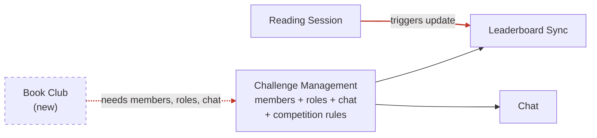
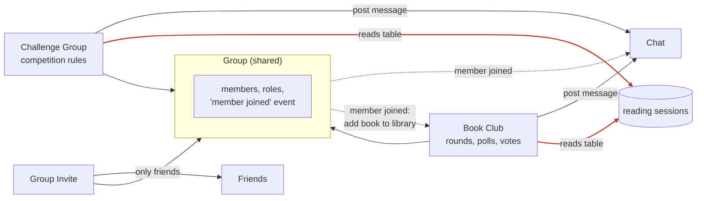
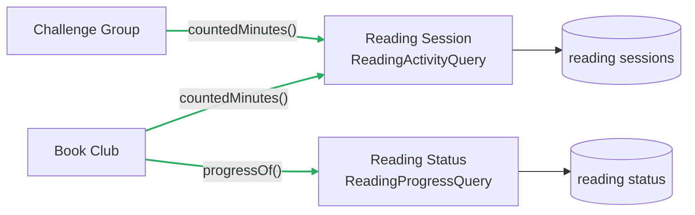

# Change analysis: adding book clubs

## 1. The change

At the start of iteration 1 the app had one kind of group: the **reading challenge**, where friends compete to read the most. The product also needed a **book club**, where members read the same book together:

- the club reads in **rounds**, each with a book and a deadline
- members **propose and vote** for the next book
- the club shows each member's **progress** on the current book

The question: how do we add book clubs without breaking challenges, and without copying code?

## 2. How we measured coupling

We used the **Balanced Coupling** model from the [modularity skill](https://github.com/vladikk/modularity). For each link between two modules we ask three questions:

| Question | Name in the model |
|---|---|
| How much do the two modules know about each other? | **Strength**. From strongest to weakest: reading the other module's data, sharing business rules, sharing classes, using only a small interface. |
| How far apart are they? | **Distance**. Two different modules are far apart. Code in the same module is close. |
| How often will this knowledge change? | **Volatility**. Challenges and clubs are the core of the product, so they change often. Members and friends change rarely. |

**The rule:** modules that are far apart should share very little. Sharing a lot is only safe when the shared knowledge rarely changes.

## 3. Before

Problems (red arrows):

- **Book clubs would depend on challenges.** Members, roles and chat all lived inside Challenge Management. To reuse them, the book club would have to depend on the challenge code, which changes often. Copying the code instead means fixing every membership rule twice.
- **Reading Session knew about leaderboards.** It had to trigger the leaderboard update. A book club would need a second trigger for member progress.
- **Low cohesion.** Challenge Management had two jobs: *being a group* and *being a competition*. A book club needs the first one but not the second.

## 4. After

What changed:

- **A small shared `Group` module.** It holds only what every group needs: members, roles and a "member joined" event. Challenges and book clubs both build on it. This is fine because membership rarely changes.
- **One module per kind of group.** Competition rules stay in Challenge Group. Rounds, polls and votes stay in Book Club. Neither one knows about the other.
- **Invites and chat work for any group.** A new kind of group needs no changes there.
- **Small links between modules.** Clubs and challenges post to the chat through one method (`postSystem`). Chat and Book Club react to the "member joined" event (Observer pattern) instead of being called directly.
- **Reading Session knows nothing about groups.** Rankings and progress are calculated when someone opens the page, so nothing needs to be triggered.

| Link | What is shared | Balanced? |
|---|---|---|
| Challenge Group / Book Club → Group | Group classes (members, roles) | Yes. They share a lot, but it rarely changes. |
| Group Invite → Friends | One method: "are they friends?" | Yes |
| Challenge Group / Book Club → Chat | One method: post a message | Yes |
| Group → Chat, Book Club (event) | A small event: group, user, time | Yes |
| Inside Book Club (rounds, polls, votes) | Many rules, all in one module | Yes. This is high cohesion. |
| Challenge Group / Book Club → reading sessions table (red) | The rule for which minutes count, written twice | **No** (fixed later, see section 7) |

## 5. Coupling and cohesion: before and after

### Is there more coupling now?

No. The "After" flow has **more arrows**, but they are **weaker**. One big module (Challenge Management) was split into five small ones, so connections that used to be hidden inside one module are now visible arrows between modules. What matters is the kind of each link, not how many links there are.

### Coupling: the links between modules

Read each cell as **before → after**.

| Link (what it is for) | Strength | Distance | Volatility | Balanced? |
|---|---|---|---|---|
| Book Club gets members and roles | High → High (shares challenge classes → shares only the small Group classes) | High → High | **High → Low** (challenge rules change often, membership rarely) | ❌ → ✅ |
| Book Club and challenges post to the chat | High → **Low** (go through Challenge Management → call one method, `postSystem`) | High → High | High → Medium | ❌ → ✅ |
| Rankings update after a reading session | High → **None** (Reading Session triggers the leaderboard → Reading Session knows nothing about groups) | High → none | High → none | ❌ → ✅ (link removed) |
| Something happens when a member joins (chat message, book added to library) | High → **Low** (direct calls inside one module → a small "member joined" event) | Low → High | High → Low | ❌ → ✅ |
| Rankings and club progress read the reading sessions | Very high → Very high (both read another module's table) | High → High | High → High | ❌ → ❌ (and now done twice; fixed later, see section 7) |

The links got **weaker** (lower strength) or now point to code that **rarely changes** (lower volatility). Only the last row did not improve. We fixed it afterwards (section 7).

### Cohesion: the parts inside each module

Inside a module the parts are close (low distance), so here a **high** strength is good: the parts belong together. A low strength means unrelated things were put in the same module.

| Module | What lives inside after the change | Strength inside | Distance | Volatility | Cohesion |
|---|---|---|---|---|---|
| Challenge Management → **Challenge Group** | Only competition rules: period, win metric, scoring | Low → **High** | Low → Low | High → High | ❌ → ✅ |
| **Group** (new) | Members, roles, "member joined" event | – → High | – → Low | – → Low | – → ✅ |
| **Book Club** (vs. a `type` flag on the challenge) | Rounds, polls, votes, progress | Low → **High** | Low → Low | High → High | ❌ → ✅ |
| **Reading Session** | Only timing sessions (no more leaderboard trigger) | Low → **High** | Low → Low | High → Medium | ❌ → ✅ |
| **"Which minutes count" rule** | Repeated in Reading Session, Challenge Group and Book Club | High → High | Low → **High** | High → High | ✅ → ❌ (back to ✅ after section 7) |

**In short:** looser coupling between modules, higher cohesion inside them, and one rule that was spread over three modules. Section 7 moves it back into Reading Session.

## 6. Decision

**We split groups into a small shared `Group` module and one module for each kind of group: `ChallengeGroup` and `BookClub`. In the class diagram, `Group` is an abstract class with these two subclasses.**

Why:

- Only membership is shared, and it rarely changes, so depending on it is safe.
- The rules that change often stay inside their own module.
- Adding a third kind of group means adding a new module, not editing the old ones (open/closed principle).

Options we rejected:

- **Copy the challenge code** for book clubs: every membership rule would change in two places.
- **One class with a `type` flag** and `if` statements: challenge rules and club rules mixed in one class.
- **Book Club depends on Challenge Group:** clubs would break whenever challenges change.

Evidence in git (PR #112): first `7a919bd` moved members and roles to `features/group/`, then `2f8830c` added book clubs on top. Challenges did not need to change.

## 7. What we improved after the analysis

The analysis found two weak points in the code, so we fixed them on the branch `refactor/group-coupling`. The app behaves the same, and all backend tests pass (190, including 4 new ones).

**1. The "which minutes count" rule is now in one place** (`d1f3e37`).

Reading Session now offers one method, `ReadingActivityQuery.countedMinutes(users, from, to, book?)`. Reading Status offers `ReadingProgressQuery.progressOf(users, book)`. Challenge Group and Book Club call these methods instead of reading the other modules' tables.

| Link | Strength | Distance | Volatility | Balanced? |
|---|---|---|---|---|
| Challenge Group / Book Club → reading sessions | Very high → **Low** (read the table → call one method) | High → High | High → High | ❌ → ✅ |
| Book Club → reading status | High → **Low** (read the table and the `'finished'` value → call one method) | High → High | Medium → Medium | ❌ → ✅ |

**2. Each group stores its own kind** (`ee0c762`).

The `groups` table has a new `kind` column (migration `0006`, which fills it in for existing groups). The Group and Group Invite modules read it there and no longer look in the `book_clubs` table. A third kind of group would not need changes in these two modules.

| Link | Strength | Distance | Volatility | Balanced? |
|---|---|---|---|---|
| Group / Group Invite → `book_clubs` table | Very high → **None** (link removed) | High → – | High → – | ❌ → ✅ |

**Still open (minor, accepted for now):**

- Book Club reads `updatedAt` as the date a member finished the book. Fixing it needs a new `finishedAt` column on `reading_status`.
- Challenge Group and Book Club write their admin's row in the members table themselves, in the same transaction that creates the group. Moving that write into Group would make it harder to keep the two steps together.
