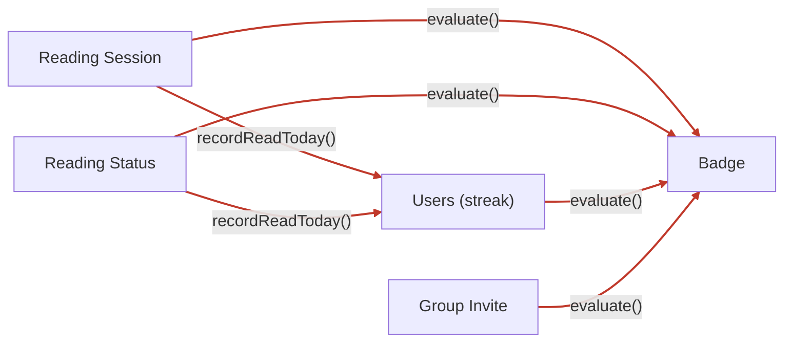
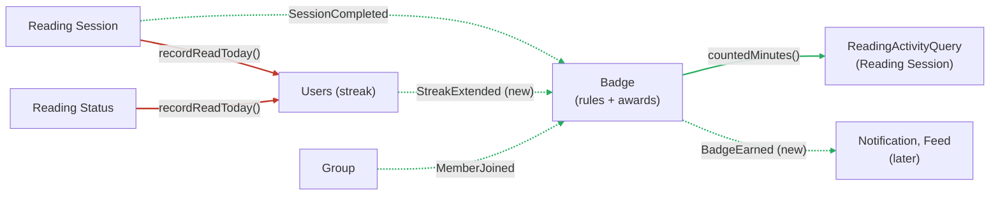

# Change analysis (iteration 2): adding reader badges

**Written:** 2026-11-19, during iteration 2 (the iteration 1 analysis, [change_analysis.md](change_analysis.md), was written on 2026-11-08).
**Diagrams:** [class diagram](class_diagram_iteration_2.png) and [component diagram](component_diagram_iteration_2.png) for iteration 2.

## 1. Change scenario and design context

### The design today

Iteration 2 added most of the reader's own space: library folders and tags, reviews, Explore with the Open Library fallback, and the **reading streak**. Two facts about the current code matter for this analysis.

1. **The streak is wired with direct calls.** [`ReadingSessionService.finish`](../../apps/backend/src/features/reading-session/reading-session-service.ts) and [`ReadingStatusService`](../../apps/backend/src/features/reading-status/reading-status-service.ts) both call `StreakService.recordReadToday` (Users module). To decide *when* to call it, they import the rules in [`streak-rules.ts`](../../apps/backend/src/features/user/streak-rules.ts) (5+ counted minutes, 5+ pages, finishing a book). That file in turn imports `ReadingStatusType` from Reading Status. We kept the direct call on purpose on 2026-11-19, to avoid reopening the rules reworked in PR #160 (see the [iteration 2 log](../iterations/2/log.md)).
2. **One event exists and nobody listens to it.** `ReadingSessionService.finish` publishes `SessionCompleted` to `SessionCompletedListener`s (Observer). The comment in the code says badges and the feed are meant to subscribe. [`router.ts`](../../apps/backend/src/api/router.ts) passes no listener, so today it does nothing. `MemberJoined` (Group) works the same way and has two listeners (chat announcement, book club).

### The change

**Readers earn badges for reading achievements** (F-GAM-01), and later get a notification (F-NOT-01) and a feed entry (F-SOC-03) when they earn one. The first slice is three badges from the catalogue in [features_priority.md](../requirements/features_priority.md):

| Badge | Needs to know |
|---|---|
| Thousand Minutes | total counted minutes of the reader |
| Week Warrior (7-day streak) | the reader's streak went up to 7 |
| Marathon (3-hour session) | one finished session of 180+ counted minutes |

The rest of the catalogue follows: Month Master (30-day streak), Group Reader (needs a membership signal) and Goal Getter (needs the yearly goal, F-READ-05, not built).

### Why the need is plausible

- Badges are **Extras #5** in the [sprint plan](../requirements/features_priority.md), in sprint 3 ("Extras, first half"). The iteration 1 class diagram already carries `Badge` as «planned».
- Notifications (**Extras #8**) and the feed (**#12**) are in sprint 4 and both list "earned a badge" as an event, so the badge change will have two followers.
- The catalogue itself will keep changing: the full catalogue, secret badges and rarity tiers (F-GAM-01, F-GAM-02) are in the Extras/Optional lists.

### What it touches

| Existing element | Why |
|---|---|
| `ReadingSession` / `ReadingSessionService` | Marathon and Thousand Minutes start from a finished session (`SessionCompleted`) |
| `ReadingStatus` / `ReadingStatusService` | finishing a book will matter for Goal Getter and later badges |
| `User` / `StreakService` | Week Warrior and Month Master depend on the streak |
| `Group` / `MemberJoined` | Group Reader |
| `ReadingActivityQuery` | total minutes for Thousand Minutes (already a published contract) |
| «planned» `Badge`, `BadgeAward`, `BadgeRule` and the events `StreakExtended`, `BadgeEarned` | new, see the [class diagram](class_diagram_iteration_2.png) |
| «planned» Badge service, Notification and feed | new, see the [component diagram](component_diagram_iteration_2.png) |

## 2. Coupling and cohesion analysis

### How we measured

Same method as in [iteration 1](change_analysis.md#2-how-we-measured-coupling): the **Balanced Coupling** model ([modularity skill](https://github.com/vladikk/modularity)), asking for each link the **strength** (reading another module's data, sharing business rules, sharing classes, or using only a small interface or event), the **distance** (different modules are far, code in one module is close) and the **volatility** (how often the shared knowledge changes). The rule: far-apart modules should share little, unless what they share rarely changes.

Volatility in this scenario, with evidence:

| Knowledge | Volatility | Evidence |
|---|---|---|
| The badge catalogue | High | full catalogue, secret badges and rarity tiers are all backlog items |
| The streak rules (what counts as a reading day) | High | built on 2026-11-16, reworked on 2026-11-18 after the PR #160 review; "streak freeze" (#9) is still to come |
| The `SessionCompleted` / `MemberJoined` event shapes | Medium to low | a handful of plain fields each; a plain data record changes less than a rule |
| The counted-minutes rule | Medium | one owner since 2026-11-08, when it moved behind `ReadingActivityQuery` |

### The straightforward way: copy the streak pattern

The quickest implementation is the one used for the streak: call a `BadgeService.evaluate(userId)` from every place where something relevant happens.

Tracing the impact:

- **Four modules gain a dependency on Badge**, the most volatile thing in the scenario. Every new badge that needs a new trigger means editing a module that has nothing to do with badges.
- `ReadingSessionService.finish` would do four jobs (save the session, update the streak, evaluate badges, publish the event), so its cohesion drops.
- A **new dependency cycle** would appear: Users calls Badge while Badge reads the streak back from Users.
- The notification and feed follow-ups would each add one more call from Badge, repeating the problem.

### The decided way: badges listen to events

Two events already exist (`SessionCompleted`, `MemberJoined`). Only **one** is new: `StreakExtended`, published by `StreakService` when a reading day actually changes the streak, carrying `userId`, `day`, `currentStreak` and `longestStreak`. Because the event carries the values, Badge never needs the streak rules.

### Coupling: the links between modules

Read each cell as **straightforward way → decided way**.

| Link | Strength | Distance | Volatility | Balanced? |
|---|---|---|---|---|
| Reading Session → Badge | High (calls `evaluate`, knows what to pass) → **None** (Reading Session knows nothing about badges) | High → – | High → – | ❌ → ✅ (link removed) |
| Reading Status → Badge | High → **None** | High → – | High → – | ❌ → ✅ (link removed) |
| Users (streak) → Badge | High, and a cycle → **None** | High → – | High → – | ❌ → ✅ (link removed) |
| Group → Badge | High → **None** | High → – | High → – | ❌ → ✅ (link removed) |
| Badge → Reading Session (`SessionCompleted`) | – → **Low** (six plain fields) | – → High | – → Medium to low | – → ✅ |
| Badge → Users (`StreakExtended`) | – → **Low** (four plain fields, not the streak rules) | – → High | – → Medium to low | – → ✅ |
| Badge → Group (`MemberJoined`) | – → **Low** (already exists) | – → High | – → Low | – → ✅ |
| Badge → `ReadingActivityQuery` (total minutes) | – → **Low** (one method of a published contract) | – → High | – → Medium | – → ✅ |
| Notification, Feed → Badge (`BadgeEarned`, later) | – → **Low** | – → High | – → Medium | – → ✅ |
| **Reading Session and Reading Status → Streak (Users)** | High → **High (unchanged)**: shared rules (5 minutes, 5 pages) and a circular import with `reading-state` | High → High | High → High | ❌ → ❌ |

What improves: the high-volatility knowledge (which badges exist and when they are earned) stays in **one** module, and the dependency arrows point *towards* the publishers' small, stable events instead of away from them.

What does **not** improve: the last row. The streak link is strong, far and volatile, so it is the weakest point of the design. We accept it for now (section 3).

### Cohesion: the parts inside each module

Inside a module the parts are close, so a **high** strength is good.

| Module | What lives inside | Strength inside | Distance | Volatility | Cohesion |
|---|---|---|---|---|---|
| `ReadingSessionService.finish` | save the session, update the streak, publish the event (three jobs, as today) | High → High | Low | Medium | ✅ → ✅ (with the straightforward way it would drop to ❌ with a fourth job) |
| **Badge** (new) | the catalogue, one rule per badge, the awards | – → High | – → Low | – → High | – → ✅ (a new badge is a new rule class in the same module) |
| **Users** | profile, friends' visibility **and** the streak | Medium → Medium | Low | Low (profile) mixed with High (streak) | ⚠️ → ⚠️ |

The Users row is a **watch item**, not part of this change: profile data rarely changes, the streak changes often and "streak freeze" is coming, so the streak will eventually deserve its own module.

### New dependencies and costs of the decided way

- **A new module and table:** `features/badge/` and the next migration for `user_badges(user_id, badge_code, earned_at)` with a unique key on `(user_id, badge_code)`.
- **One more event** (`StreakExtended`) and, later, `BadgeEarned`.
- **More wiring in `router.ts`**, which builds the services by hand with no DI container: each listener has to be passed in.
- **A listener failure must not break the request.** `ReadingSessionService.finish` awaits its listeners after saving the session, so a throwing badge listener would answer `500` for a session that was saved. We need a small publish helper that logs and skips a failing listener.
- **Eventual consistency.** Awarding happens in the same request but after the save; a crash in between would miss one award. Rules look at the state (total minutes, longest streak), not at the change, and the unique key makes awarding idempotent, so the next event repairs it.

## 3. Alternatives, decision and consequences

### Options

| Option | For | Against |
|---|---|---|
| **A. Keep the current design:** call `evaluate` from each place, like the streak | Fastest to write; no new event; matches existing code | Four modules depend on the most volatile one; each new trigger edits unrelated code; `finish` gets a fourth job; notifications and feed add more calls |
| **B. Work badges out when read** (like standings and the live streak, [infra.md](../architecture/infra.md)) | Nothing to keep in sync; no new table; all six badges can be derived from sessions, `longestStreak` and memberships | No "earned at" date; no moment to notify or to publish to the feed (F-NOT-01, F-SOC-03 need one); the profile and Home recompute totals on every read |
| **C. Badges subscribe to events** (decided) | Publishers know nothing about badges; one new event; the "earned" moment exists for notifications and the feed; reuses the Observer pattern already in the code | New module and table; more wiring; needs failure isolation in the publisher |
| **D. A generic event bus with a queue or outbox** | Retries and no lost awards | A new piece of infrastructure (the project already chose not to add Redis for caching), far beyond six badges |

### Decision

**We implement option C in the next sprints**, in this order:

1. `features/badge/` with `Badge`, `BadgeAward`, a `BadgeRule` per badge, and the `user_badges` migration. First rules: Thousand Minutes, Week Warrior, Marathon.
2. `StreakExtended`, published by `StreakService` when the streak changes. The **streak itself stays a direct call**: the decision of 2026-11-19 stands.
3. Pass the Badge listener to `ReadingSessionService`, to `StreakService` and to `joinListeners` in `router.ts`, and add the failure-isolating publish helper.
4. Publish `BadgeEarned` after an award, so notifications and the feed can subscribe without changing Badge.

### Why

- It puts the volatile knowledge (the catalogue) in one module and removes the need for four other modules to know it exists. That is the balance the model asks for: far apart means little shared knowledge.
- It costs **one new event**, because two of the three triggers already exist. The Observer pattern is already in the codebase and understood by the team.
- Option B is attractive and consistent with the "worked out when read" rule, but F-NOT-01 and F-SOC-03 need the moment a badge is earned, which only stored awards can give. If notifications are cut from the Extras, B becomes a good fallback.
- Option A is the cheapest today and the most expensive on the second badge that needs a new trigger.

### Consequences

- **Benefits:** a new badge is one new rule class; Reading Session, Reading Status and Group do not change when the catalogue grows; notifications and the feed attach to `BadgeEarned`.
- **Drawbacks:** one more module, one more table and one more piece of manual wiring; awarding is synchronous, so it adds a little time to the request that finishes a session.
- **Accepted debt:** the Reading Session / Reading Status → Streak link stays strong and volatile. We revisit it when "streak freeze" (#9) starts: that is the moment to move the streak into its own module, publish `ReadingDayCounted`-style events instead of direct calls, and break the circular import.
- **When to revisit the decision:** if more than about five listeners react to one event, or an award must never be lost (for example, a paid reward), move to option D.

### How we will know it worked

- A test that finishes a 180-minute session and finds a Marathon award, with **no change** to `ReadingSessionService` beyond passing the listener.
- Adding the fourth badge (Month Master) touches only `features/badge/`.
- A throwing listener leaves the session saved and the request successful.