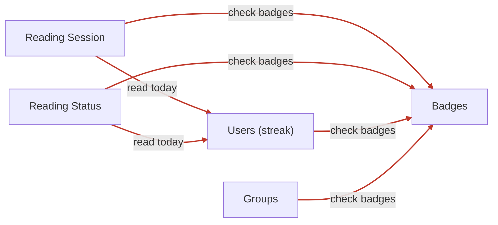
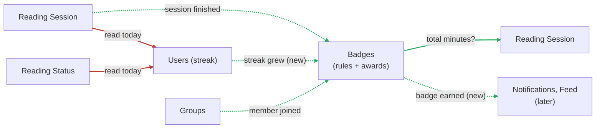

# Change analysis (iteration 2): adding reader badges

**Written:** 2026-11-19, during iteration 2 (the iteration 1 analysis, [change_analysis_iteration_1.md](change_analysis_iteration_1.md), was written on 2026-11-08).
**Diagrams:** [class diagram](class_diagram_iteration_2.png) and [component diagram](component_diagram_iteration_2.png) for iteration 2.

## 1. The change

### Words used in this document

| Term | Meaning |
|---|---|
| **Reading session** | A timed reading period. The reader presses start and stop, and the app saves how many minutes they read and which book. |
| **Reading status** | Where a book is in the reader's list: *want to read*, *reading* or *finished*, plus the current page. |
| **Library, folders and tags** | The reader's personal list of books. Folders group books (for example "Summer"); tags are free labels (for example "fantasy"). |
| **Review** | A star rating and short text a reader writes about a book. |
| **Explore** | The page where readers search for books to add to their library. |
| **Open Library** | A free, public online catalogue of books. When a book is not in our own database, Explore looks it up there. |
| **Streak** | The number of days in a row the reader has read. A day counts if they read at least 5 minutes, read at least 5 pages, or finished a book. Missing a day resets it to zero. |
| **Group, challenge, book club** | A group of friends. In a *challenge* they compete to read the most; in a *book club* they read the same book together. |
| **Badge** | A small award shown on the reader's profile for an achievement, for example "read for 1000 minutes". |
| **Module** | One part of the backend with its own job, for example "Reading Session" or "Users". |
| **Event** | A short message a module sends when something happens ("a session was finished"). Other modules can choose to react to it; the sender does not know who is listening. |

### What the app does today

Iteration 2 added most of the reader's personal space: library folders and tags, reviews, Explore with Open Library, and the streak. Two facts about the current design matter here:

1. **The streak is updated by direct calls.** When a reader finishes a reading session or changes a book's status, those two modules call the Users module to say "this person read today". To decide *when* to say it, they also need to know the streak rules (5 minutes, 5 pages, finished book). We kept it this way on purpose on 2026-11-19, so as not to reopen rules that had just been reworked (PR #160, see the [iteration 2 log](../iterations/2/log.md)).
2. **An unused "session finished" event already exists.** When a session ends, Reading Session sends a "session finished" event. The code says badges and the activity feed are meant to listen to it, but nobody listens yet. Groups have a similar "member joined" event, which the chat and book clubs already use.

### The change we expect

**Readers earn badges for reading achievements** (F-GAM-01). Later they also get a notification (F-NOT-01) and an entry in their friends' activity feed (F-SOC-03) when they earn one. The first three badges, from [features_priority.md](../requirements/features_priority.md):

| Badge | When it is earned | What the app needs to know |
|---|---|---|
| Thousand Minutes | after 1000 minutes of reading in total | the reader's total reading minutes |
| Week Warrior | after a 7-day streak | the reader's streak |
| Marathon | after one session of 3 hours or more | the length of a finished session |

More badges come later: Month Master (30-day streak), Group Reader (joined a group) and Goal Getter (reached the yearly reading goal, not built yet).

### Why this change is likely

- Badges are planned for sprint 3 in the [sprint plan](../requirements/features_priority.md), and the iteration 1 class diagram already shows a planned `Badge`.
- Notifications and the activity feed are planned for sprint 4, and both list "earned a badge" as something to show. So the badge design will soon be built upon.
- The list of badges will keep growing: secret badges and rarity levels are also in the backlog.

### What it touches

To award these badges, the new code needs information from four existing parts of the app: reading sessions (minutes, long sessions), reading status (finished books), the streak (in Users) and groups (joining a group).

## 2. Coupling and cohesion

### How we measured

Same method as in [iteration 1](change_analysis_iteration_1.md#2-how-we-measured-coupling), the **Balanced Coupling** model ([modularity skill](https://github.com/vladikk/modularity)). For each link between two modules we ask:

| Question | Name in the model |
|---|---|
| How much do the two modules know about each other? | **Strength** |
| How far apart are they? (different modules are far, code in the same module is close) | **Distance** |
| How often will this knowledge change? | **Volatility** |

**The rule:** modules that are far apart should share very little, unless what they share rarely changes.

How often each piece of knowledge changes in this scenario:

| Knowledge | How often it changes | Why we think so |
|---|---|---|
| The list of badges and their conditions | Often | more badges, secret badges and rarity levels are all planned |
| The streak rules | Often | built on 2026-11-16, changed again on 2026-11-18 after review; "streak freeze" is still planned |
| The content of the "session finished" and "member joined" events | Rarely | each is just a few values (who, which book, how long, when) |
| The rule for which reading minutes count | Sometimes | it has had one owner (Reading Session) since 2026-11-08 |

### Option 1: copy the streak approach

The quickest way is to do what we did for the streak: every place where something relevant happens calls the badge module and asks "did this person earn a badge?".

Problems (red arrows):

- **Four modules now depend on badges**, the part that changes most. Every new kind of badge may need a change in a module that has nothing to do with badges.
- **Finishing a session does too much:** save the session, update the streak, check badges and send the event, all in one step.
- **A loop appears:** Users calls Badges, and Badges asks Users for the streak.
- **Notifications and the feed would make it worse:** Badges would have to call each of them directly.

### Option 2 (chosen): badges listen to events

The other modules do not call Badges. They just send their events, and Badges listens. Two of the three events already exist. Only **one is new**: "streak grew", sent by Users when the streak goes up, with the current and longest streak. Because the event already carries the numbers, Badges does not need to know the streak rules.

### Coupling: the links between modules

Read each cell as **option 1 → option 2**.

| Link | Strength | Distance | Volatility | Balanced? |
|---|---|---|---|---|
| Reading Session, Reading Status, Users, Groups → Badges | High (each calls Badges and knows what to send) → **None** (they do not know Badges exists) | High → – | Often → – | ❌ → ✅ (link removed) |
| Badges ← Reading Session ("session finished") | – → **Low** (a few plain values) | – → High | – → Rarely | – → ✅ |
| Badges ← Users ("streak grew") | – → **Low** (two numbers, not the streak rules) | – → High | – → Rarely | – → ✅ |
| Badges ← Groups ("member joined") | – → **Low** (already exists) | – → High | – → Rarely | – → ✅ |
| Badges → Reading Session (total minutes) | – → **Low** (one question with one number as answer) | – → High | – → Sometimes | – → ✅ |
| Notifications, Feed ← Badges ("badge earned", later) | – → **Low** | – → High | – → Sometimes | – → ✅ |
| **Reading Session and Reading Status → streak** | High → **High (unchanged)**: both know the streak rules | High → High | Often → Often | ❌ → ❌ |

**What improves:** everything about badges (which ones exist, when they are earned) lives in **one** module, and the other modules only share small events that rarely change.

**What does not improve:** the last row. The streak link is strong, between far-apart modules, and about rules that change often. It is the weakest point of the design, and we accept it for now (section 3).

### Cohesion: the parts inside each module

Inside a module the parts are close, so here a **high** strength is good: the parts belong together.

| Module | What lives inside | Cohesion |
|---|---|---|
| Finishing a session | save the session, update the streak, send the event (same as today) | ✅ → ✅ (option 1 would add a fourth job: ❌) |
| **Badges** (new) | the list of badges, one rule per badge, the awards earned | – → ✅ (a new badge is one new rule in the same module) |
| **Users** | profile, friends **and** the streak | ⚠️ → ⚠️ |

The Users row is something to **watch**, not part of this change: profile data rarely changes, but the streak changes often and "streak freeze" is coming. The streak will probably deserve its own module later.

### What option 2 costs

- **A new module and a new database table** to store which reader earned which badge and when. Each badge can be earned only once per reader.
- **Two new events:** "streak grew" now and "badge earned" later.
- **More setup code:** each listener has to be connected by hand when the app starts.
- **A badge error must not break the reader's action.** If checking badges fails, the session must still be saved and the reader must not see an error. We need a small helper that logs the error and carries on.
- **A badge could be missed in rare cases.** If the server crashes between saving the session and awarding the badge, that badge is missing. Rules check totals (total minutes, longest streak), not just the last action, so the next event awards it.

## 3. Alternatives, decision and consequences

### Options

| Option | For | Against |
|---|---|---|
| **A. Copy the streak approach** (option 1 above) | Fastest to write; no new event; looks like existing code | Four modules depend on the part that changes most; each new badge may edit unrelated code |
| **B. Calculate badges when the profile is opened**, without storing them (as we do for challenge rankings and the live streak) | Nothing to keep in sync; no new table | No "earned on" date; no moment to send a notification or post to the feed; totals are recalculated on every visit |
| **C. Badges listen to events** (option 2 above, chosen) | Other modules know nothing about badges; only one new event now; there is a clear "earned" moment for notifications and the feed; reuses an approach already in the code | New module and table; more setup; needs error protection |
| **D. A separate message system with a queue** | Retries, so no badge is ever lost | A whole new piece of infrastructure, far too much for six badges |

### Decision

**We will implement option C in the next sprints**, in this order:

1. Create the Badges module and its table, with the first three badges: Thousand Minutes, Week Warrior and Marathon.
2. Make Users send "streak grew" when the streak goes up. The **streak itself stays a direct call**, as decided on 2026-11-19.
3. Connect Badges as a listener to the three events, with the error-protection helper.
4. Send "badge earned" after a badge is awarded, so notifications and the feed can react without changing Badges.

### Why

- Everything that changes often (the list of badges) is in one place, and the other modules do not need to know it exists. Far-apart modules share little, which is what the model asks for.
- It costs **only one new event**, because two of the three already exist, and the team already uses this listen-to-events approach for groups.
- Option B is simpler, but notifications and the feed need the exact moment a badge is earned, which only stored badges can give. If notifications are dropped from the plan, B becomes a good fallback.
- Option A is the cheapest today but becomes the most expensive as soon as a badge needs a new trigger.

### Consequences

- **Benefits:** a new badge is one new rule; Reading Session, Reading Status and Groups do not change when badges are added; notifications and the feed simply listen to "badge earned".
- **Drawbacks:** one more module, one more table and more setup code; badges are checked during the reader's request, so finishing a session takes slightly longer.
- **Accepted debt:** Reading Session and Reading Status still know the streak rules. We will revisit this when "streak freeze" starts: that is the moment to move the streak to its own module and have it listen to events too.
- **When to reconsider:** if more than about five modules listen to one event, or a badge must never be lost (for example a paid reward), move to option D.

### How we will know it worked

- A test finishes a 3-hour reading session and the reader gets the Marathon badge, **without changing** the Reading Session code beyond connecting the listener.
- Adding the fourth badge (Month Master) only changes the Badges module.
- If checking badges fails, the session is still saved and the reader sees no error.
