# Class diagram (iteration 2)

Mermaid source of [`class_diagram_iteration_2.png`](class_diagram_iteration_2.png). It uses the default Mermaid theme, like the earlier diagrams. Classes marked «planned» are designed but not built yet. The changes from iteration 1 are listed in [`design.md`](../design.md#iteration-3).

```mermaid
classDiagram
    class User {
        +id: UUID
        +email: Email
        +username: Username
        +displayName: String
        +bio: String
        +photoUrl: String
        +timezone: String
        +profileVisibility: ProfileVisibility
        +currentStreak: Integer
        +longestStreak: Integer
        +lastReadDate: Date
        +register()$ User
        +rename(displayName: String)
        +moveTo(timezone: String)
        +makeProfilePublic()
        +makeProfilePrivate()
        +recordReadingDay(day: Date) Boolean
        +/streakOn(day: Date) StreakSnapshot
    }
    class Friendship {
        +status: FriendshipStatus
        +createdAt: DateTime
        +respondedAt: DateTime
    }
    class Book {
        +id: UUID
        +title: BookTitle
        +isbn13: Isbn13
        +pageCount: PageCount
        +description: String
        +coverUrl: String
        +isCommunityAdded: Boolean
        +progressAt(page: Integer) PageProgress
    }
    class Author {
        +name: AuthorName
    }
    class BookCatalog {
        <<interface>>
        +search(query: String, limit: Integer) CatalogBook[*]
    }
    class OpenLibraryCatalog {
        +timeout: 3 s
        +cache: LRU 1 h
    }
    class ReadingStatus {
        +progress: PageProgress
        +startedOn: Date
        +finishedOn: Date
        +updatedAt: DateTime
        +startReading()
        +finish()
        +abandon()
        +moveBackToShelf()
        +updateProgress(progress: PageProgress)
        +setDates(startedOn: Date, finishedOn: Date)
    }
    class ReadingState {
        <<abstract>>
        +tracksProgress: Boolean
        +allowsReview: Boolean
        +start() ReadingState
        +finish() ReadingState
        +abandon() ReadingState
        +moveBackToShelf() ReadingState
    }
    class NotStarted
    class InProgress
    class Finished
    class DidNotFinish
    class ReadingSession {
        +startedAt: DateTime
        +endedAt: DateTime
        +durationSeconds: Integer
        +countedMinutes: Integer
        +start()$ ReadingSession
        +finish(now: DateTime)
        +cancel()
        +isActive() Boolean
    }
    class Folder {
        +name: FolderName
        +createdAt: DateTime
        +rename(name: FolderName)
    }
    class Tag {
        +name: TagName
        +createdAt: DateTime
    }
    class Review {
        +rating: Rating
        +comment: ReviewComment
        +createdAt: DateTime
        +updatedAt: DateTime
    }
    class Group {
        <<abstract>>
        +id: UUID
        +name: GroupName
        +description: String
        +kind: GroupKind
        +createdAt: DateTime
        +isMember(user: User) Boolean
        +isAdmin(user: User) Boolean
        +requireCanLeave(user: User)
    }
    class Membership {
        +role: MemberRole
        +joinedAt: DateTime
    }
    class ChallengeGroup {
        +period: ChallengePeriod
        +winMetric: WinMetric
        +metricGoal: Integer
        +/standings: Standing[*]
        +statusAt(now: DateTime) ChallengeStatus
    }
    class BookClub {
        +/currentRound: Round
        +/memberProgress: Progress[*]
        +startNextRound(book: Book, deadline: Date)
    }
    class Round {
        +number: Integer
        +startDate: Date
        +deadline: Date
        +outcome() RoundOutcome
    }
    class BookPoll {
        +closesAt: DateTime
        +anonymous: Boolean
        +propose(member: User, book: Book) Proposal
        +vote(member: User, proposal: Proposal)
        +close()
    }
    class Proposal {
        +createdAt: DateTime
    }
    class Vote {
        +castAt: DateTime
    }
    class GroupInvite {
        +status: InviteStatus
        +createdAt: DateTime
        +respondedAt: DateTime
        +send()$ GroupInvite
        +accept()
        +decline()
    }
    class ChatMessage {
        +seq: Integer
        +kind: MessageKind
        +body: MessageBody
        +createdAt: DateTime
        +deletedAt: DateTime
        +write()$ ChatMessage
        +system()$ ChatMessage
        +deleteBy(user: User)
    }
    class Attachment {
        <<planned>>
        +url: String
        +type: MediaType
    }
    class SessionCompleted {
        <<event>>
        +sessionId: UUID
        +userId: UUID
        +bookId: UUID
        +startedAt: DateTime
        +endedAt: DateTime
        +countedMinutes: Integer
    }
    class MemberJoined {
        <<event>>
        +groupId: UUID
        +userId: UUID
        +at: DateTime
    }
    class StreakExtended {
        <<planned event>>
        +userId: UUID
        +day: Date
        +currentStreak: Integer
        +longestStreak: Integer
    }
    class BadgeEarned {
        <<planned event>>
        +userId: UUID
        +badge: BadgeCode
        +earnedAt: DateTime
    }
    class Badge {
        <<planned>>
        +code: BadgeCode
        +name: String
        +description: String
    }
    class BadgeAward {
        <<planned>>
        +earnedAt: DateTime
    }
    class BadgeRule {
        <<planned>>
        +badge: Badge
        +earnedBy(event) Boolean
    }
    class ThousandMinutes {
        <<planned>>
    }
    class WeekWarrior {
        <<planned>>
    }
    class Marathon {
        <<planned>>
    }
    class MemberRole {
        <<enumeration>>
        ADMIN
        MEMBER
    }
    class GroupKind {
        <<enumeration>>
        CHALLENGE
        BOOK_CLUB
    }
    class WinMetric {
        <<enumeration>>
        MINUTES
        PAGES
        BOOKS
        STREAK
    }
    class InviteStatus {
        <<enumeration>>
        PENDING
        ACCEPTED
        DECLINED
    }
    class MessageKind {
        <<enumeration>>
        TEXT
        SYSTEM
    }

    User "1" -- "0..*" Friendship : requests
    User "1" -- "0..*" Friendship : receives

    Book "0..*" -- "1..*" Author : written by
    BookCatalog <|.. OpenLibraryCatalog
    BookCatalog ..> Book : imports by ISBN-13

    User "1" -- "0..*" ReadingStatus : library
    ReadingStatus "0..*" --> "1" Book
    ReadingStatus "1" --> "1" ReadingState : state
    ReadingState <|-- NotStarted
    ReadingState <|-- InProgress
    ReadingState <|-- Finished
    ReadingState <|-- DidNotFinish

    User "1" -- "0..*" ReadingSession : reads
    ReadingSession "0..*" --> "1" Book
    ReadingSession ..> User : counts a reading day (5+ min)
    ReadingStatus ..> User : counts a reading day (5+ pages or finished)

    User "1" *-- "0..*" Folder : owns
    Folder "0..*" --> "0..*" Book : holds (must be in library)
    User "1" *-- "0..*" Tag : owns
    Tag "0..*" --> "0..*" Book : labels (must be in library)

    User "1" -- "0..*" Review : writes
    Book "1" -- "0..*" Review : receives
    Review ..> ReadingState : only if allowsReview

    Group <|-- ChallengeGroup
    Group <|-- BookClub
    Group "1" *-- "1..*" Membership
    Membership "0..*" --> "1" User : member
    Membership ..> MemberRole
    Group ..> GroupKind
    ChallengeGroup ..> WinMetric
    ChallengeGroup ..> ReadingSession : ranks members from
    BookClub ..> ReadingSession : club minutes from

    BookClub "1" *-- "1..*" Round
    Round "0..*" --> "1" Book
    BookClub "1" *-- "0..*" BookPoll
    BookPoll "1" *-- "0..*" Proposal
    BookPoll "1" *-- "0..*" Vote
    Proposal "0..*" --> "1" Book
    Proposal "0..*" --> "1" User : proposed by
    Vote "0..*" --> "1" Proposal
    Vote "0..*" --> "1" User : voter
    BookClub ..> ReadingStatus : member progress from

    Group "1" -- "0..*" GroupInvite
    GroupInvite "0..*" --> "1" User : inviter
    GroupInvite "0..*" --> "1" User : invitee
    GroupInvite ..> InviteStatus
    GroupInvite ..> MemberJoined : accept publishes

    Group "1" *-- "0..*" ChatMessage : chat
    ChatMessage "0..*" --> "0..1" User : author
    ChatMessage ..> MessageKind
    ChatMessage "1" *-- "0..*" Attachment
    MemberJoined ..> ChatMessage : announced in chat

    ReadingSession ..> SessionCompleted : finish publishes
    User ..> StreakExtended : streak change publishes

    User "1" -- "0..*" BadgeAward : earns
    BadgeAward "0..*" --> "1" Badge
    BadgeRule "1" --> "1" Badge : decides
    BadgeRule <|-- ThousandMinutes
    BadgeRule <|-- WeekWarrior
    BadgeRule <|-- Marathon
    BadgeRule ..> SessionCompleted : reacts to
    BadgeRule ..> StreakExtended : reacts to
    BadgeRule ..> MemberJoined : reacts to
    BadgeAward ..> BadgeEarned : award publishes
```

