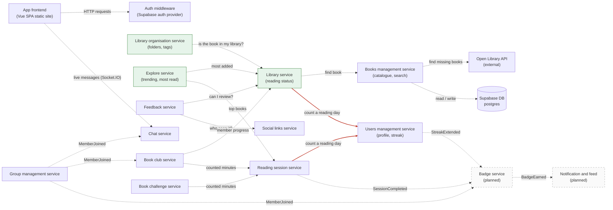

# Component diagram, iteration 2 (simple view)

A continuation of the draw.io [iteration 1 component diagram](component_diagram_iteration_1.png), in the same simple style. It keeps the iteration 1 layout and only shows what changed in iteration 2. The full diagram is [`component_diagram_iteration_2.png`](component_diagram_iteration_2.png).

How to read it:

- **Green boxes** are new services in iteration 2.
- **Dashed grey boxes** are planned, not built yet.
- **Dotted arrows** are events: the sender publishes them and does not know who listens.
- **Red arrows** are direct calls that the [change analysis](change_anaysis_iteration_2.md) accepts as tight coupling for now.
- Unchanged iteration 1 links (authentication, chat, social links, group logic) are left out to keep the picture readable.

## What changed from iteration 1

- **Books management was split.** Books management now only keeps the catalogue (books, search, adding a missing book). The reading status of each book moved to the new **Library service**.
- **New services:** **Library organisation** (folders and tags), **Explore** (trending and most read) and the outside **Open Library API**, used when a search finds too few local books.
- **Services ask each other instead of reading the database.** In iteration 1, Book club, Book challenge and Reading session each had their own line to the database. Now Book club, Book challenge and Explore ask Reading session and the Library service for what they need. The database link is shown once.
- **Feedback** now asks the Library service whether the reader can review the book and Social links who can see it, instead of going through Books management.
- **Users management owns the streak.** Reading session and the Library service call it to count a reading day (red arrows).
- **Events.** Group management announces `MemberJoined` (to Chat, Book club and Badge), Reading session announces `SessionCompleted`, and Users management announces `StreakExtended`.
- **Planned:** the **Badge service** and **Notification and feed**, which only listen to events, so no existing service has to call them.
