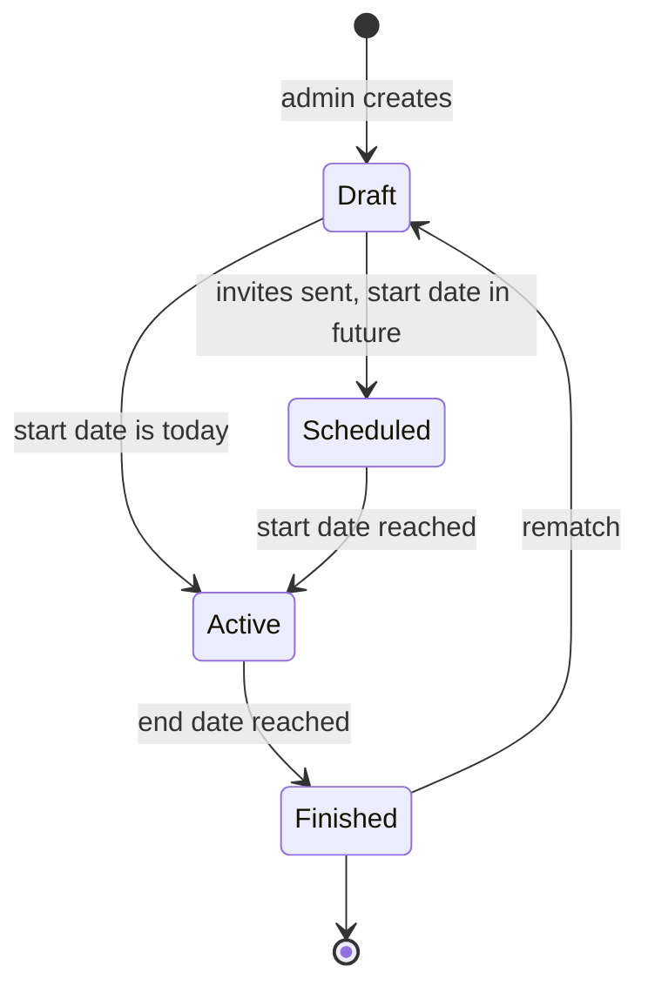

Version 1.1 · 2026-10-10 

---

## 1. Features

A quick list of everything the product does. Each item points to its detailed business requirement in section 2 (IDs in brackets). Technical requirements are in section 3.

**Access and Home**

- When a user opens the app, an authentication page appears. Nothing else is reachable without logging in. [F-AUTH-01]
- A user who forgot their password can reset it by email. [F-AUTH-02]
- A new user goes through a short onboarding: pick genres, import books already read, add the current book, set a goal, invite friends, quick tour. Every step can be skipped. [F-ONB-01]
- After login the user lands on a Home page showing:
    - books currently being read, with a one-click "start session"
    - the current streak and the yearly goal ring
    - active challenges and book clubs, with rank or progress
    - friends' activity, friends reading now, and trending books
    - pending friend and group invites [F-HOME-01]

**Books and library**

- Each book has a page with its metadata (cover, title, author, genre, pages, ISBN, description), average rating, public reviews and friends who read it. [F-BOOK-01]
- If a book can't be found, the user can add it with just its name and a default cover, so no one leaves the app because their book is missing. [F-BOOK-02]
- A book can be found by typing its ISBN [F-BOOK-03], or by scanning its barcode with the webcam (optional). [F-BOOK-04]
- The user saves books to their library with a status: not started (want to read), in progress, finished, did not finish. [F-LIB-01]
- The user can rate a book from 1 to 5 and add comments. [F-LIB-02]
- The user can create folders to organize books [F-LIB-03] and add tags such as "borrowed", "audiobook", "reread". [F-LIB-04]
- The same book can be finished more than once (re-reads). [F-LIB-05]
- A book can be marked as "did not finish", with an optional reason. [F-LIB-06]
- Optional: the user can copy a public folder from another account into their own, or follow it. [F-LIB-07]

**Reading experience**

- The user starts a reading timer for a book and stops it when done. The minutes go to the profile and to every group where the session counts. [F-READ-01]
- The user can log pages or a percentage alongside the timer. This gives a personal reading speed, which makes the import estimate more accurate over time. [F-READ-02]
- Anti-cheat is optional and chosen by the group admin: a simple timer, or "still reading?" checks, auto-pause on inactivity, a daily cap on counted minutes, or a page update required at the end. [F-READ-03]
- Daily or weekly reading streaks, with a "streak freeze" that protects a missed day. High priority. [F-READ-04]
- Personal yearly goals (books, minutes) with a progress ring on Home. [F-READ-05]

**Profile**

- Each user has a profile with:
    - books finished and in progress, with their 1–5 rating and comments
    - number of books read, minutes read, current and longest streak
    - badges earned, level, and challenges won
    - folders and want-to-read books [F-PROF-01]
- The profile can be private or public. Default: private. [F-PROF-02]
- A new user can add all the books they already read. The app estimates the reading time of each one and adds it to the profile minutes, so the user doesn't start from zero. Estimated minutes never count in competitions. [F-PROF-03]
- The profile shows a label based on the most-read genre, e.g. "Preferences: Fiction / Action", "Preferences: Romance". [F-PROF-04]
- Optional: a fun reader persona based on time of day, genres and pace, e.g. "Night Owl Romance Reader", "Weekend Sci-Fi Marathoner". [F-PROF-05]

**Social**

- The user can invite other users as friends, by username or by email. [F-SOC-01]
- The user can find other users with a public profile and see their books, minutes, badges, etc. [F-SOC-02]
- An activity feed shows what friends and groups are doing: "Ana finished a 45-minute session", "Pedro reached 50%". [F-SOC-03]
- Optional: see each friend's current book and whether they are reading right now, like friends' activity in a music app. [F-SOC-04]
- Optional: send a book to a friend with a personal note. [F-SOC-05]

**Groups**

- The user can create groups with friends, in 2 categories: challenge and book club. [F-GRP-01]
- Each group has a chat with support for images and videos. [F-GRP-02]
- Each group has a leaderboard. Timer minutes go to the group leaderboard and to the profile. [F-GRP-03]
- **Challenge:** members run reading sessions to earn points. Whoever reads the most wins. The creator chooses the duration. During the challenge, each session must be linked to the book the user is reading. [F-GRP-04]
    - The win metric can be customized: most minutes, most pages, most books finished, or longest streak. [F-GRP-05]
    - Optional: team vs team. [F-GRP-06]
- **Book club:** one book is selected for the whole club, with a goal and a deadline, e.g. "read book X in 1 month". Every session on that book adds points to the group. If everyone finishes the book by the deadline, the round is completed. [F-GRP-07]
    - Members can propose books and vote on the next one before the creator selects it. Proposals can be anonymous or not. [F-GRP-08]
- Optional: live "read together now" rooms where members see each other's timers running in real time. [F-GRP-09]
- Optional: nudges, friendly reminders to members who haven't read today, sent by in-app notification and email (it's a web app, so there are no push notifications), with limits so they don't become spam. [F-GRP-10]

**Explore and discovery**

- The user can search for books (title, author, ISBN) and users. [F-EXP-01]
- The book page shows the average score from all public ratings and all public comments. From there the user saves the book as read, want to read or in progress. [F-EXP-02]
- "Friends who read this" on the book page, with their ratings shown first. [F-EXP-03]
- Trending lists: top books this weekend, trending this month, trending among friends, trending in your genre. [F-EXP-04]
- Optional: public reading lists curated by users (e.g. "Best books for a rainy weekend"), in a discovery feed like public music playlists. Others can follow or copy them. [F-EXP-05]
- Optional: personalized suggestions based on ratings, genres and what friends loved. [F-EXP-06]

**Gamification**

- Achievements (badges) for milestones, either visible or secret. Examples:
    - Fiction Expert: finish 10 fiction books
    - Group Reader: finish 1 book in a book club
    - Champion: win 5 challenges · Thousand Minutes: 1,000 minutes of reading
    - streak badges (7, 30, 100, 365 days) and Goal Getter (reach the yearly goal)
    - Night Reader (after midnight), Early Bird, Marathon (3-hour session), Genre Explorer (5 genres), Comeback (return after 30 days), Underdog (win a challenge you were losing) [F-GAM-01]
- Optional: rarity tiers (common, rare, legendary), with the percentage of users who own each badge. [F-GAM-02]
- Levels and XP for constant progression, e.g. "Bookworm Lv. 12". [F-GAM-03]

**Retrospective and notifications**

- The user receives a monthly and a yearly retrospective of what they read. [F-RET-01]
- In-app notifications plus optional emails for invites, challenge results, badges, nudges, streaks at risk and retrospectives. [F-NOT-01]

---

## 2. Business requirements

**Priority (MoSCoW):**

`*Must*` = required for the first deliverable

`*Should*`= planned if time allows

`*Could*` = nice to have, built after Must and Should.

### 2.1 Access and onboarding

#### F-AUTH-01 — Sign up, log in, log out · Must

**Goal:** only identified users can use the app, so that all reading data belongs to a person.

**User story:** As a visitor, I want to create an account and log in so that my reading data is saved and only visible to the right people.

**Rules**

1. A visitor who opens the app sees the authentication page. No other page is reachable without logging in.
2. Sign up requires: email, password, display name, unique username.
3. Email and username must be unique across the app.
4. After a successful login, the user lands on the Home page.
5. A logged-in user can log out at any time. After logout, the authentication page is shown.
6. A first-time user goes to onboarding (F-ONB-01) before the Home page.

**Acceptance scenarios**

```gherkin
Feature: Authentication

  Scenario: Visitor is redirected to authentication
    Given I am not logged in
    When I open any page of the app
    Then I see the authentication page

  Scenario: Successful sign up
    Given I am on the authentication page
    When I sign up with a new email, a valid password, a display name and an unused username
    Then my account is created
    And I am taken to onboarding

  Scenario: Username already taken
    Given a user with username "ana_reads" exists
    When I try to sign up with username "ana_reads"
    Then I see a message that the username is already taken
    And no account is created

  Scenario: Returning user logs in
    Given I have an account and finished onboarding
    When I log in with correct credentials
    Then I land on the Home page
```

#### F-AUTH-02 — Password recovery · Must

**User story:** As a user who forgot my password, I want to reset it by email so that I don't lose my account.

**Rules**

1. The user requests a reset by entering their email.
2. The system sends a reset link to that email. The link expires after a limited time. **[Proposed default: 1 hour]**
3. For privacy, the message shown is the same whether or not the email exists.

#### F-ONB-01 — First-time onboarding · Must

**Goal:** a new user understands the app and has real data in it within a few minutes.

**User story:** As a newcomer, I want a short guided setup so that I understand the app and don't start from an empty profile.

**Rules**

1. Onboarding runs once, right after the first sign up. It can be skipped and restarted later from settings.
2. Steps, in order:
    1. Welcome: what the app does (tracking, challenges, book clubs, badges).
    2. Pick favorite genres (optional, used for suggestions).
    3. Import books already read (F-PROF-03), optional.
    4. Add a book currently being read (optional).
    5. Set a yearly reading goal (F-READ-05), optional.
    6. Invite friends (F-SOC-01), optional.
    7. Short tour of the main areas: Home, Library, Groups, Explore, Profile.
3. Every step except the welcome can be skipped.

**Acceptance scenarios**

```gherkin
Feature: Onboarding

  Scenario: New user completes onboarding
    Given I just created my account
    When I go through all onboarding steps
    Then I land on the Home page
    And the books and goal I entered appear in my library and on Home

  Scenario: New user skips onboarding
    Given I just created my account
    When I choose "Skip"
    Then I land on the Home page
    And I can restart onboarding from settings
```

---

### 2.2 Home

#### F-HOME-01 — Homepage dashboard · Must

**Goal:** in one look, the user sees where they are and what to do next, which is usually "start reading".

**User story:** As a user, I want a home page that shows my current reading and progress so that I can start a session quickly and stay motivated.

**Rules** — the Home page shows: **[Proposed default content]**

1. **Currently reading:** books "In progress", each with a "Start session" button and its progress.
2. **Streak:** current streak and freezes left (F-READ-04).
3. **Goal ring:** progress toward the yearly goal (F-READ-05).
4. **My groups:** active challenges and book clubs, with my rank or the group's progress and days left.
5. **Activity feed:** recent friend and group activity (F-SOC-03).
6. **Friends reading now** (F-SOC-04), if enabled.
7. **Trending:** a short trending section (F-EXP-04).
8. Pending invites (friend requests, group invites).

**Acceptance scenarios**

```gherkin
Feature: Home

  Scenario: Start reading from Home
    Given I have "Dune" in progress
    When I open Home
    Then I see "Dune" under "Currently reading"
    And I can start a reading session for "Dune" with one click

  Scenario: Empty state for a new user
    Given I have no books in my library
    When I open Home
    Then I see an invitation to add my first book or explore books
```

---

### 2.3 Books and library

#### F-BOOK-01 — Book catalog and book page · Must

**User story:** As a user, I want each book to have its own page so that I can see its details and decide whether to read it.

**Rules**

1. The book page shows: cover, title, author(s), genre(s), page count, ISBN, description, publication year.
2. It also shows the average rating, public reviews (F-EXP-02), friends who read it (F-EXP-03) and my own status for this book.
3. From the book page the user can: add it to the library with a status, change the status, rate and review it, add it to a folder, start a session (if in progress), and send it to a friend (F-SOC-05).

#### F-BOOK-02 — Add a missing book · Must

**Goal:** no user leaves the app because their book is not in the catalog.

**User story:** As a user, I want to add a book that doesn't exist in the catalog so that I can still track it.

**Rules**

1. When a search returns no result, the user sees an "Add this book" option.
2. Required: title. Optional: author, genre, page count, ISBN, cover image.
3. With no cover uploaded, the book gets a **default cover** showing its title.
4. A user-added book is immediately usable by its creator (library, sessions, groups).
5. A user-added book is visible to other users in search and marked as "added by the community". **[Proposed default]**
6. Before creating it, the system warns if a book with a very similar title and author already exists, to avoid duplicates.

**Acceptance scenarios**

```gherkin
Feature: Add a missing book

  Scenario: Add a book that is not in the catalog
    Given I search for "My Grandmother's Recipes" and get no results
    When I choose "Add this book" and enter the title
    Then the book is created with a default cover
    And I can add it to my library and start a reading session for it

  Scenario: Possible duplicate
    Given the catalog has "The Hobbit" by J.R.R. Tolkien
    When I try to add "The Hobbit" by Tolkien
    Then I am shown the existing book and asked whether I still want to create a new one
```

#### F-BOOK-03 — Find a book by ISBN · Should

**Rules**

1. The user can type an ISBN (10 or 13 digits) in search.
2. If found, the book page opens directly.
3. If not found, the "Add a missing book" form opens with the ISBN pre-filled.

#### F-BOOK-04 — Scan a barcode with the webcam · Could

**Rules**

1. On computers with a webcam, the user can hold the book's barcode in front of the camera to read the ISBN.
2. The app asks for camera permission first. If permission is refused, typing the ISBN (F-BOOK-03) remains available.
3. The result follows the same behavior as F-BOOK-03.

#### F-LIB-01 — Add a book to the library with a status · Must

**User story:** As a user, I want to save books with a status so that I know what I have read, am reading, and want to read.

**Rules**

1. Statuses: **Not started** (want to read), **In progress**, **Finished**, **Did not finish (DNF)**.
2. Each book has exactly one current status per user.
3. A user can have several books "In progress" at the same time.
4. Starting a session on a "Not started" book moves it to "In progress" automatically.
5. Marking a book "Finished" records the finish date. The user can edit the start and finish dates.
6. Status changes update profile statistics, goals, badges and the activity feed.

**Acceptance scenarios**

```gherkin
Feature: Library statuses

  Scenario: Starting a session moves a book to In progress
    Given "1984" is "Not started" in my library
    When I start a reading session for "1984"
    Then "1984" becomes "In progress"

  Scenario: Finishing a book
    Given "1984" is "In progress"
    When I mark it as "Finished"
    Then my "books read" count increases by 1
    And badge rules are checked
```

#### F-LIB-02 — Rate and review a book · Must

**Rules**

1. A user can rate a book from **1 to 5** and write an optional comment.
2. Rating and comment are possible for books that are Finished, DNF, or In progress. **[Proposed default]**
3. The user can edit or delete their own rating and comment.
4. The rating and comment stay attached to the book in the user's profile.
5. They count in the public average and public reviews only if the user's profile is public (see F-PROF-02 and Open question Q4).

#### F-LIB-03 — Folders (shelves) · Must

**User story:** As a user, I want to organize books into folders so that I can group them my own way.

**Rules**

1. A user can create, rename and delete folders.
2. A book can be in several folders.
3. Deleting a folder does not remove its books from the library.
4. Each folder has its own visibility (private or public). A public folder is visible only if the profile is also public.

#### F-LIB-04 — Tags · Should

**Rules**

1. A user can add free tags to any book in the library (e.g. "borrowed", "audiobook", "reread").
2. The library can be filtered by tag, status, genre and folder.

#### F-LIB-05 — Re-reads · Should

**Rules**

1. A finished book can be started again. This creates a new **read-through** of the same book.
2. Each read-through has its own dates, sessions and progress.
3. "Books read" counts each finished read-through. **[Proposed default]** The book page shows "Read 2 times".

**Example:** Ana finished "Pride and Prejudice" in 2024 and again in 2026. Her library shows it once, with two read-throughs, and her 2026 retrospective includes it.

#### F-LIB-06 — Did not finish (DNF) · Must

**Goal:** users can drop a book without feeling guilty, which keeps the library honest.

**Rules**

1. The user can mark any "In progress" book as DNF, with an optional reason (free text or a choice: "Not for me", "Too slow", "Will try later", "Other").
2. DNF books do not count as "books read" but their counted minutes still count toward total minutes.
3. A DNF book can be restarted later (moves back to "In progress").

#### F-LIB-07 — Copy or follow a public folder · Could

**Rules**

1. On another user's public folder, a user can **copy** it: a new folder with the same books is created in their own account, with all books added as "Not started" unless already in their library.
2. A user can **follow** a public folder and see it update when the owner changes it.

---

### 2.4 Reading sessions

#### F-READ-01 — Reading session timer · Must

**Goal:** measure real reading time, which feeds the profile, streaks, goals and group competitions.

**User story:** As a reader, I want to start and stop a timer while I read so that my reading time is recorded.

**Rules**

1. A session is always linked to one book from the user's library.
2. The user can start, pause, resume and stop a session.
3. Only **one session** can be active per user at a time.
4. When the session stops, the user sees a summary: book, duration, and optionally pages read (F-READ-02).
5. Counted minutes of a session go to:
    - the user's profile (total minutes, XP)
    - **every active group** of the user where the session counts (see rules 6–7)
6. **Challenge groups:** the session counts if it happens during the challenge period.
7. **Book club groups:** the session counts only if it is for the club's selected book.
8. If the session is still running when the browser tab is closed, it keeps running and the user is reminded to stop it next time. **[Proposed default]**
9. The user can delete a session. They cannot manually add or edit minutes for a session that counts in a group. **[Proposed default, protects competitions]**

**Acceptance scenarios**

```gherkin
Feature: Reading session

  Scenario: A session adds minutes to profile and challenge
    Given I am a member of the active challenge "October Sprint"
    And "Dune" is in progress
    When I start a session for "Dune" and stop it after 30 minutes
    Then 30 minutes are added to my profile
    And 30 minutes are added to my score in "October Sprint"

  Scenario: Only one active session
    Given I have a running session for "Dune"
    When I try to start a session for "1984"
    Then I am asked to stop the "Dune" session first

  Scenario: Book club only counts the club book
    Given I am in book club "Classics" reading "Emma"
    When I complete a 20-minute session for "Dune"
    Then nothing is added to the "Classics" progress
```

#### F-READ-02 — Page and progress tracking · Should

**Goal:** know how far into each book the user is, and learn each user's personal reading pace.

**Rules**

1. At the end of a session, or any time, the user can log the current page or a percentage.
2. Progress is shown on Home, the library and the book page as a percentage.
3. Reaching 100% suggests marking the book as Finished.
4. The system calculates a **personal reading pace** (pages per minute) from sessions that have both a duration and pages logged.
5. The personal pace replaces the global average pace in import estimates (F-PROF-03) once enough data exists. **[Proposed default: at least 5 sessions with pages]**

**Example:** Pedro logged 5 sessions, 150 minutes and 120 pages in total. His pace is 0.8 pages per minute. A 320-page imported book is estimated at 400 minutes.

#### F-READ-03 — Anti-cheat options · Should

**Goal:** keep challenges fair, because a timer left running on a desk would make leaderboards meaningless.

**User story:** As a group admin, I want to choose how strict session tracking is in my group so that competitions feel fair.

**Rules**

1. Anti-cheat is a **setting per group**, chosen by the group admin when creating the group. Default: **Simple timer** (no checks).
2. Options (Simple timer, or one or several of the checks below):

| Option | Behavior |
| --- | --- |
| **Simple timer** | Start and stop, no checks. |
| **"Still reading?" check** | At regular intervals the user must confirm. Without an answer, the session pauses at the last confirmation. |
| **Auto-pause on inactivity** | The session pauses when the user is inactive in the app for a set time. |
| **Daily cap** | A maximum number of counted minutes per day in this group (e.g. 240). |
| **Page update required** | The session counts only if the user logs a page number at the end. |
1. Anti-cheat rules affect the minutes **counted in that group**. When a session counts in several groups with different rules, the profile receives the lowest counted value. A session in no group counts in full on the profile. **[Proposed default]**
2. Group members can see which anti-cheat options are active before joining.

**Acceptance scenarios**

```gherkin
Feature: Anti-cheat

  Scenario: Daily cap
    Given the challenge "Sprint" has a daily cap of 240 minutes
    And I already have 230 counted minutes today in "Sprint"
    When I complete a 60-minute session
    Then only 10 minutes are added to my "Sprint" score

  Scenario: Unanswered "still reading?" check
    Given the group has the "still reading?" check every 30 minutes
    When I do not answer the check at minute 30
    Then the session pauses
    And only 30 minutes are counted
```

#### F-READ-04 — Reading streaks with streak freeze · Must

**Goal:** the strongest habit mechanic. Reading a little every day keeps the streak going.

**User story:** As a reader, I want to see how many days in a row I have read so that I stay motivated to read every day.

**Rules**

1. A day counts toward the streak when the user, that day (in their timezone):
    - finishes a session of at least **5 counted minutes**; or
    - moves a book that is **in progress** forward by at least **5 pages**; or
    - moves a book from **in progress** to **finished**.

    The last two let readers who read away from the app keep their streak. Starting a book, abandoning it, or marking a book finished that was never in progress does not count.
2. The user can choose a **daily** or **weekly** streak. A weekly streak counts weeks with at least a target number of reading days (chosen by the user, e.g. 3 of 7).
3. **Streak freeze:** a freeze automatically protects the streak on a missed day (or missed week, for weekly streaks).
    - The user earns freezes through milestones (e.g. 1 freeze per 7-day streak), with a maximum stock. **[Proposed default: max 2]**
4. A missed day with no freeze resets the streak to 0. The longest streak ever is kept on the profile.
5. Streak milestones (7, 30, 100, 365 days) award badges.

**Acceptance scenarios**

```gherkin
Feature: Streaks

  Scenario: Streak grows
    Given my streak is 4 days
    When I complete a 10-minute session today
    Then my streak becomes 5 days

  Scenario: Reading away from the app counts
    Given my streak is 4 days and a book is in progress at page 100
    When I update the book to page 105 today
    Then my streak becomes 5 days

  Scenario: Short sessions do not count
    Given my streak is 4 days and I read yesterday
    When I complete a 3-minute session today
    Then my streak stays 4 days and today is not counted yet

  Scenario: Freeze protects a missed day
    Given my streak is 12 days and I have 1 freeze
    When a day passes without any session
    Then my streak stays 12 days
    And I have 0 freezes

  Scenario: Streak lost
    Given my streak is 12 days and I have 0 freezes
    When a day passes without any session
    Then my streak becomes 0
    And my longest streak stays 12
```

#### F-READ-05 — Personal reading goals · Should

**Rules**

1. The user can set a yearly goal in **books**, **minutes**, or both.
2. Home shows a progress ring for each goal, plus whether they are ahead of or behind schedule.
3. The user can change the goal at any time.
4. Reaching a goal awards a badge and is highlighted in the yearly retrospective.

**Example:** Goal is 24 books in 2026. On 1 July, the user has finished 10 books. The ring shows 10/24 (42%) and "2 books behind schedule".

---

### 2.5 Profile

#### F-PROF-01 — Personal profile and statistics · Must

**User story:** As a user, I want a profile that shows my reading life so that I can see my progress and share it.

**Rules** — the profile shows:

1. Display name, username, photo, short bio.
2. Books **finished** and **in progress**, with my 1–5 rating and comments.
3. **Statistics:** number of books read, total minutes read (counted plus estimated, shown separately), current and longest streak, challenges won.
4. **Badges** earned, and level/XP (F-GAM-03).
5. **Genre preference label** (F-PROF-04) and reader persona (F-PROF-05).
6. Folders, and Want-to-read books.

#### F-PROF-02 — Profile privacy · Must

**Rules**

1. A profile is either **Private** or **Public**. Default: **Private**.
2. **Public:** anyone in the app can find the profile in Explore and see its content.
3. **Private:** the profile is not visible in Explore to non-friends. **[Proposed default: accepted friends can still see it — see Q3]**
4. Group-related activity (scores on a leaderboard, chat messages) is always visible to the members of that group, whatever the profile setting.
5. The user can change the setting at any time. The change applies immediately.

**Acceptance scenarios**

```gherkin
Feature: Profile privacy

  Scenario: Default privacy
    Given I just created my account
    Then my profile is private

  Scenario: Private profile hidden from strangers
    Given "ana_reads" has a private profile
    And I am not her friend
    When I search for "ana_reads" in Explore
    Then I do not see her profile content
```

#### F-PROF-03 — Import books already read · Must

**Goal:** the user does not start from zero.

**User story:** As a newcomer who has read many books, I want to add the books I already read so that my profile reflects my real reading history.

**Rules**

1. The user can add many books at once as "Finished" (during onboarding or later), with optional rating and finish date.
2. For each imported book the system estimates minutes: **page count ÷ reading pace**.
    - Pace = the user's personal pace if known (F-READ-02), otherwise a global average pace. **[Proposed default: 1 page per minute]**
    - If the page count is unknown, a default page count is used. **[Proposed default: 300 pages]**
3. Estimated minutes are added to the profile as **estimated minutes**, shown separately from counted minutes.
4. Estimated minutes **never** count in groups, leaderboards, streaks or time-based badges. They do count toward "books read" and genre-based badges. **[Proposed default]**

**Acceptance scenarios**

```gherkin
Feature: Import past reads

  Scenario: Import a finished book
    Given my pace is unknown
    When I import "The Hobbit" (310 pages) as finished
    Then "The Hobbit" appears in my finished books
    And 310 estimated minutes are added to my profile
    And no points are added to any group
```

#### F-PROF-04 — Genre preference label · Should

**Rules**

1. The profile shows a label based on the genre(s) the user reads most, e.g. "Preferences: Fiction / Action".
2. It is calculated from finished books (and optionally reading minutes) by genre, and updates automatically.
3. Up to 2 genres are shown. **[Proposed default]**

#### F-PROF-05 — Reader persona ("Reading DNA") · Could

**Rules**

1. The system generates a fun persona from three signals: **time of day** read most, **favorite genre**, **pace/session length**.
2. Examples: "Night Owl Romance Reader", "Weekend Sci-Fi Marathoner", "Early Bird Mystery Sprinter".
3. The persona appears on the profile and in the retrospective. The user can hide it.

---

### 2.6 Social

#### F-SOC-01 — Friends · Must

**User story:** As a user, I want to add friends so that I can follow their reading and invite them to groups.

**Rules**

1. A user can send a friend request by username or invite someone by email (people without an account receive an invitation to sign up).
2. The receiver can accept or decline. Friendship is mutual.
3. A user can remove a friend at any time. The other person is not notified.
4. Only friends can be invited to groups. **[Proposed default]**

**Acceptance scenarios**

```gherkin
Feature: Friends

  Scenario: Invite an existing user
    Given "pedro_lê" has an account
    When I send him a friend request and he accepts
    Then we appear in each other's friend list

  Scenario: Invite someone without an account
    When I invite "maria@example.com"
    Then she receives an email invitation to join the app
    And when she signs up, she has a pending friend request from me
```

#### F-SOC-02 — Find and view other users · Must

**Rules**

1. Explore lets the user search other users by name or username.
2. Users with a public profile (and friends, see F-PROF-02) can be opened. Their profile shows books, minutes, badges, folders, etc.
3. From a profile, the user can send a friend request.

#### F-SOC-03 — Activity feed · Should

**Goal:** light social pressure and inspiration.

**Rules**

1. The feed shows recent events from friends and from the user's groups, e.g.:
    - "Ana finished a 45-minute session of *Dune*"
    - "Pedro reached 50% of *Emma*"
    - "Maria earned the *Marathon* badge"
    - "João won the challenge *October Sprint*"
2. Group feed (inside a group): only events from that group.
3. Events from private profiles appear only to their friends and group members.
4. Users can react to an event (e.g. a like or an emoji). **[Proposed default]**

#### F-SOC-04 — Friend presence ("now reading") · Could

**Rules**

1. Like a music app showing what friends are listening to, friends can see each user's **current book** and whether they are **reading right now** (a session is running).
2. This is **opt-in**: off by default, turned on in settings.

#### F-SOC-05 — Send a book to a friend · Could

**Rules**

1. From a book page, the user can send a book to one or more friends, with an optional personal note.
2. The friend receives a notification and can add the book to "Want to read" with one click.

---

### 2.7 Groups

Groups come in two categories: **Challenge** (compete) and **Book Club** (read one book together). Both share creation, membership, chat and leaderboards.

#### F-GRP-01 — Create and manage a group · Must

**User story:** As a user, I want to create a group with my friends so that we can read together.

**Rules**

1. Any user can create a group and becomes its **admin**.
2. At creation the admin chooses: name, picture (optional), category (**Challenge** or **Book Club**), and the category's settings (see F-GRP-04 and F-GRP-07).
3. The admin invites friends. Invitees accept or decline.
4. The admin can remove members and edit settings that do not change an ongoing competition (name, picture). Duration, metric and anti-cheat cannot change after the start. **[Proposed default]**
5. Any member can leave a group. Their past points stay in history, but they leave the active leaderboard. **[Proposed default]**
6. If the admin leaves, admin rights pass to the oldest member.
7. A user can be in several groups at the same time.

#### F-GRP-02 — Group chat with images and videos · Must

**Rules**

1. Every group has a chat visible only to its members.
2. Messages can contain text, **images** and **videos**, within the formats and sizes in TFR-04.
3. Messages appear in real time for members who have the group open.
4. Members can delete their own messages. The admin can delete any message.
5. System messages appear in the chat for key events (member joined, challenge started, book chosen, winner).

#### F-GRP-03 — Group leaderboard · Must

**Rules**

1. Every group has a leaderboard ranking members by the group's metric (default: counted minutes).
2. The leaderboard updates after a session ends, within the time set in NFR-05.
3. Ties share the same rank.
4. Points earned in a group also show on the user's personal profile (XP and minutes). A session's minutes are added to the profile **once**, even when the session counts in several groups (F-READ-01).

#### F-GRP-04 — Challenge group · Must

**Goal:** friendly competition. Whoever reads the most wins.

**User story:** As a competitive reader, I want to challenge my friends over a period so that we push each other to read more.

**Rules**

1. The creator sets the **start date**, **duration** (e.g. 1 week, 1 month, custom), the **win metric** (F-GRP-05, default: minutes) and **anti-cheat** (F-READ-03).
2. During the challenge, every session must be linked to a book the user is reading. Any book can count.
3. Only counted minutes from sessions inside the challenge period count.
4. When the challenge ends:
    - The leaderboard is frozen.
    - The member in first place wins. Ties: all tied members win. **[Proposed default]**
    - The winner's "challenges won" count increases, and badges are checked.
    - A result message is posted in the chat and the feed.
5. A finished challenge can be restarted with the same members and settings ("rematch").

**Lifecycle**



**Acceptance scenarios**

```gherkin
Feature: Challenge

  Scenario: Winner at the end
    Given the challenge "October Sprint" runs from 1 to 31 October
    And on 31 October at the end of the day Ana has 900 minutes and Pedro 750
    When the challenge ends
    Then Ana is declared the winner
    And Ana's "challenges won" increases by 1
    And the result is posted in the group chat

  Scenario: Session outside the challenge period
    Given the challenge "October Sprint" ended on 31 October
    When I complete a session on 1 November
    Then nothing is added to "October Sprint"
```

#### F-GRP-05 — Challenge win metrics · Should

**Rules** — the creator picks one metric:

| Metric | Winner is the member with… |
| --- | --- |
| Most minutes (default) | the most counted minutes |
| Most pages | the most pages logged (requires page tracking) |
| Most books finished | the most books marked Finished during the challenge |
| Longest streak | the longest daily streak within the challenge period |

#### F-GRP-06 — Team vs team challenge · Could

**Rules**

1. The admin can split members into 2 or more teams (manually or randomly).
2. Each team's score is the sum of its members' scores on the chosen metric.
3. The leaderboard shows teams first, then members within each team.

#### F-GRP-07 — Book club group · Must

**Goal:** a group reads the same book together and succeeds together.

**User story:** As a book club member, I want everyone to read the same book by a deadline so that we can discuss it and complete the goal together.

**Rules**

1. The admin selects **one book** for the club (or uses voting, F-GRP-08) and sets the **goal**: finish the book by a **deadline** (e.g. "Read *Emma* in 1 month").
2. When the book is selected, it is added to every member's library as "Not started" (unless it is already there). It moves to "In progress" with the member's first session (F-LIB-01). **[Proposed default]**
3. Sessions for the club book add points to the club and to the member's profile.
4. The club shows each member's progress (percentage) and finished/not finished.
5. **The round is completed** when **every member** marks the book as Finished before the deadline.
6. At the deadline, if not everyone finished, the round is marked "Not completed" and the progress is kept.
7. After the deadline, the admin can pick a next book and start a new round. Past rounds are kept in the club history.

**Acceptance scenarios**

```gherkin
Feature: Book club

  Scenario: Everyone finishes in time
    Given the club "Classics" has 4 members reading "Emma" until 30 November
    When all 4 members mark "Emma" as Finished before 30 November
    Then the round is marked "Completed"
    And each member's "group reader" badge rules are checked

  Scenario: Deadline passes
    Given 3 of 4 members finished "Emma"
    When 30 November passes
    Then the round is marked "Not completed"
    And the club shows who finished
```

#### F-GRP-08 — Book club voting · Should

**Rules**

1. The admin opens a vote with a closing date.
2. Members propose books (maximum per member set by the admin, default 1).
3. Members vote for one or more options. **[Proposed default: one vote per member]**
4. The admin decides if proposals are **anonymous** (who proposed is hidden) or **named**.
5. When the vote closes, the results are shown and the **admin makes the final selection** (usually the winner).

#### F-GRP-09 — Live reading rooms ("Read together now") · Could

**Rules**

1. A group member can open a live room. Other members see it and can join.
2. In the room, everyone sees who is present, their book, and their timer running in real time.
3. Sessions started in the room are normal sessions and count as usual.

#### F-GRP-10 — Nudges · Could

**Goal:** gentle reminders, without spam.

**Rules**

1. A member can nudge another member who has not read today.
2. Nudges arrive as an **in-app notification** and an **email** (since this is a web app, there are no push notifications).
3. Limits: one nudge per sender per receiver per day, and a maximum of nudges a user receives per day. **[Proposed default: 3]**
4. A user can turn off nudge emails in settings.
5. The system can also send an automatic reminder when the user's streak is at risk (e.g. in the evening if no session today), at most once per day.

---

### 2.8 Explore and discovery

#### F-EXP-01 — Search books and users · Must

**Rules**

1. One search field finds **books** (title, author, ISBN) and **users** (name, username).
2. Results are split into Books and Readers.
3. Book results show cover, title, author and average rating.
4. No book found → "Add this book" (F-BOOK-02).
5. Only public profiles, plus friends, appear in user results.

#### F-EXP-02 — Public ratings and reviews on the book page · Must

**Rules**

1. The book page shows the **average rating** from all public ratings, and the number of ratings.
2. It lists public reviews (rating plus comment), newest first, with an option to sort by most helpful. **[Proposed default]**
3. From the book page, the user can save the book as **Not started**, **In progress** or **Finished**.

#### F-EXP-03 — "Friends who read this" · Should

**Rules**

1. The book page shows friends who read the book, **their ratings first**, before the global average and public reviews.
2. Friends' ratings show even if their profile is private.

#### F-EXP-04 — Trending books · Should

**Rules** — Explore and Home show these lists:

| List | Based on |
| --- | --- |
| Top books this weekend | Most counted minutes from Friday to Sunday, all users |
| Trending this month | Most counted minutes and new "In progress" in the last 30 days |
| Trending among friends | Same, limited to the user's friends |
| Trending in your genre | Same, limited to the user's preferred genres |

#### F-EXP-05 — Curated public reading lists · Could

**Rules**

1. A user with a public profile can publish a folder as a **public list**, with a title, description and cover (e.g. "Best books for a rainy weekend").
2. Other users can **follow** a list (see updates) or **copy** it (F-LIB-07).
3. Explore shows a discovery feed of popular lists, like public playlists in a music app, sorted by followers.

#### F-EXP-06 — Personalized suggestions · Could

**Rules**

1. The system suggests books based on the user's ratings, preferred genres, and books friends rated highly.
2. Books already in the user's library are never suggested.
3. Each suggestion shows why it is suggested (e.g. "Because you liked *Dune*", "Ana rated it 5").

---

### 2.9 Gamification

#### F-GAM-01 — Badges · Must

**Goal:** reward milestones and give users things to aim for.

**Rules**

1. A badge has: name, icon, description, unlock condition, **visibility** (visible or secret) and **rarity** (F-GAM-02).
2. **Visible** badges show their condition and the user's progress before they are earned (e.g. "Fiction Expert 6/10").
3. **Secret** badges show only "???" until earned. After that, they show normally.
4. When a badge is earned, the user is notified and the event appears in the feed.
5. Badges are permanent once earned.

**Starting badge catalog example**

| Badge | Condition | Visibility |
| --- | --- | --- |
| Fiction Expert | Finish 10 fiction books | Visible |
| Group Reader | Finish 1 book read in a book club | Visible |
| Champion | Win 5 challenges | Visible |
| Thousand Minutes | Reach 1,000 counted minutes | Visible |
| Genre Explorer | Finish books from 5 different genres | Visible |
| Marathon | Complete a single 3-hour session | Visible |
| Week Warrior / Month Master / Century / Year-Long | 7 / 30 / 100 / 365-day streak | Visible |
| Goal Getter | Reach the yearly reading goal | Visible |
| Night Reader | Complete a session after midnight | Secret |
| Early Bird | Complete a session before 6:00 | Secret |
| Comeback | Read again after 30 days away | Secret |
| Underdog | Win a challenge you were losing at its halfway point | Secret |

**Acceptance scenarios**

```gherkin
Feature: Badges

  Scenario: Earn a visible badge
    Given I have finished 9 fiction books
    When I mark a 10th fiction book as Finished
    Then I earn the "Fiction Expert" badge
    And I receive a notification

  Scenario: Secret badge stays hidden
    Given I have never read after midnight
    When I look at my badges
    Then "Night Reader" appears as "???"
```

#### F-GAM-02 — Badge rarity tiers · Could

**Rules**

1. Each badge has a tier: **Common**, **Rare**, **Legendary**.
2. Each badge shows the percentage of users who own it (e.g. "Legendary · 2% of readers").

#### F-GAM-03 — XP and levels · Should

**Rules**

1. Users earn XP for: counted reading minutes, finishing books, earning badges, winning challenges, completing book club rounds.
2. XP adds up to **levels** with a title (e.g. "Bookworm Lv. 12").
3. Each level needs more XP than the previous one.
4. The profile shows the current level and progress to the next one.
5. Estimated minutes from imports give no XP. **[Proposed default]**

**Example XP table [Proposed default, to tune]:** 1 XP per counted minute · 50 XP per finished book · 100 XP per challenge won · 25/75/200 XP per Common/Rare/Legendary badge.

---

### 2.10 Retrospective

#### F-RET-01 — Monthly and yearly retrospective · Should

**User story:** As a reader, I want a summary of my reading at the end of each month and year so that I can see what I achieved and share it.

**Rules**

1. A **monthly** retrospective is available on the 1st of each month for the previous month. A **yearly** one is available on 1 January. **[Proposed default: both]**
2. Content: books finished, total minutes, longest session, longest streak, top genre, top-rated book, badges earned, challenges won, reader persona, goal progress.
3. The user is notified (in-app and email) when it is ready.
4. The user can share it to their feed (only if they choose to).
5. Months with no reading show a gentle "fresh start" message instead.

---

### 2.11 Notifications

#### F-NOT-01 — In-app and email notifications · Must

**Rules**

1. Notifications appear in an in-app notification center with an unread count.
2. Events that notify: friend request, group invite, challenge start/end, book club book chosen, vote opened, badge earned, nudge, book sent by a friend, retrospective ready, streak at risk.
3. Some notifications are also sent by **email** (group invites, challenge results, nudges, streak at risk, retrospective).
4. The user can turn each email type on or off in settings.

---

## 3. Open questions

| # | Question | Proposed default |
| --- | --- | --- |
| Q1 | What exactly does Home show? | The list in F-HOME-01 |
| Q2 | How are group points calculated? | Points = the group's win metric (F-GRP-05): 1 point per counted minute by default. Profile XP follows the table in F-GAM-03. |
| Q3 | Can friends see a private profile? | Yes, friends can; strangers cannot |
| Q4 | Do ratings from private profiles count in the public average? | No, only public profiles (as in the notes) |
| Q5 | Monthly or yearly retrospective? | Both |
| Q6 | Do imported (estimated) minutes count anywhere competitive? | No, profile only |
| Q7 | Can sessions be added manually (e.g. "I read 30 min on paper yesterday")? | Allowed for the profile only, never for groups |
| Q8 | Can a user be in a challenge and a book club at the same time, with one session counting in both? | Yes, if the session matches both groups' rules |
| Q9 | Interface language? | To decide (NFR-17) |
| Q10 | Is there an app-level administrator (moderation, merging duplicate books)? | Yes, a minimal admin role (TFR-19) |
| Q11 | Maximum group size? | 50 members (NFR-10) |
| Q12 | Is the "Top books this weekend" list global or only among friends? | Global, with a friends variant |