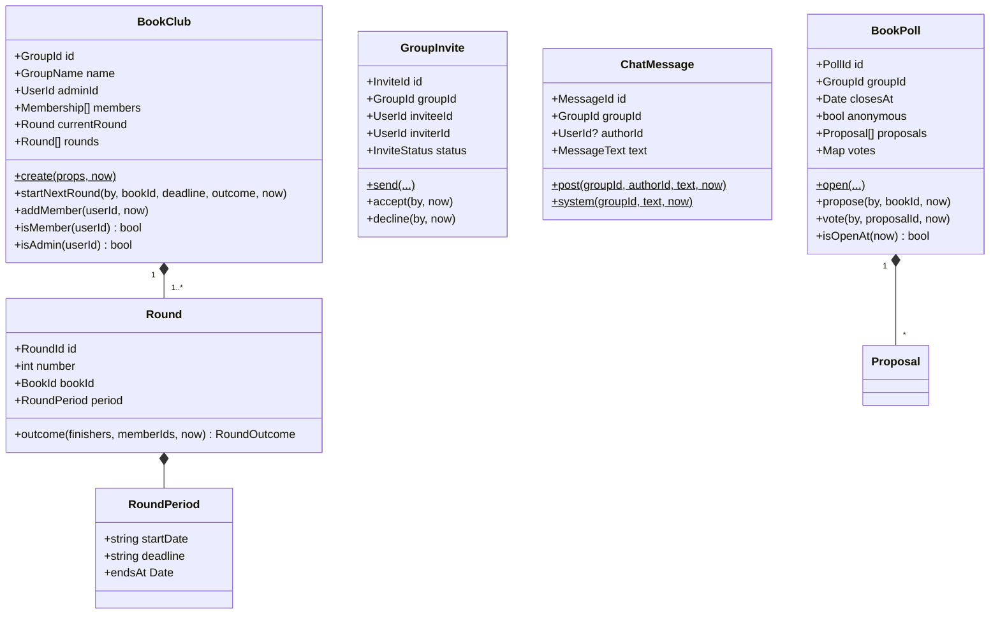

# Spec: Book clubs

- **Status:** Implemented on branch `104-feature-create-book-clubs`
- **Date:** 2026-11-04
- **Parent issue:** [#104](https://github.com/MESW-LES-2627/les-project-group-6/issues/104)
- **Requirements:** [F-GRP-01, F-GRP-02, F-GRP-03, F-GRP-07, F-GRP-08](../product/requirements.md#27-groups), F-READ-01 rule 7
- **Design:** [`14-book-club.png`](../design/screens/14-book-club.png) (page), [`13-create-group.png`](../design/screens/13-create-group.png) (create form)

## 1. Goal

A group of friends reads **one book together by a deadline** and succeeds only if everyone finishes. Book clubs are the second group category, next to challenges, and reuse what challenges already built: the `groups` and `member` tables, the creator-as-admin rule, the leaderboard component, and the chat component.

## 2. Scope

**In scope**

| Area | What |
|---|---|
| Create | A reader creates a book club with a name, an optional description, the first book and the round deadline, and picks friends to invite. They become admin and first member. |
| Books | The club book is picked from the catalog (`GET /book?title=`). A missing book can be added with only its title (F-BOOK-02), from the same picker. |
| Rounds | Round 1 starts on the creation day. Only the club book counts. After the round is over, the admin starts the next round with a new book and deadline. Past rounds stay in the history. |
| Progress | Per member: counted minutes on the round book, page progress (%), finished or not. The round is *completed* when every member finished before the deadline, *not completed* when the deadline passes first. |
| Library | When a book is selected, it is added as "Not started" to the library of every member who doesn't already have it (F-GRP-07 rule 2). A member who joins later also gets it. |
| Invites | Generic for any group: the admin invites a **friend**; the invitee accepts or declines. Accepting adds them as a member. |
| Chat | Generic for any group: members post text messages; the club and challenge pages load them from the API and poll for new ones. System messages announce key events (club created, member joined, round started, voting opened). |
| Voting | The admin opens a vote with a closing time and chooses anonymous or named proposals. Members propose books (one per member) and cast one vote, which they can change until it closes. The admin makes the final selection by starting the next round. |

**Out of scope** (tracked elsewhere or later)

- Anti-cheat settings (F-READ-03): the club page shows "Simple timer" only.
- Images and videos in the chat, deleting messages, real-time push (WebSocket/SSE). Polling every 5 s stands in for real time.
- Leaving a group, removing members, admin hand-over (#55, #59).
- Friend requests (#33, #36): friends come from accepted `friendships` rows (seeded for the demo).
- Badges ("Group Reader") and notifications when a round completes.
- Authentication: like the rest of the API, `userId` is sent in the body, path or query until Supabase Auth lands.

## 3. Domain model

All rules live in plain TypeScript classes (see the [backend layout](../../apps/backend/README.md#folder-layout)).

### Rules

| Object | Rule | Error |
|---|---|---|
| `RoundPeriod` | `deadline` is a valid ISO date, on or after the start, at most 365 days later. The round ends at the start of the day after the deadline (UTC), like `ChallengePeriod`. | `400` |
| `BookClub.create` | Creator is admin and first member; round 1 starts today with the chosen book. | `400` on bad name / date |
| `BookClub.startNextRound` | Only the admin. Only when the current round is over (`completed` or `not-completed`). Round number increments; the new round starts today. | `403`-like → `409` (`BusinessRuleViolationError`) |
| `Round.outcome` | `completed` if every current member finished the book before `endsAt`; else `not-completed` once `now >= endsAt`; else `active`. | — |
| `GroupInvite.send` | Only the admin invites; the invitee must be a friend, not a member, and not already invited (pending). | `409` |
| `GroupInvite.accept/decline` | Only the invitee; only while pending. | `409` |
| `ChatMessage` | Only members post. Text is trimmed, 1 to 2000 characters. | `409` / `400` |
| `BookPoll.open` | Only the admin; one open poll at a time; `closesAt` in the future. | `409` / `400` |
| `BookPoll.propose` | Members only, while open, at most one proposal per member, a book only once, not the current round book. | `409` |
| `BookPoll.vote` | Members only, while open, one vote per member (a new vote replaces the old one). | `409` |

Members who joined after a round ended are not expected to read it. *"Finished before the deadline"* is read from `reading_status`: status `finished` with `updated_at < endsAt`. A later edit of a finished book can move `updated_at`; this is accepted for now and noted in the log.

## 4. Data

Existing tables reused: `groups`, `member`, `book_clubs` (`current_book_id` mirrors the current round's book), `book_club_rounds`, `conversations`, `posts`, `friendships`, `reading_status`, `reading_sessions`.

Migration `0002_book_clubs`:

| Change | Why |
|---|---|
| `book_club_rounds.book_id uuid not null → books(id)` + unique `(book_club_id, round_number)` | A round reads one book; history needs it. |
| `posts.author_id` nullable | System messages have no author. The `chk_post_parent` check stays. |
| `group_invites (id, group_id, invitee_id, inviter_id, status, created_at, responded_at)` + partial unique index on `(group_id, invitee_id) where status = 'pending'` | Invites for any group. |
| `book_club_polls (id, group_id, closes_at, anonymous, created_at, closed_at)` | One vote on the next book. |
| `book_club_proposals (id, poll_id, book_id, proposed_by, created_at)` + unique `(poll_id, book_id)` | Proposed books. |
| `book_club_votes (poll_id, user_id, proposal_id, cast_at)` PK `(poll_id, user_id)` | One vote per member per poll. |

The chat stores one `conversations` row per group (name `General`, created on the group's first message) and its messages in `posts`. `book_club_rounds.status` is left at its default: the outcome is derived.

The migration adds a `NOT NULL` column to `book_club_rounds`; it applies only while that table is empty, which holds because no code wrote to it before.

## 5. API

`userId` identifies the acting reader until auth lands. Errors use the existing mapping: `400` invalid value, `404` missing, `409` rule violation.

| Method | Path | Body / query | Result |
|---|---|---|---|
| `POST` | `/groups/book-clubs` | `userId, name, description?, bookId, deadline` | `201` club |
| `GET` | `/groups/book-clubs/:id` | `?userId=` | `200` club detail: current round, book, `standings`, `history`, `poll` |
| `GET` | `/user/:userId/book-clubs` | — | `200` clubs the user belongs to |
| `POST` | `/groups/book-clubs/:id/rounds` | `userId, bookId, deadline` | `201` club (admin, round over) |
| `POST` | `/groups/book-clubs/:id/poll` | `userId, closesAt, anonymous` | `201` poll (admin) |
| `POST` | `/groups/book-clubs/:id/poll/proposals` | `userId, bookId` | `201` poll |
| `PUT` | `/groups/book-clubs/:id/poll/vote` | `userId, proposalId` | `200` poll |
| `POST` | `/groups/:id/invites` | `userId, inviteeId` | `201` invite (any group) |
| `GET` | `/user/:userId/group-invites` | — | `200` pending invites with group name, kind and inviter |
| `POST` | `/group-invites/:id/accept` | `userId` | `200` invite |
| `POST` | `/group-invites/:id/decline` | `userId` | `200` invite |
| `GET` | `/user/:userId/friends` | — | `200` accepted friends |
| `GET` | `/groups/:id/messages` | `?userId=` | `200` messages, oldest first (members only) |
| `POST` | `/groups/:id/messages` | `userId, text` | `201` message (members only) |

Friends picked on the create form are invited right after the group is created, one `POST /groups/:id/invites` each, the same way for challenges and clubs.

`GET /groups/book-clubs/:id` standings item: `{ userId, displayName, username, role, minutes, currentPage, percent, finished }`, sorted by minutes. Minutes are the counted minutes of finished sessions **on the round book** that ended inside the round (F-READ-01 rule 7).

## 6. Frontend

| Where | Change |
|---|---|
| `GroupChat.vue` | Optional `groupId` + `userId` props: loads messages from the API, polls every 5 s, sends through the API. Without them it keeps the local mock behaviour. Used by both group pages. |
| `BookPicker.vue` (new) | Search the catalog by title, pick a result, or add the typed title as a new book. Used by the create form, "Propose a title" and "Start next round". |
| `/groups/new` | Book Club: book picker + deadline, saved through the API. Friends come from the API (mock fallback); selected friends are invited after create, for challenges too. |
| `/groups/:groupId` | Non-mock ids try the challenge endpoint then the book club endpoint. The club page renders the API data: round card, progress leaderboard, live chat, voting panel, history, and an admin panel (open voting, start next round, invite friends). |
| `/groups` | Lists the reader's book clubs from the API, and real pending invites with Accept / Decline. |

The mock `classics` club stays for the design demo.

## 7. Testing

- Unit: `RoundPeriod`, `Round.outcome`, `BookClub` (admin rules, next round), `GroupInvite`, `ChatMessage`, `BookPoll`, and each service with in-memory repositories.
- Integration: the book club repository round-trip and the progress query against PostgreSQL (counted minutes only on the club book inside the round).
- Frontend: create book club, club page from the API, live chat send, invites accept/decline, voting.

## 8. Decisions

| Decision | Why | Rejected |
|---|---|---|
| Chat and invites are generic group features (`features/group-chat`, `features/group-invite`), not book club code. | Both group kinds need them (F-GRP-01, F-GRP-02); this is the "reuse" asked in #104. | A chat inside the book club feature, duplicated later for challenges. |
| Invites are sent after creation, not as part of `POST /groups/book-clubs`. | One invite flow for both group kinds; the club and its invites are separate aggregates. | `inviteeIds` in the create body. |
| A "member joined" event (Observer) lets the chat and the book club react to an accepted invite. | The invite does not need to know the chat or the library. | Calling the chat and library from the invite service. |
| Round outcome is computed on read. | Same as challenge status and the no-background-jobs decision in [`infra.md`](../architecture/infra.md). | Storing `book_club_rounds.status` and a job at the deadline. |
| Polling for chat updates. | No real-time infra exists yet; 5 s is fine for a club. | WebSocket / SSE now. |
| Admin selects the next book by starting a round; the winning proposal is not auto-selected. | F-GRP-08 rule 5 and the design note "The final selection is the admin's". | Auto-selecting the winner when the poll closes. |
